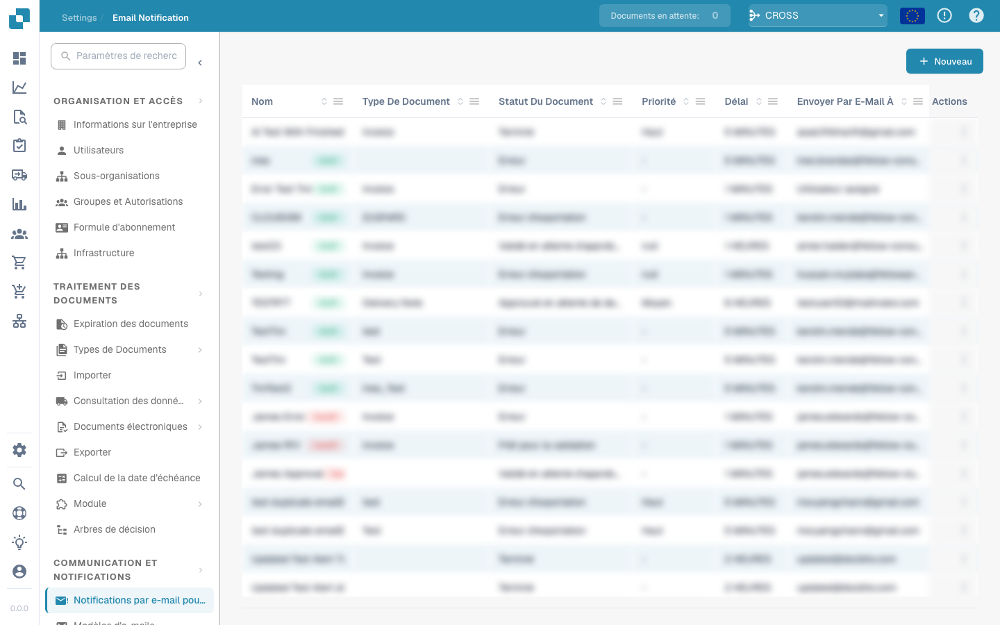

# Notification par e-mail


DocBits Tutoriel sur les tâches et les notifications : attribuer du travail, suivre l'état et gérer les tâches de flux de travail


<figure><figcaption></figcaption></figure>

La configuration des notifications par e-mail est essentielle. Les notifications par e-mail dans DocBits peuvent être configurées pour informer les utilisateurs de divers événements liés au document, tels que : l'achèvement du traitement, les erreurs d'importation ou d'exportation ou les demandes d'intervention de l'utilisateur. Cet outil est essentiel pour maintenir une communication efficace et une continuité opérationnelle dans les environnements de traitement de documents. Voici quelques raisons pour lesquelles cela est important :

**Communication en temps réel :**

* Les alertes par e-mail permettent aux utilisateurs d'être immédiatement informés des événements importants ou des modifications apportées à leur système de gestion documentaire. Cela garantit que toutes les parties concernées sont immédiatement informées des mises à jour importantes.

**Transparence et traçabilité :**

* En configurant les notifications par e-mail, les utilisateurs peuvent suivre et surveiller l'état des événements de traitement des documents. Cela améliore la transparence et la traçabilité du système de gestion documentaire.

**Timely reactions:**

* La notification automatique des événements tels que les versions de documents, les commentaires ou les approbations permet aux utilisateurs de répondre rapidement aux demandes ou aux mises à jour. Cela contribue à accroître l’efficacité et la productivité.

**Automatisation des workflows :**

* Les notifications par e-mail peuvent être intégrées aux flux de travail pour envoyer automatiquement des notifications aux utilisateurs concernés lorsque certaines actions sont entreprises. Cela permet une automatisation transparente des processus métier.

**Rappels et délais :**

* La configuration des notifications par e-mail peut être utilisée pour rappeler aux utilisateurs les échéances à venir ou les tâches en suspens. Cela permet de garantir que les tâches importantes sont terminées à temps.

Dans l'ensemble, la configuration des notifications par courrier électronique joue un rôle important dans l'amélioration de la communication, l'augmentation de l'efficacité et la garantie que les événements de traitement des documents sont gérés de manière rapide et efficace. En automatisant les notifications, les organisations peuvent garantir que les informations importantes ne sont pas perdues et que toutes les parties concernées sont toujours tenues au courant.

Ce paramètre est essentiel pour garantir que les parties prenantes sont tenues informées de l'état de traitement des documents importants, ce qui facilite une prise de décision rapide et une gestion efficace des flux de travail documentaires.
