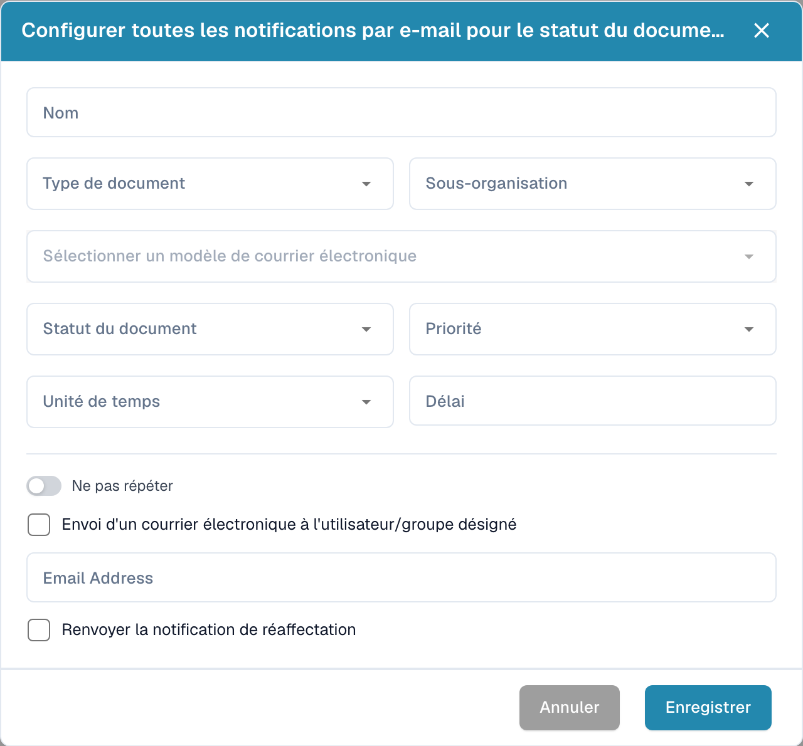

# Configurer les notifications par courriel

Ouvrez les paramètres de notification par courriel et créez une nouvelle configuration. Définissez le moment de l’envoi et les destinataires prévus.

<figure><figcaption>
Dialogue de configuration d’une notification par courriel.
</figcaption></figure>

1. Saisissez un nom et choisissez le type de document et, si nécessaire, la sous-organisation.
2. Sélectionnez le modèle de courriel et le statut du document.
3. Définissez priorité, unité de temps et délai.
4. Vérifiez si la notification doit se répéter.
5. Choisissez l’utilisateur ou groupe affecté, ou indiquez l’adresse de courriel prévue.
6. Vérifiez le renvoi éventuel lors d’une nouvelle affectation.

Contrôlez les destinataires, délais et messages avant l’enregistrement. L’image montre une configuration vide non enregistrée et ne démontre pas l’envoi d’un courriel.



