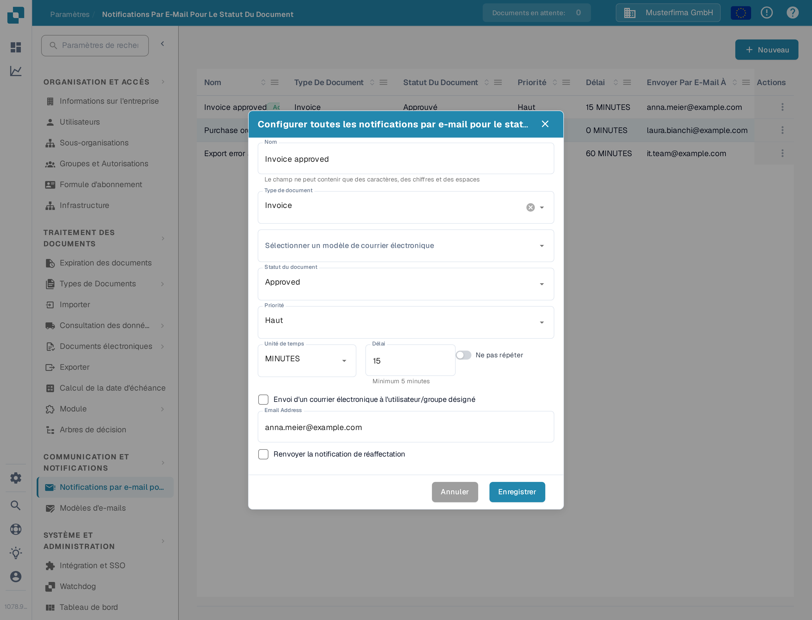
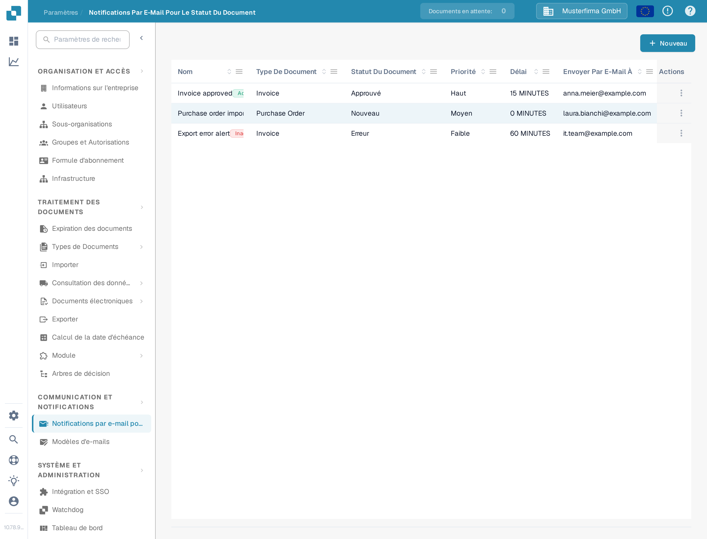
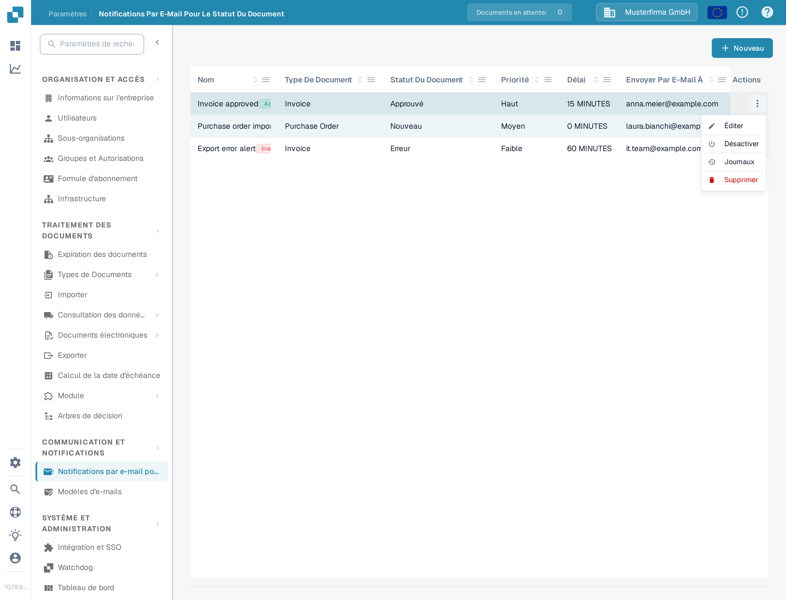

# Gestion des notifications

Ouvrez **Paramètres → Notification par e-mail** pour afficher les règles de votre organisation. Une règle relie un statut de document à un modèle d'e-mail et à un destinataire. L'exemple ci-dessous utilise une règle de démonstration pour les factures et reste **inactive** dans le bac à sable DocBits.

## Exemple : une facture est prête pour la validation

Avant de créer une règle, préparez un modèle d'e-mail pour **Facture** sous **Paramètres → Modèles d'e-mails**. Dans cet exemple, le modèle s'appelle **Docs Demo Invoice Notification**. Le modèle fournit l'objet et le message de l'e-mail.

1. Sélectionnez **+ Nouveau** sur la page **Notification par e-mail**.
2. Saisissez **Docs Demo Invoice Validation** comme nom, sélectionnez **Facture** comme type de document et choisissez le modèle d'e-mail préparé.
3. Choisissez **Prêt pour la validation** comme statut et **Moyen** comme priorité. Définissez **Unité de temps** sur **MINUTES** et **Délai** sur **10**. Le délai minimum en minutes est de cinq.
4. Sélectionnez **Envoi d'un courrier électronique à l'utilisateur/groupe désigné**. Activez **Ne pas répéter** si le message ne doit être envoyé qu'une seule fois. Vérifiez le destinataire et le minutage, puis sélectionnez **Enregistrer**.

<figure><figcaption>
La règle d'exemple enregistrée, ouverte pour modification. Ses valeurs montrent quand et à qui la notification serait envoyée.
</figcaption></figure>

La règle apparaît désormais dans la liste. L'exemple de documentation a ensuite été désactivé, de sorte que son menu **Actions** propose **Activer**. Vérifiez le nom, le type de document, le statut, le délai et le destinataire dans votre propre liste avant d'activer une règle.

<figure><figcaption>
L'exemple enregistré vous donne une règle à retrouver et à gérer dans la liste.
</figcaption></figure>

## Modifier, activer ou supprimer une règle

Ouvrez le menu **Actions** de la ligne. **Éditer** ouvre la règle et ses valeurs actuelles. **Activer** active cette règle inactive ; une règle active propose **Désactiver** à la place. **Journaux** ouvre l'historique de ses notifications. **Supprimer** supprime la règle après confirmation. Vérifiez les destinataires et le minutage avant d'activer ou de modifier une règle.

<figure><figcaption>
Les actions disponibles dépendent de l'état actif de la règle.
</figcaption></figure>

Si la liste affiche **No Record Found!**, créez d'abord une règle. Si les listes **Type de document** ou de modèles d'e-mail sont vides, configurez un type de document actif et un modèle correspondant avant de revenir à ce formulaire.

Pour la configuration initiale, voir [Configuration des Notifications](configuration-des-notifications.md). Si les e-mails n'arrivent pas comme prévu, voir [Dépannage](depannage.md).
