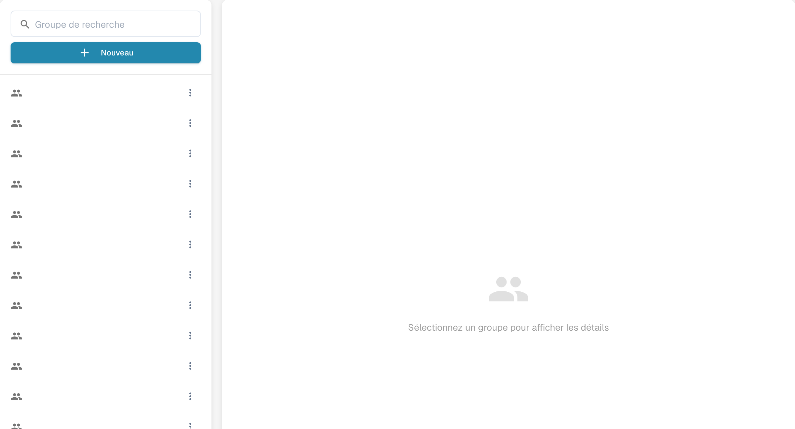

# Groups, Users and Permissions

Ces paramètres répondent à trois questions différentes : qui peut se connecter, dans quelle sous-organisation la personne travaille, et ce que son groupe est autorisé à faire.

| Si vous devez… | Ouvrez… |
| --- | --- |
| Ajouter ou modifier le compte d'une personne | **Paramètres de la table** → **Utilisateurs** ; lisez ensuite [Users](users/README.md). |
| Organiser les accès entre les unités de l'entreprise | **Paramètres de la table** → **Sous-organisations** ; lisez ensuite [Sub-Organizations](sub-organizations/README.md). |
| Contrôler l'accès par groupe | **Paramètres de la table** → **Groupes et Autorisations** ; lisez ensuite [Groups and Permissions](groups-and-permissions/README.md). |

<figure><figcaption>
Panneau de sélection des groupes.
</figcaption></figure>

Si un utilisateur ne voit pas un document ou une action, vérifiez d'abord son compte et son organisation. Vérifiez ensuite les autorisations du groupe concerné. Utilisez un compte de test non administrateur pour confirmer l'accès dont disposera réellement un utilisateur normal avant de modifier une organisation en production.
