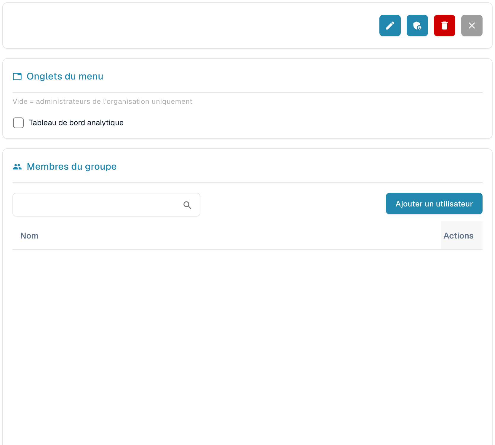

# Groupes et autorisations


DocBits Groups & Permissions Tutorial: Set User Roles, Access Rights & Secure Your Workspace


<figure><figcaption>
Détails du groupe sélectionné ; les données personnelles sont masquées.
</figcaption></figure>

Les groupes et les autorisations vous permettent de contrôler quels utilisateurs peuvent accéder à des types de documents spécifiques et quelles actions ils peuvent effectuer.

## Activer/désactiver les groupes et les autorisations

Utilisez le commutateur en haut de la page pour activer ou désactiver le système de groupes et d'autorisations. Lorsqu'il est désactivé, le système utilise un modèle d'accès plus simple, sans restrictions basées sur les groupes.

## Liste des groupes

Le tableau affiche tous les groupes configurés avec :

| Colonne | Description |
|--------|-------------|
| **Nom du groupe** | Le nom du groupe. |
| **Description du groupe** | Une brève description de l'objectif du groupe. |
| **Actes** | Menu avec les options pour modifier ou supprimer le groupe. |

Utilisez la barre **Recherche** pour rechercher des groupes par nom. Cliquez sur **+ New** pour créer un nouveau groupe.

## Configurer les autorisations d'un groupe

Lorsque vous sélectionnez un groupe (via le menu Actions → Edit), un tableau d'autorisations apparaît, dans lequel vous pouvez configurer l'accès par type de document :

| Autorisation | Description |
|------------|-------------|
| **Vue** | Autorisation de voir les documents de ce type. |
| **Mettre à jour** | Autorisation de modifier les documents de ce type. |
| **Supprimer** | Autorisation de supprimer les documents de ce type. |
| **Première approbation** | Autorisation d'effectuer l'approbation initiale. |
| **Deuxième approbation avant l'exportation** | Autorisation d'effectuer un second niveau d'approbation (le cas échéant). |

Chaque ligne du tableau d'autorisations représente un type de document (par exemple Invoice, Credit Note, Delivery Note). Cochez ou décochez les cases pour accorder ou retirer des autorisations à ce groupe.

## Créer un nouveau groupe

1. Cliquez sur **+ New** en haut à droite.
2. Saisissez un **Nom du groupe** et, facultativement, une **Description**.
3. Configurez les autorisations pour chaque type de document.
4. Affectez des utilisateurs au groupe.
5. Cliquez sur **Enregistrer** pour appliquer.
