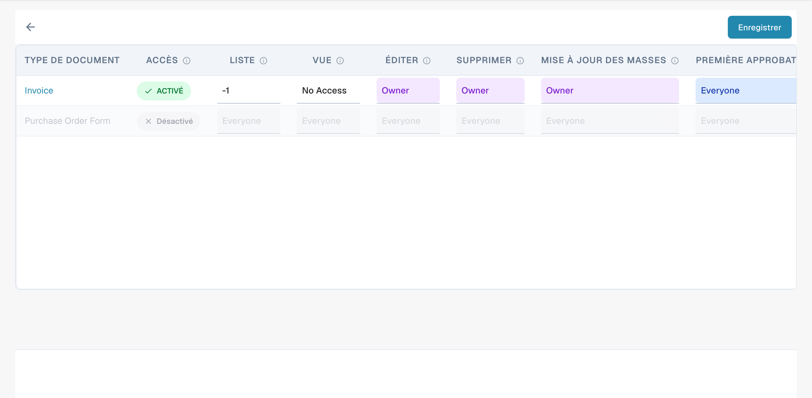
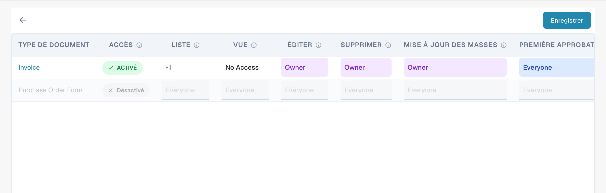

# Activation des autorisations


DocBits Groups & Permissions Tutorial: Set User Roles, Access Rights & Secure Your Workspace


L'activation ou la désactivation du système d'autorisations à l'aide du commutateur a divers effets sur les fonctionnalités de DocBits.

## **Activation du système d'autorisations :**

<figure><figcaption>
Sélection d’un groupe pour consulter ses permissions.
</figcaption></figure>

* Lorsque le système d'autorisations est activé, les autorisations d'accès des utilisateurs et des groupes sont appliquées.
* Les utilisateurs n'ont accès qu'aux ressources auxquelles ils sont explicitement autorisés à accéder, en fonction des autorisations attribuées.
* Les administrateurs peuvent gérer les autorisations des utilisateurs et des groupes individuels et s'assurer que seules les personnes autorisées peuvent consulter ou modifier les données.

<figure><figcaption>
Matrice de permissions par type de document et action.
</figcaption></figure>

## Only Assigned Documents

<figure><figcaption>
Niveaux d’accès par action dans la matrice de permissions.
</figcaption></figure>

Le commutateur **Only Assigned Documents** contrôle la visibilité des documents pour les utilisateurs en fonction de leurs appartenances à des groupes. Lorsqu'il est activé, les utilisateurs ne peuvent voir que les documents qui leur sont spécifiquement attribués ou qui sont attribués à un groupe auquel ils appartiennent. Lorsqu'il est désactivé, les utilisateurs disposant de l'autorisation de visualisation appropriée peuvent voir tous les documents, indépendamment de l'attribution.

#### Fonctionnement

* **État désactivé (par défaut)** :
  * Lorsque le commutateur est désactivé, les utilisateurs qui font partie d'un groupe peuvent voir tous les documents s'ils disposent de l'autorisation de visualisation appropriée. L'attribution des documents n'affecte pas la visibilité.
* **État activé** :
  * Lorsque le commutateur est activé, les utilisateurs ne peuvent voir que les documents qui leur sont explicitement attribués ou qui sont attribués à un groupe dont ils font partie. Cela impose une visibilité des documents plus stricte, basée sur les affectations aux groupes.

#### Scénario d'exemple

1. **Par défaut (état désactivé)** :
   * Un utilisateur qui fait partie du groupe « Sales » peut voir tous les documents du système qu'il a l'autorisation de consulter, même s'ils ne lui sont pas attribués.
2. **Activé (état activé)** :
   * Un utilisateur du groupe « Sales » ne peut voir que les documents qui lui sont attribués ou qui sont attribués au groupe « Sales », ce qui restreint l'accès aux documents en dehors de ses attributions.

## Désactivation du système d'autorisations :

<figure><figcaption>
Commande d’activation de la gestion des permissions.
</figcaption></figure>

* Lorsque le système d'autorisations est désactivé, toutes les autorisations d'accès sont supprimées et les utilisateurs ont généralement un accès illimité à toutes les ressources.
* Cela peut être utile lorsqu'une collaboration ouverte est temporairement nécessaire, sans les restrictions du contrôle d'accès.
* Cependant, le risque de fuite de données ou d'accès non autorisé peut être accru, car les utilisateurs peuvent accéder à des informations sensibles auxquelles ils ne sont pas autorisés à accéder.

L'activation ou la désactivation du système d'autorisations est une décision importante, fondée sur les exigences de sécurité et sur le fonctionnement de l'organisation. Dans les environnements où la confidentialité et le contrôle d'accès sont essentiels, il est courant de laisser le système d'autorisations activé afin de garantir l'intégrité et la confidentialité des données. Dans d'autres cas, la désactivation du système d'autorisations peut être temporairement nécessaire pour faciliter la collaboration, mais elle doit être utilisée avec prudence pour minimiser les risques de sécurité potentiels.

L’interface actuelle utilise une matrice de permissions par type de document et action. Certains niveaux d’accès peuvent rester en anglais. Les instructions sur l’ancien interrupteur Only Assigned Documents s’appliquent uniquement aux versions qui proposent cet interrupteur.
