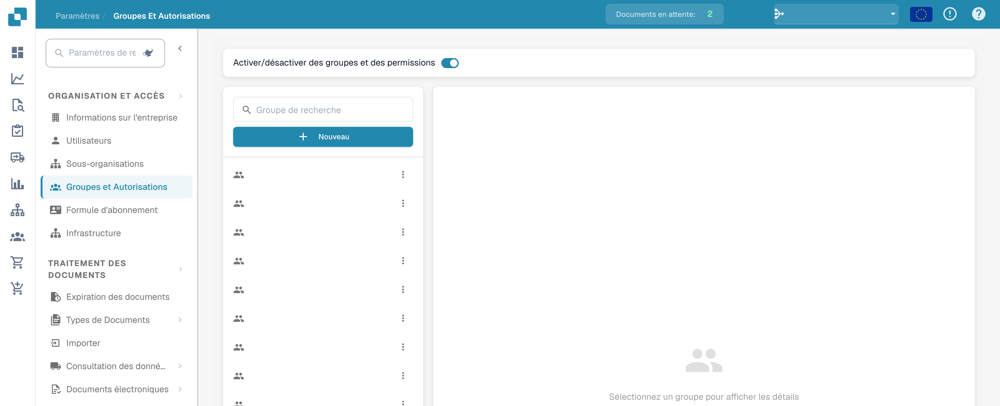
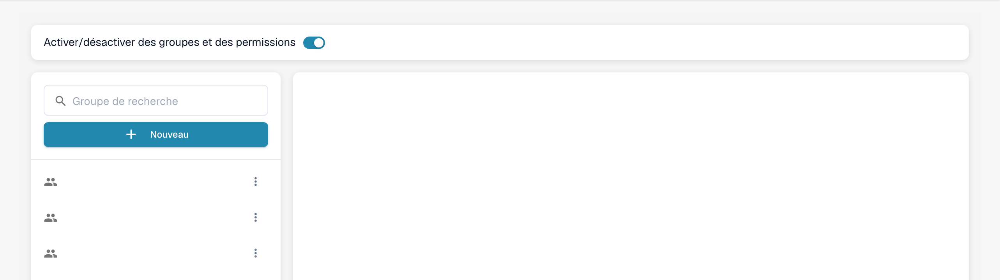
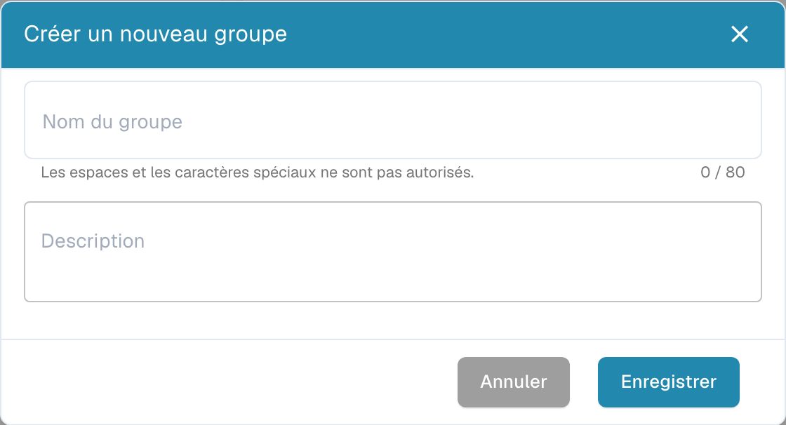
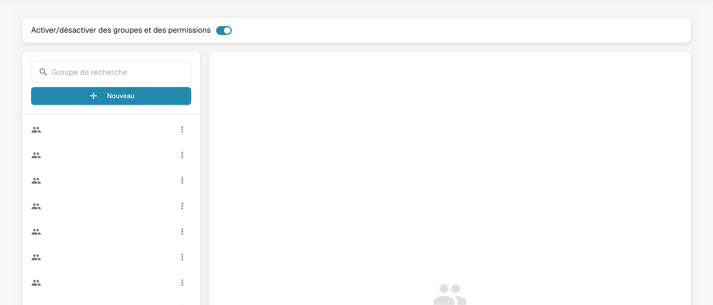

# Ajout/modification de groupes


DocBits Tutoriel Groupes et autorisations : définissez les rôles des utilisateurs, les droits d'accès et sécurisez votre espace de travail


## Pour ajouter un nouveau groupe ou modifier les autorisations d'un groupe existant, procédez comme suit :

* **Accédez aux paramètres des groupes :** Connectez-vous à votre compte administrateur et allez dans Group Settings dans le panneau d'administration.

<figure><figcaption>
Accès aux paramètres des groupes et permissions.
</figcaption></figure>

Cette fenêtre s'ouvre :

<figure><figcaption>
Liste des groupes avec les noms masqués.
</figcaption></figure>

* **Cliquez sur le bouton + New :** Si vous souhaitez ajouter un nouveau groupe, cliquez sur le bouton + New pour démarrer le processus d'ajout d'un nouveau groupe.

<figure><figcaption>
Dialogue de création d’un groupe non enregistré.
</figcaption></figure>

* **Remplissez le formulaire :** Indiquez le nom du groupe et une description du groupe.
* **Enregistrez les informations :** Une fois le nom et la description du groupe renseignés, cliquez sur le bouton « Save ».

<figure><figcaption>
Administration des groupes et permissions.
</figcaption></figure>

## Modification des groupes :

* **Modifier les groupes :** Pour modifier des groupes, cliquez sur « edit » ; vous pouvez ici changer le nom du groupe

<figure><figcaption></figcaption></figure>

<figure><figcaption></figcaption></figure>

* **Activer Groups & permissions :** Pour que le groupe soit visible, « Groups & permissions » doit être activé.

<figure><figcaption></figcaption></figure>

* **Vérifiez les résultats :** Après l'enregistrement, contrôlez les résultats pour vous assurer que le groupe a bien été ajouté, modifié ou mis à jour.
