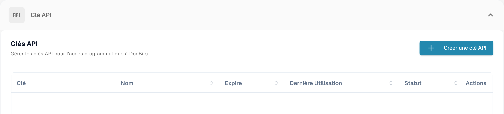
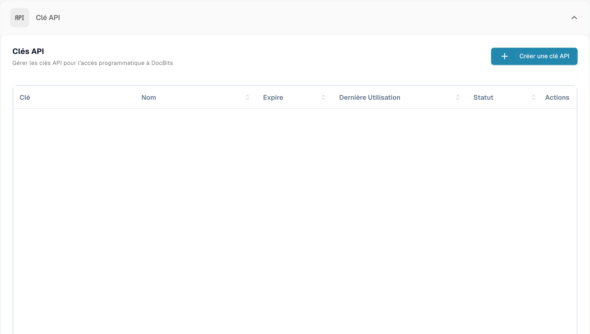
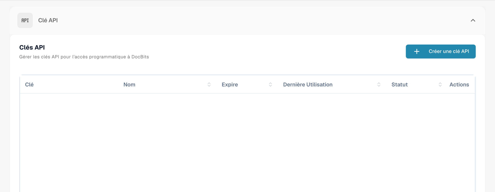
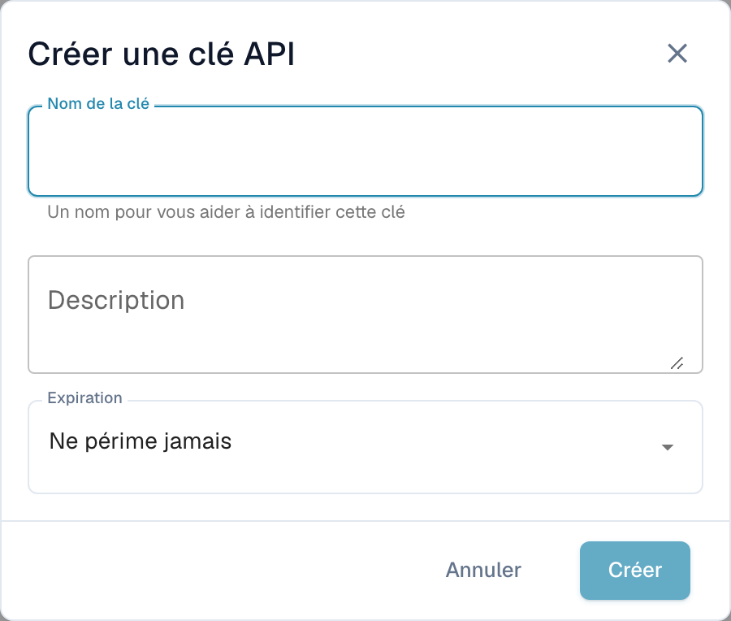

# Gestion des clés API

Une API key permet à un autre système — votre ERP, un script ou une application partenaire — de dialoguer avec DocBits sans qu'un utilisateur se connecte. Votre organisation peut détenir autant de clés que nécessaire, et chacune se gère séparément : donnez-lui son propre nom, décidez si elle expire, et révoquez-la individuellement si elle venait à être exposée.

Comme chaque intégration peut avoir sa propre clé, vous pouvez en désactiver une sans perturber les autres.

## Ouvrir la gestion des clés API

Allez dans **Paramètres de la table** et sélectionnez **Intégration et SSO** sous **Système et Administration**.

<figure><figcaption>
Accès à l’administration des clés API.
</figcaption></figure>

La section **Clé API** en haut de la page liste toutes les clés que possède votre organisation.

<figure><figcaption>
Liste des clés API sans afficher les clés ni leurs noms.
</figcaption></figure>

## Comprendre la liste

<figure><figcaption>
Liste des clés API ; les clés et informations de compte sont masquées.
</figcaption></figure>

| Colonne | Ce qu'elle vous indique |
| --- | --- |
| **Clé** | Les premiers caractères de la clé, suivis de `****`. Le reste n'est plus jamais affiché après la création — voir [Créer une clé API](#creer-une-cle-api). |
| **Nom** | Le nom que vous avez donné à la clé, avec sa description en dessous. |
| **Expire** | La date à laquelle la clé cesse de fonctionner, ou **Jamais** si vous n'en avez pas défini. |
| **Dernière utilisation** | Quand une requête est arrivée pour la dernière fois avec cette clé. **Jamais utilisé** signifie qu'aucun système ne l'a encore utilisée — utile pour repérer les clés que vous pouvez retirer sans risque. |
| **Statut** | **Actif** signifie que la clé fonctionne. Une clé révoquée est désactivée définitivement. |
| **Actes** | Le menu à trois points, où vous pouvez révoquer la clé. |

Si vous avez plus de clés qu'il n'en tient sur une page, utilisez les commandes de pagination au bas de la liste.


**Dernière utilisation** est le moyen le plus rapide de trouver les clés dont plus personne n'a besoin. Une clé qui n'a jamais servi, ou qui n'a pas servi depuis des mois, est une bonne candidate à la révocation.


## Créer une clé API

1. Cliquez sur **+ Create API Key** en haut à droite de la section API Keys.
2. Remplissez la boîte de dialogue :

<figure><figcaption>
Dialogue de création d’une clé API, sans enregistrement.
</figcaption></figure>

| Champ | Ce qu'il faut saisir |
| --- | --- |
| **Nom de la clé** | Obligatoire. Nommez-la d'après le système qui l'utilisera — `M3 Production`, `Invoice Import Script` — pour pouvoir savoir plus tard à quelle intégration une clé appartient. |
| **Description** | Facultatif. De la place pour une note sur l'usage de la clé ou sur qui l'a mise en place. |
| **Expiration** | Choisissez une date d'expiration, ou laissez **Ne périme jamais**. Une date d'expiration est le choix le plus sûr : la clé se retire d'elle-même si l'intégration venait à être oubliée. |

3. Cliquez sur **Créer**. DocBits vous montre la nouvelle clé :

4. Copiez la clé à l'aide de l'icône de copie et collez-la directement dans le système qui l'utilisera, ou dans votre gestionnaire de mots de passe.
5. Cochez **J'ai copié et enregistré cette clé** et cliquez sur **Fait**.


**La clé complète n’est affichée qu’une seule fois.** DocBits stocke un hachage à sens unique de la clé et un court préfixe d’identification. Ni vos administrateurs ni le support DocBits ne peuvent récupérer la clé complète d’origine à partir de ce hachage. Si vous la perdez, révoquez-la et créez-en une nouvelle.


Traitez la clé comme un mot de passe. Quiconque la détient peut agir sur les documents et les données de votre organisation.

Voir [Stockage sécurisé des identifiants](../../../../security/secure-storage-of-credentials.md).

La clé API complète n’est affichée qu’une fois après sa création. Copiez-la dans le stockage sécurisé approuvé et vérifiez sa conservation avant de fermer le dialogue. La liste ne révèle pas à nouveau le secret complet.
