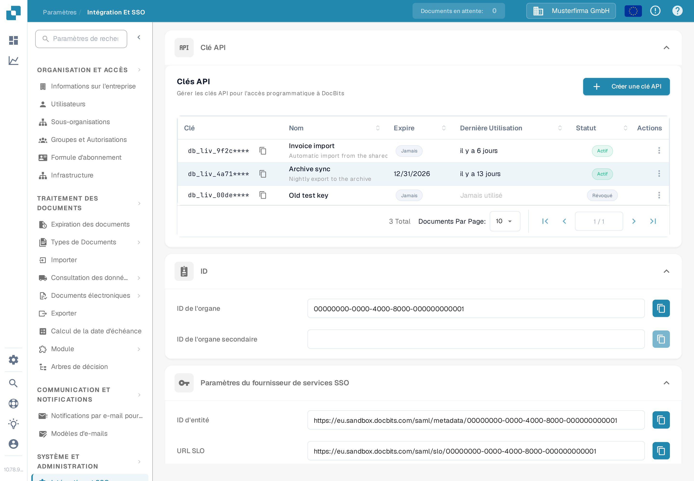

# Clé API

<figure><figcaption>
Paramètres → Intégration et SSO → Clé API. Le préfixe de la clé est masqué dans cette capture d'écran.
</figcaption></figure>

La section **Clé API** en haut de la page Intégration et SSO liste toutes les clés API créées par votre organisation. Une clé API permet à un autre système — votre ERP, un script ou une application partenaire — d'accéder à DocBits sans qu'un utilisateur ne se connecte. Pour les instructions étape par étape, consultez [Gestion des Clés API](api-key-management.md).

### Liste des clés API

* **Clé :** Les premiers caractères de la clé, suivis de `****`. La clé complète n'est affichée qu'une seule fois, lors de sa création ; elle ne peut plus être consultée ensuite. L'icône de copie à côté de la clé copie le préfixe visible dans votre presse-papiers.
* **Nom / Expire / Dernière Utilisation / Statut :** Chaque ligne affiche le nom de la clé, la date à laquelle elle cessera de fonctionner, la date de la dernière requête l'ayant utilisée et son état actif ou non.
* **Créer une clé API :** Ouvre une boîte de dialogue pour créer une nouvelle clé pour une intégration. Consultez [Gestion des Clés API](api-key-management.md) pour les champs et l'affichage unique de la clé complète.
* **Actions (menu à trois points) :** Ouvre les actions d'une clé : modifier son nom, la révoquer ou supprimer une clé déjà révoquée. La révocation désactive la clé de manière définitive.

### Paramètres du fournisseur de services SSO (authentification unique)

Voici les valeurs dont votre fournisseur d'identité a besoin pour permettre aux utilisateurs de se connecter à DocBits avec leur identifiant d'entreprise. Pour le guide de configuration complet, consultez [Configuration de l'authentification unique (SSO)](configuring-single-sign-on-sso/).

* **ID d'entité :** L'identifiant de DocBits en tant que fournisseur de services dans la configuration SSO. L'icône de copie copie la valeur dans votre presse-papiers.
* **URL SLO (déconnexion unique) :** L'URL utilisée pour déconnecter un utilisateur de toutes les applications connectées via SSO en même temps. L'icône de copie copie la valeur.
* **URL SSO :** L'URL utilisée pour lancer le processus d'authentification unique. L'icône de copie copie la valeur.
* **Télécharger le certificat :** Télécharge le certificat de sécurité dont votre fournisseur d'identité a besoin pour faire confiance à DocBits.
* **Télécharger les métadonnées :** Télécharge le fichier de métadonnées SAML qui peut être importé directement dans la plupart des fournisseurs d'identité.

### Paramètres du fournisseur de services d'identité

Configurez DocBits pour utiliser votre fournisseur d'identité (IdP) externe pour la connexion.

* **ID du locataire :** L'identifiant de locataire de votre fournisseur d'identité, utilisé lorsque DocBits s'intègre à des services cloud qui gèrent l'accès par locataire.
* **Téléverser un fichier :** Téléverse le fichier de métadonnées ou de configuration reçu de votre fournisseur d'identité.
* **Configure :** Enregistre les paramètres et applique la configuration téléversée. Saisissez d'abord l'ID du locataire ou téléversez le fichier, puis cliquez sur **Configure**.
