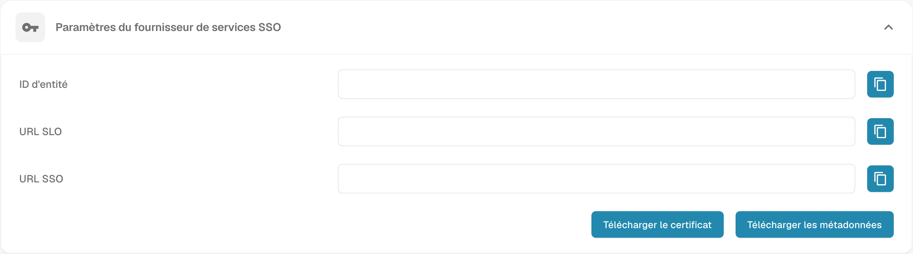

# Configurer l’authentification unique (SSO)

Configurez DocBits comme fournisseur de services SAML (SP) et connectez votre fournisseur d’identité (IdP). Vous devez disposer d’un accès administrateur aux paramètres concernés dans les deux systèmes.

## Ouvrir les paramètres SSO

Connectez-vous à DocBits en tant qu’administrateur et ouvrez l’authentification unique dans les paramètres d’intégration.

<figure><figcaption>
Paramètres du fournisseur de services SSO dans DocBits : valeurs de l’organisation masquées ; aucune configuration n’a été enregistrée.
</figcaption></figure>

## Consulter les valeurs du fournisseur de services DocBits

DocBits affiche Entity ID, SSO URL et SLO URL en lecture seule. Copiez ces valeurs ou utilisez les métadonnées du SP pour configurer l’application DocBits chez votre IdP ; ne saisissez pas de valeurs de remplacement dans ces champs DocBits. Entity ID identifie le fournisseur de services. Utilisez les points de terminaison affichés conformément aux exigences SAML de votre IdP.

## Télécharger le certificat et les métadonnées du SP

Utilisez Download Certificate et le téléchargement des métadonnées dans les paramètres du fournisseur de services DocBits. Ces fichiers décrivent DocBits en tant que SP. Transmettez les métadonnées du SP et, si nécessaire, le certificat du SP téléchargé à votre IdP. Ce certificat est distinct des métadonnées de l’IdP que vous importez dans DocBits.

## Configurer le fournisseur d’identité

1. Chez votre IdP, configurez DocBits à l’aide des valeurs du SP affichées dans DocBits ou des métadonnées du SP téléchargées.
2. Utilisez la Tenant ID de DocBits si votre fournisseur l’exige. Vérifiez le contexte du tenant et du fournisseur dans les paramètres du fournisseur d’identité de DocBits.
3. Récupérez auprès de l’IdP les métadonnées SAML XML de l’application configurée, puis importez ces métadonnées XML de l’IdP dans DocBits. N’utilisez pas à leur place les métadonnées du SP DocBits téléchargées précédemment.
4. Enregistrez la configuration avec l’action Configure/Save dans les paramètres du fournisseur d’identité de DocBits.

## Tester la connexion et la déconnexion prises en charge

Vérifiez qu’un utilisateur peut se connecter à DocBits via l’IdP configuré. Testez Single Log-Out uniquement si DocBits et l’IdP le prennent en charge et s’il est configuré des deux côtés. Une déconnexion de DocBits ne garantit pas à elle seule la déconnexion de toutes les autres applications connectées.
