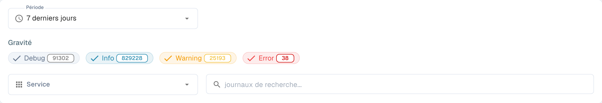

# Journal d’activité

<figure><figcaption>
Filtres du journal d’activité ; les entrées sont masquées.
</figcaption></figure>

Activity Logging offre une vue en temps réel des événements système de tous les services DocBits. Utilisez-le pour surveiller l'activité de traitement, diagnostiquer les erreurs et auditer le comportement du système.

## Analytics Banner

En haut de la page, une bannière renvoie vers l'**Tableau de bord analytique** pour les graphiques, les indicateurs et la surveillance en temps réel.

## Filtres

| Filtre | Description |
|--------|-------------|
| **Période** | Sélectionnez une période (par exemple Today, Last 7 Days, Last 30 Days). |
| **Gravité** | Activez ou désactivez les niveaux de gravité à inclure ou à exclure : **Déboguer**, **Info**, **Avertissement**, **Erreur**. Chaque pastille indique le nombre actuel. |
| **Service** | Filtrez les journaux par service (par exemple api, auth, api-service). |
| **Search logs** | Recherche en texte libre dans les messages de journal. |

## Tableau des journaux

| Colonne | Description |
|--------|-------------|
| **Horodatage** | Date et heure de l'événement. Triable. |
| **Gravité** | Badge de couleur : Info (bleu), Warning (jaune), Error (rouge), Debug (gris). |
| **Composant** | Le service ou le module qui a généré le journal (par exemple api, auth, api-service). |
| **Message** | Le message de journal complet avec les détails de l'événement. |

Les résultats sont paginés — utilisez les commandes en bas de page pour naviguer entre les pages.

## Actions du pied de page

| Action | Description |
|--------|-------------|
| **Auto-refresh** | Activez cette option pour actualiser automatiquement l'affichage des journaux à intervalles réguliers. |
| **Refresh Now** | Actualise manuellement les données des journaux. |
| **Export JSON** | Exporte les journaux actuellement filtrés sous forme de fichier JSON. |
| **Download Logs** | Télécharge l'ensemble des données de journal. |
