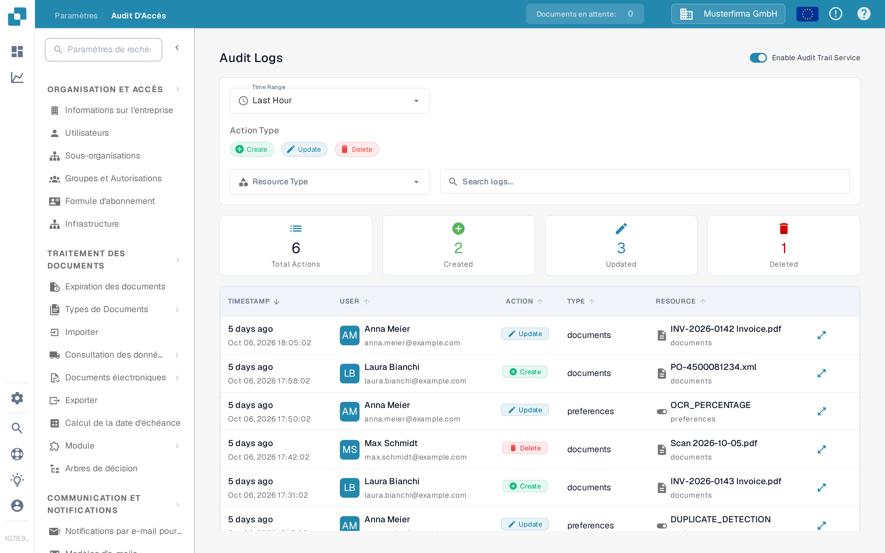
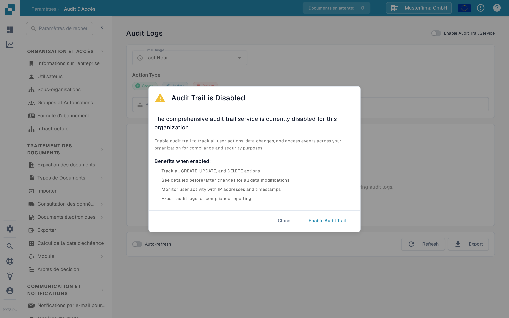

# Audit d'Accès

<figure><figcaption>
La page Sandbox en français avant l'activation de la journalisation d'audit.
</figcaption></figure>

Audit d'Accès enregistre qui a créé, modifié ou supprimé une ressource, et quand. Ouvrez **Paramètres → Journal d'Activité → Audit d'Accès** pour consulter le journal. N'activez le service pour une organisation que si vous avez l'intention de collecter des événements d'audit.

## Quand la journalisation d'audit est désactivée

<figure><figcaption>
La boîte de dialogue explique ce qui sera enregistré avant d'activer le service.
</figcaption></figure>

La première visite dans une session de navigateur peut afficher **Audit Trail is Disabled**. **Close** ferme la boîte de dialogue et laisse la journalisation d'audit désactivée. **Enable Audit Trail** l'active pour l'organisation en cours. Sur la page derrière la boîte de dialogue, **Enable Now** et l'interrupteur **Enable Audit Trail Service** l'activent également. Ces contrôles modifient le paramètre de l'organisation ; ils ne font pas qu'afficher un aperçu de la fonctionnalité.

Tant que le service est désactivé, les filtres et le tableau du journal ne peuvent pas afficher d'événements. L'état vide explique comment activer la journalisation. Après l'activation, utilisez l'interrupteur pour la désactiver à nouveau si nécessaire. Les événements ne sont disponibles que lorsque le service est activé et a collecté des données.

## Trouver un événement

| Contrôle                           | Ce qu'il fait                                                               |
| ---------------------------------- | --------------------------------------------------------------------------- |
| **Time Range**                     | Limite la liste à une période telle que Last Hour, Today ou Last 7 Days.    |
| **Create**, **Update**, **Delete** | Inclut ou exclut ces types d'action.                                        |
| **Resource Type**                  | Limite les résultats à un type de ressource, tel que documents ou settings. |
| **Search logs**                    | Recherche les entrées d'audit visibles par texte.                           |
| **Refresh**                        | Charge une fois les dernières entrées correspondantes.                      |
| **Auto-refresh**                   | Met à jour la liste automatiquement tant que la page est ouverte.           |
| **Export**                         | Télécharge les données actuelles du journal d'audit dans un fichier JSON.   |

Les cartes de résumé affichent le nombre total d'actions ainsi que les actions créées, mises à jour et supprimées pour les filtres sélectionnés. Dans le tableau, **Timestamp** indique quand un événement a eu lieu, **User** identifie l'acteur, **Action** nomme la modification et **Resource** identifie l'élément concerné. Ouvrez le contrôle de détails d'une ligne pour examiner la modification enregistrée. Si aucun événement n'apparaît, vérifiez que le service est activé et élargissez la plage de temps avant de modifier les autres filtres.
