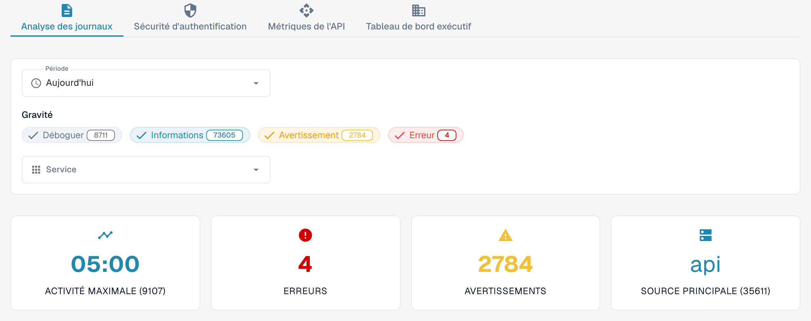

# Analytique

Ouvrez **Paramètres → Journal d'Activité → Analytique** avec un compte administrateur de l’organisation. Cette page réunit l’activité des journaux, les événements d’authentification, l’utilisation de l’API et une vue d’ensemble pour la direction. Commencez par **Analyse des journaux**. Sélectionnez **Consulter les journaux d'événements** pour ouvrir la liste des événements et examiner une entrée précise.

<figure><figcaption>
Vue actuelle de Dev en français. Les compteurs appartiennent à l’environnement de test et seront différents dans votre organisation.
</figcaption></figure>

## Onglets

| Onglet | Description |
|--------|-------------|
| **Analyse des journaux** | Répartition de la gravité des journaux, évolution chronologique et ventilation par service. |
| **Sécurité d'authentification** | Événements d’authentification, tentatives de connexion et métriques de sécurité. |
| **Métriques de l'API** | Volume des requêtes API, temps de réponse et taux d’erreur. |
| **Tableau de bord exécutif** | Vue d’ensemble pour les administrateurs de l’organisation ; sa disponibilité dépend du rôle. |

Chaque onglet possède ses propres contrôles de période. Vérifiez à nouveau la période sélectionnée après un changement d’onglet.

## Filtres des journaux

| Filtre | Description |
|--------|-------------|
| **Période** | Choisissez **Dernière heure**, **Aujourd'hui**, **7 derniers jours**, **Les 30 derniers jours** ou **Personnalisé**. Le choix personnalisé affiche les dates et heures de début et de fin. |
| **Gravité** | Cliquez sur **Déboguer** (Debug), **Informations**, **Avertissement** ou **Erreur** pour inclure ou exclure ce niveau. Le nombre sur chaque filtre indique son total actuel. |
| **Service** | Sélectionnez un ou plusieurs services dont vous souhaitez examiner les événements. |

## Cartes de synthèse

Quatre cartes apparaissent sous les filtres :

| Carte | Description |
|-------|-------------|
| **Activité maximale** | Moment où le volume de journaux est le plus élevé, avec le nombre correspondant. |
| **Erreurs** | Nombre d’erreurs sur la période sélectionnée. |
| **Avertissements** | Nombre d’avertissements sur la période sélectionnée. |
| **Source principale** | Service produisant le plus de journaux, avec son total. |

## Suivi des utilisateurs réels (RUM)

Lorsque la télémétrie du navigateur est disponible, la section RUM affiche des métriques de performance du frontend. Les données disponibles dépendent de l’environnement et de la période. Un graphique vide, un message d’indisponibilité ou un indicateur de chargement ne constitue pas un résultat mesuré.

## Graphiques des journaux et téléchargements

Dans **Analyse des journaux**, choisissez une des vues suivantes :

| Vue | Description |
|-----|-------------|
| **Gravité** | Graphique circulaire montrant la répartition des niveaux de journal. |
| **Chronologie** | Graphique linéaire montrant le volume de journaux dans le temps. |
| **Service** | Graphique en barres avec la ventilation par service. |

Dans le graphique **Chronologie**, ouvrez le menu en haut à droite et choisissez **Download SVG**, **Download PNG** ou **Download CSV**. Ces options concernent le graphique affiché ; les autres graphiques peuvent ne pas proposer la même barre d’outils.

Si aucune donnée n’est disponible, essayez une **Période** plus large ou moins de filtres de **Gravité**.

## Erreurs JS avec traces de pile

Lorsque cette carte est disponible, son badge d’environnement indique le périmètre des erreurs, par exemple **dev seulement**. La carte répertorie les exceptions récentes du navigateur, limitées à 24 heures. **Copier tout le JSON** copie les entrées actuellement chargées dans cette carte, et non le journal complet des événements. Le bouton est désactivé lorsque la liste est vide.

Pour une entrée disponible, cliquez sur le message pour développer la trace de pile. Les actions de la ligne permettent de copier cette entrée en JSON ou de copier sa trace de pile. Un lien de trace apparaît uniquement si l’entrée possède un identifiant de trace.
