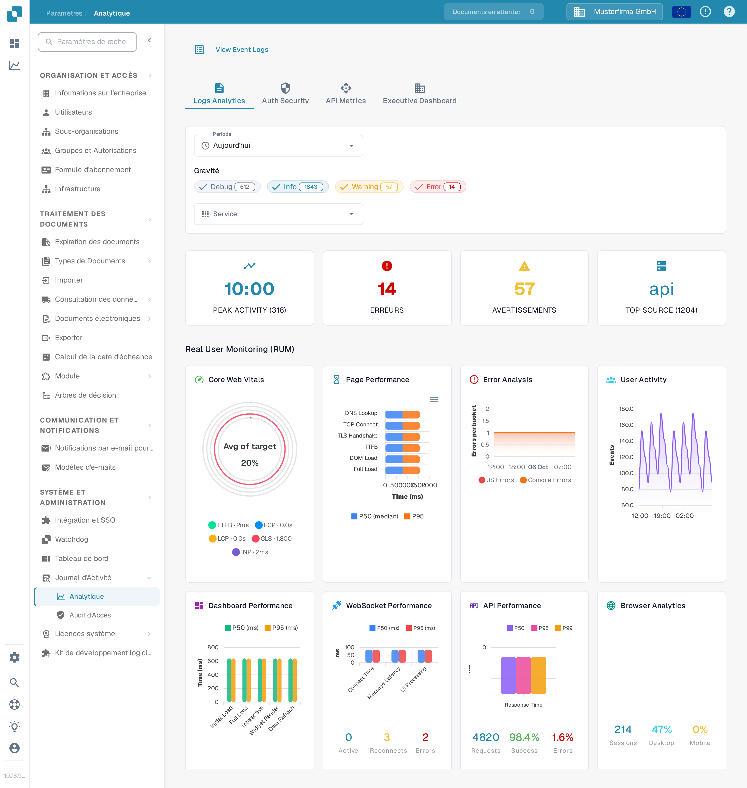

# Analytique

<figure><figcaption>
Utilisez les onglets et les filtres pour restreindre les métriques à examiner.
</figcaption></figure>

La page Analytique vous aide à examiner les tendances des journaux, les événements d'authentification, l'utilisation de l'API et une vue d'ensemble pour la direction. Commencez par **Logs Analytics**. Choisissez **View Event Logs** pour ouvrir la liste des événements sous-jacente lorsque vous devez examiner une entrée en particulier.

## Onglets

| Onglet | Description |
|--------|-------------|
| **Logs Analytics** | Répartition de la gravité des journaux, graphiques chronologiques et ventilation par service. |
| **Auth Security** | Événements d'authentification, tentatives de connexion et métriques de sécurité. |
| **API Metrics** | Volumes de requêtes API, temps de réponse et taux d'erreur. |
| **Executive Dashboard** | Vue d'ensemble de plus haut niveau destinée aux administrateurs d'organisation ; les autres rôles peuvent ne pas voir cet onglet. |

## Filtres

| Filtre | Description |
|--------|-------------|
| **Période** | Sélectionnez une fenêtre de temps (par ex. Aujourd'hui, 7 derniers jours) pour les métriques affichées. |
| **Gravité** | Cliquez sur Debug, Info, Warning ou Error pour inclure ou exclure ce niveau. Un nombre sur une puce indique son total actuel. |
| **Service** | Choisissez le service dont vous voulez examiner les événements. |

## Cartes de synthèse

Quatre cartes de synthèse apparaissent sous les filtres :

| Carte | Description |
|-------|-------------|
| **PEAK ACTIVITY** | Heure de la journée avec le plus grand volume de journaux, avec le nombre total. |
| **ERREURS** | Nombre total d'erreurs pour la période sélectionnée. |
| **AVERTISSEMENTS** | Nombre total d'avertissements pour la période sélectionnée. |
| **TOP SOURCE** | Le service produisant le plus de journaux, avec son nombre. |

## Real User Monitoring (RUM)

Sous les cartes de synthèse, les métriques RUM affichent les données de performance du front-end collectées lors de véritables sessions de navigation d'utilisateurs.

## Graphiques d'analyse

Dans **Logs Analytics**, sélectionnez l'un des trois boutons de graphique pour modifier l'affichage des mêmes journaux filtrés :

| Vue | Description |
|-----|-------------|
| **Severity** | Graphique circulaire montrant la répartition des niveaux de journal (Debug, Info, Warning, Error). |
| **Timeline** | Graphique linéaire montrant le volume de journaux dans le temps. |
| **Service** | Graphique en barres décomposant les journaux par service. |

Si un graphique indique qu'aucune donnée n'est disponible, essayez une **Période** plus large ou moins de filtres **Gravité**. Les chiffres de la capture d'écran appartiennent à l'organisation Sandbox synthétique et différeront dans votre organisation.
