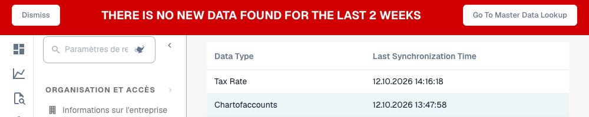

# Vérifier la synchronisation des données

Utilisez cette vue lorsqu'un fournisseur, une commande ou une autre donnée de référence manque. Elle présente la date de synchronisation enregistrée par type de données dans l'organisation courante, pas le contenu de chaque enregistrement importé.

<figure><figcaption>
Dates de synchronisation enregistrées pour deux types de données et avertissement concernant des données de plus de deux semaines. Cet extrait ne prouve pas que les données importées sont complètes. Les en-têtes des colonnes restent affichés en anglais. L’avertissement et ses boutons restent également affichés en anglais.
</figcaption></figure>

## Étapes

1. Confirmez organisation, sous-organisation concernée et société ERP d'origine.
2. Ouvrez **Paramètres → Journal d'activité → Synchronisation des données**. Les anciennes versions la placent dans les paramètres des journaux.
3. Repérez le type dans **Data Type** et lisez **Last Synchronization Time** selon votre format de date. Les mises à jour les plus récentes apparaissent d'abord.
4. Comparez cette date au changement attendu à la source. Une mise à jour des fournisseurs ne prouve pas l'actualité des commandes.
5. Recherchez l'identifiant manquant dans les données de référence ou les commandes. Comparez société, numéro fournisseur/commande et identifiants de ligne avec la source.
6. Examinez canal d'importation et journaux : message source, organisation cible, correspondance et réponse. Corrigez la cause dans l'intégration ; cette vue n'a pas de bouton de démarrage ou de relance.
7. Après la mise à jour corrigée, rechargez cette vue puis la recherche ou le document concerné. Vérifiez date et valeurs réelles.

## Interpréter

| Observation | Vérification suivante |
| --- | --- |
| Aucune ligne | Organisation, configuration d'importation et synchronisations enregistrées. Vide ne signifie pas réussi. |
| Un type est ancien | Suivre ce flux indépendamment des autres lignes. |
| Avertissement de données anciennes | L'avertissement actuel peut apparaître sans ligne ou si toutes les mises à jour datent de plus de deux semaines. Votre processus peut exiger des données bien plus récentes. |
| Date récente, enregistrement absent | Périmètre source, identifiants, contenu du message, correspondance et réponse. La date ne prouve pas l'exhaustivité. |

Pour le support, conservez environnement, organisation, type, identifiant, date attendue et erreur ou identifiant de trace exact, avec les preuves pertinentes anonymisées.

Voir [Importer les données de référence](../../../infor-integration-and-configuration/importing-customer-master-data/README.md), [Journal d'activité](README.md) et [Recherche de données de référence](../document-processing/master-data-lookup.md).
