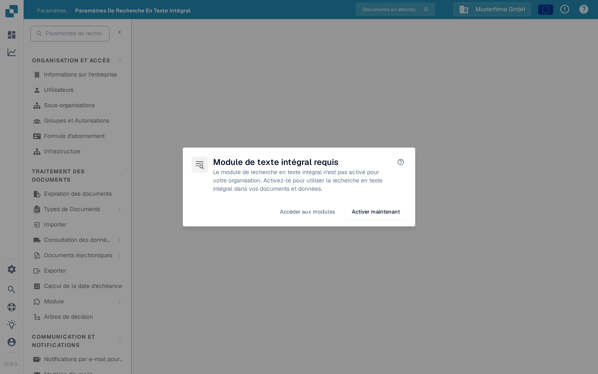

# Paramètres de la Recherche Plein Texte

<figure><figcaption>
Lorsque la Recherche Plein Texte est désactivée, cette boîte de dialogue explique la marche à suivre.
</figcaption></figure>

Les Paramètres de la Recherche Plein Texte contrôlent ce que DocBits indexe et la façon dont ce contenu devient consultable dans les documents, les données de référence ERP et les modèles. La page de paramètres affiche une boîte de dialogue d'exigence tant que le **module Recherche Plein Texte** n'est pas activé — consultez [Recherche plein texte](../document-processing/module/fulltext-search.md) pour le langage de requête destiné aux utilisateurs.

## Pré-requis

Le module Recherche Plein Texte doit être activé dans **Paramètres → Module → Tableaux de bord et analyses → Recherche de texte intégral**. Si le module n'est pas activé, la boîte de dialogue propose trois actions :

* **Aide (?)** — Ouvrir la documentation de la Recherche Plein Texte dans un nouvel onglet avant de modifier un paramètre.
* **Accéder aux modules** — Ouvrir les paramètres du module Tableaux de bord et analyses pour vérifier la configuration.
* **Activer maintenant** — Ouvrir la boîte de dialogue d'abonnement. Vérifiez et confirmez cette boîte de dialogue avant que le module ne soit activé ; cliquer sur ce bouton seul ne l'active pas.

La page de paramètres elle-même devient accessible une fois le module actif.

## Disposition de la page

La page de paramètres est organisée en trois onglets, chacun couvrant un type de contenu différent que la Recherche Plein Texte peut indexer.

### Onglet « Documents »

L'onglet Documents traite tout ce qui concerne l'indexation des documents traités :

* **Statistiques d'indexation** — totaux pour les documents indexés et en attente, rafraîchis à la demande.
* **Préférences de vecteurs** — trois interrupteurs au niveau de l'organisation qui décident si l'indexation vectorielle s'exécute en parallèle de l'index texte pour les documents. L'indexation vectorielle alimente le mode de requête `vector:` et la fonction « Trouver des similaires ».
* **Actions de réindexation** — lancez une réindexation complète ou incrémentale. Pendant qu'une réindexation tourne, vous voyez la progression en direct (documents par minute, temps restant estimé), l'état actuel du flux et la dernière erreur (s'il y en a une).
* **Diagnostic de synchronisation** — diagnostic à la demande pour les cas où l'index semble désaligné du dépôt de documents sous-jacent.

<mark>La réindexation n'est pas destructive — la recherche existante continue de fonctionner pendant que le nouvel index est en cours de construction.</mark>

### Onglet « ERP »

L'onglet ERP contrôle l'indexation des données de référence ERP — fournisseurs, clients, articles et entités similaires. Chaque entité a son propre interrupteur :

* **Indexation** — indexe textuellement l'entité pour qu'elle soit consultable depuis le tableau de bord.
* **Vecteur** — indexe vectoriellement l'entité pour qu'elle puisse être appariée par des requêtes sémantiques.

Utilisez l'action **Tout basculer** en haut de la liste pour appliquer le même état à toutes les entités à la fois. L'indexation démarre en arrière-plan ; un indicateur sur chaque ligne montre quand elle est en cours.

### Onglet « Modèles »

L'onglet Modèles liste les versions de modèles connues de l'index plein texte. Utilisez cette vue pour confirmer après un redéploiement que les versions de modèles dont vous dépendez sont bien présentes dans l'index.

## Ce qui est indexé

Une fois activée et configurée, la Recherche Plein Texte permet aux utilisateurs :

* De chercher dans tout le contenu d'un document (pas seulement les champs de métadonnées).
* De retrouver des documents par le texte contenu dans les fichiers téléversés.
* D'utiliser des opérateurs de recherche avancés pour des requêtes précises.
* D'accéder aux résultats directement depuis le tableau de bord.
* D'utiliser la recherche sémantique (préfixe `vector:`) quand l'indexation vectorielle est active pour ce type de contenu.

Consultez la page du module [Recherche plein texte](../document-processing/module/fulltext-search.md) pour la référence complète du langage de requête, y compris les requêtes par plage, les filtres intelligents et le mode de recherche IA.
