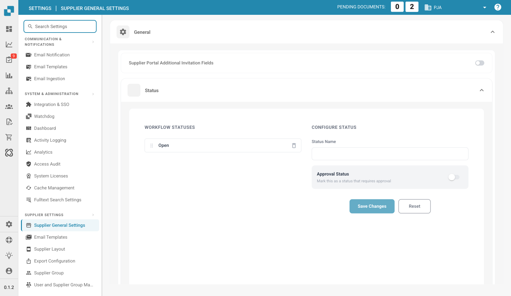

# Supplier General Settings

<figure><figcaption>
Page des paramètres généraux des fournisseurs
</figcaption></figure>

### Aperçu

L'interface **Supplier General Settings** fournit aux administrateurs les outils essentiels pour personnaliser le portail fournisseur. Parmi les fonctionnalités clés figurent la possibilité de téléverser le logo de l'entreprise et de définir la politique et la déclaration de confidentialité. Ces paramètres sont essentiels pour préserver la cohérence de la marque et garantir le respect des exigences légales.

### Upload Logo

#### Objectif

La fonctionnalité **Upload Logo** permet aux administrateurs de personnaliser le portail fournisseur en téléversant le logo de leur entreprise. Cela renforce la reconnaissance de la marque et offre une expérience visuelle cohérente aux utilisateurs qui accèdent au portail.

#### Étapes pour téléverser un logo

1. **Accédez à Supplier General Settings** :
   * Accédez à la section **Supplier General Settings** depuis le menu principal.
2. **Repérez la section Upload Logo** :
   * Faites défiler la page des paramètres jusqu'à la section **Upload Logo**.
3. **Téléversez un nouveau logo** :
   * Cliquez sur la zone **Upload Logo** pour ouvrir la boîte de dialogue de sélection de fichier.
   * Sélectionnez le fichier image à téléverser. Les formats pris en charge sont généralement `.png`, `.jpg` ou `.jpeg`.
   * Le logo téléversé s'affiche dans la zone d'aperçu.
4. **Enregistrez le logo téléversé** :
   * Une fois le logo téléversé, cliquez sur le bouton **Save** pour appliquer les modifications.
   * Le nouveau logo s'affiche alors dans l'ensemble du portail fournisseur.

#### Bonnes pratiques

* **Dimensions du logo** : veillez à ce que les dimensions du logo soient optimisées pour les affichages sur ordinateur et sur mobile. Le système peut proposer des recommandations ou un redimensionnement automatique.
* **Taille du fichier** : utilisez un fichier image compressé pour réduire les temps de chargement et améliorer l'expérience utilisateur.
* **Cohérence de la marque** : utilisez le même logo sur toutes les plateformes afin de conserver une identité de marque cohérente.

### Policy and Privacy Statement

#### Objectif

La section **Policy and Privacy Statement** permet aux administrateurs de téléverser ou de définir les documents juridiques qui régissent l'utilisation du portail fournisseur. Ces documents sont essentiels pour respecter les exigences légales et réglementaires ; ils décrivent les conditions d'utilisation, les politiques de protection des données et d'autres informations essentielles pour les utilisateurs.

#### Étapes pour téléverser la politique et la déclaration de confidentialité

1. **Accédez à Supplier General Settings** :
   * Accédez à la section **Supplier General Settings** depuis le menu principal.
2. **Repérez la section Policy and Privacy Statement** :
   * Faites défiler la page jusqu'à la section **Policy and Privacy Statement**.
3. **Téléversez ou mettez à jour les documents** :
   * Cliquez sur le bouton **Upload Document** pour sélectionner le ou les fichiers concernés.
   * Choisissez le fichier du document depuis votre stockage local. Les formats pris en charge sont généralement `.pdf`, `.docx` ou `.txt`.
   * Les documents téléversés sont listés dans cette section pour contrôle.
4. **Enregistrez les modifications** :
   * Après avoir téléversé ou mis à jour les documents, cliquez sur le bouton **Save** afin que les nouvelles politiques soient appliquées.

#### Bonnes pratiques

* **Mises à jour régulières** : passez régulièrement en revue et mettez à jour la Policy and Privacy Statement afin qu'elle respecte les dernières exigences légales et les politiques de l'entreprise.
* **Clarté et accessibilité** : veillez à ce que les documents téléversés soient clairs, concis et accessibles à tous les utilisateurs. Envisagez de proposer des traductions si votre base de fournisseurs est internationale.
* **Relecture juridique** : faites relire tous les documents par un conseiller juridique avant de les téléverser afin de garantir leur conformité aux lois et réglementations applicables.
