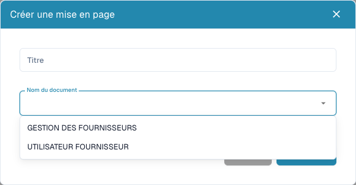

# Configurer les formulaires fournisseurs

<figure><figcaption>
Choisir le public externe ou interne avant d’enregistrer une présentation.
</figcaption></figure>

Les présentations fournisseurs définissent les formulaires externes et ceux du personnel interne. Elles ne modifient ni la facture imprimée ni l'apprentissage de son extraction. Vous devez avoir des droits administrateur et des besoins définis pour chaque public.

## Choisir le public

1. Ouvrez **Paramètres → Paramètres fournisseurs → Présentation fournisseurs**.
2. Examinez les présentations existantes et ouvrez la bonne avant d'en créer une autre.
3. Pour une nouvelle présentation, choisissez **Nouveau**, un titre explicite et le type de document : utilisateur fournisseur pour l'externe, gestion fournisseur pour l'interne.
4. Enregistrez la définition, ouvrez sa présentation dans la liste et confirmez le public.

## Configurer champs et structure

1. Ouvrez les champs fournisseurs. Vérifiez titre, nom du champ ERP, liste de valeurs et propriétés obligatoire, lecture seule et masqué.
2. Créez un champ avec nom, titre et type. Les sélections/recherches/options exigent la bonne liste de valeurs. Un fichier exige son type de document ; pour les autres champs, vérifiez le nom ERP.
3. Enregistrez les réglages corrects. Définition et disposition du formulaire sont des étapes distinctes.
4. Organisez groupes et champs via **Éléments** et **Champs** dans la bonne présentation. Sélectionnez un élément et vérifiez ses propriétés disponibles.
5. Donnez aux groupes des noms et titres valides. Ne masquez/verrouillez pas un champ obligatoire sans valeur existante ou processus adapté.
6. Enregistrez puis rouvrez la présentation. **Annuler** quitte l'éditeur. Le modèle par défaut peut remplacer la disposition actuelle ; utilisez-le délibérément.

## Tester les deux vues

Avec un fournisseur fictif et un compte de test, contrôlez séparément inscription et détails internes : messages obligatoires, choix, fichiers, champs masqués/en lecture seule. L'enregistrement dans l'éditeur ne prouve ni inscription, ni approbation, ni export réussi.

Si un champ manque, vérifiez définition, visibilité, présentation et public. Pour une valeur ERP absente, vérifiez aussi la correspondance d'exportation.

Voir [Portail fournisseurs](../../setup/supplier-portal/README.md), [Paramètres généraux](supplier-general-settings.md) et [Autorisations](supplier-permissions.md).
