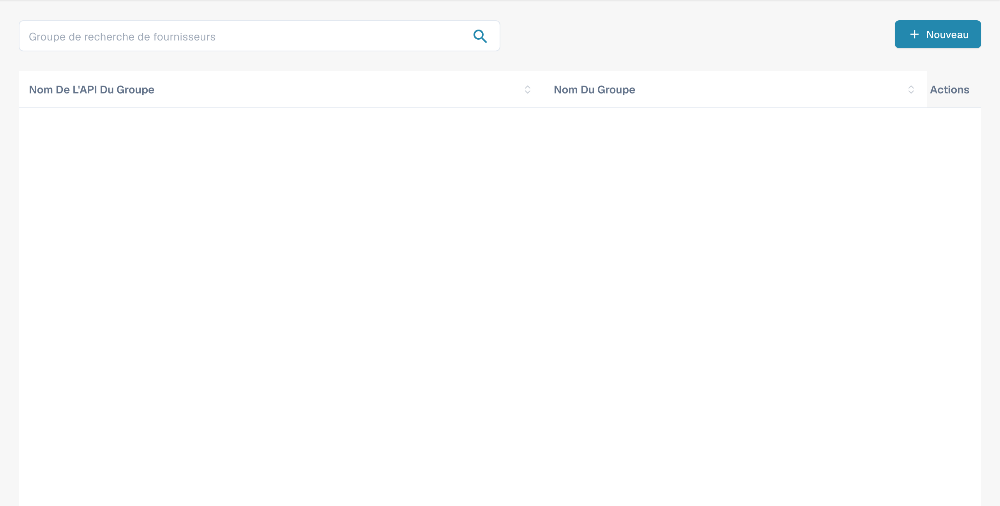
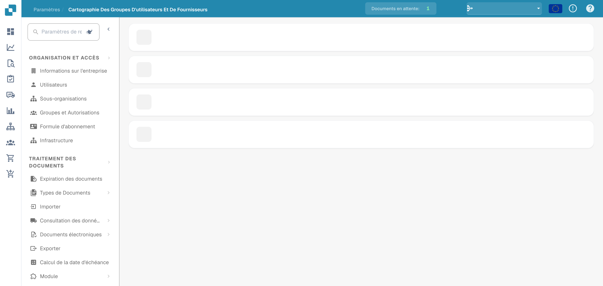

# Autorisations fournisseur

### Groupe de fournisseurs

<figure><figcaption>
Liste des groupes fournisseur avec les noms masqués.
</figcaption></figure>

Gérez les groupes de fournisseurs pour catégoriser les fournisseurs par type, région ou rôle. Chaque groupe possède un **nom d'API de groupe** (utilisé pour les intégrations) et un **nom de groupe** (nom d'affichage).

Cliquez sur **+ Nouveau** pour créer un groupe. Utilisez le menu à trois points sur chaque ligne pour modifier ou supprimer.

### Mappage des utilisateurs et des groupes de fournisseurs

<figure><figcaption>
Association des utilisateurs aux groupes fournisseur.
</figcaption></figure>

Attribuez des utilisateurs à des groupes de fournisseurs pour contrôler quels employés peuvent accéder à des ensembles spécifiques de fournisseurs et les gérer. Chaque groupe est présenté sous la forme d'une section extensible répertoriant ses utilisateurs attribués avec un décompte des membres.

Cliquez sur **+ Nouveau** dans un groupe pour ajouter un mappage d'utilisateur. Utilisez le menu à trois points pour supprimer un mappage.
