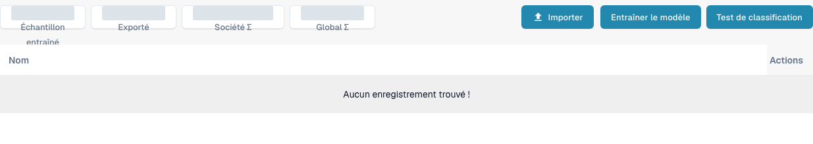

# Entraînement des documents

L’entraînement de documents apprend à DocBits où trouver les valeurs dans les documents qu’il ne lit pas encore correctement. Entraînez séparément les champs d’en-tête et les champs de ligne.

Pour examiner l’entraînement de classification d’un type de document, ouvrez **Paramètres** → **Types de Documents**, puis choisissez **Formation du modèle** sur une fiche de type de document existante. La vue affiche les exemples d’entraînement ainsi que **Importer**, **Entraîner le modèle** et **Test de classification**. Examinez les exemples existants avant toute modification et utilisez des fichiers de test autorisés pour tout entraînement ou test de classification ultérieur.

<figure><figcaption>
Vue française de l’entraînement de modèles pour un type de facture existant. Aucun document d’exemple n’est répertorié ; les compteurs agrégés sont masqués. Aucune importation, aucun entraînement et aucun test de classification n’ont été exécutés.
</figcaption></figure>

* [Entraîner les champs d’en-tête](training-header-fields.md): indiquez où une valeur d’en-tête, comme une date ou un montant total, apparaît dans le document.
* [Entraîner les champs de ligne et les tableaux](training-line-fields-table-training/README.md): définissez la structure du tableau des lignes pour un fournisseur précis.

Les résultats de l’entraînement dépendent des documents utilisés. Vérifiez les valeurs extraites sur un autre document de test avant de vous y fier.
