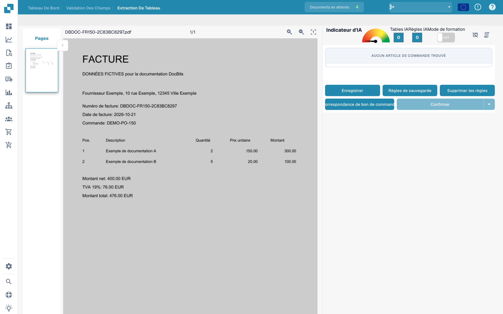
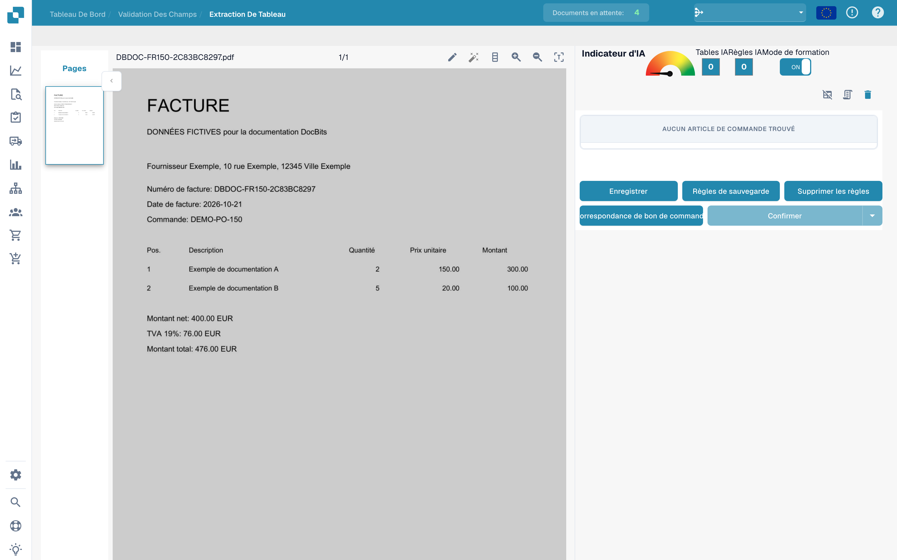
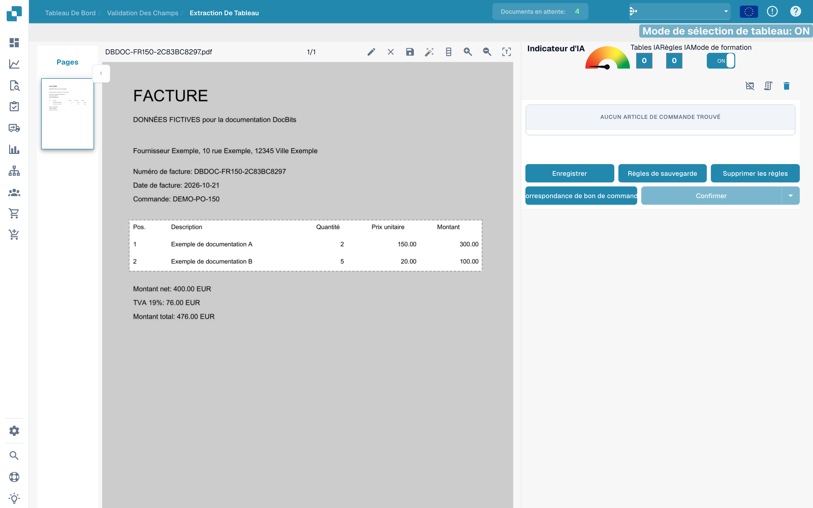
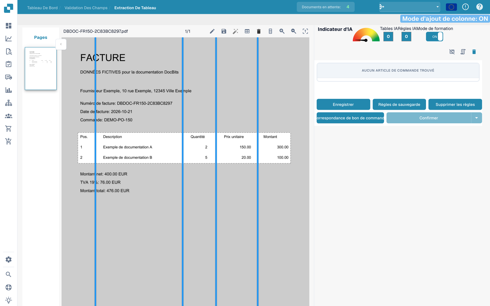
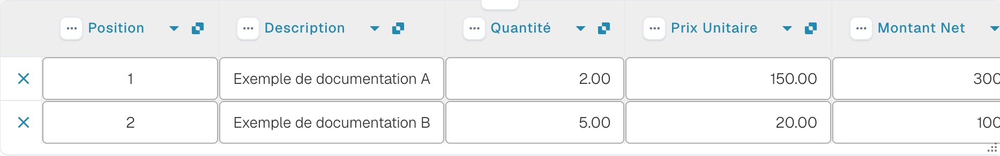

# Définir les tableaux et les colonnes

Si un tableau n’est pas reconnu complètement, utilisez l’entraînement pour définir sa zone et ses colonnes. Les exemples utilisent une facture fictive et un brouillon non enregistré.

## Ouvrir l’entraînement

Ouvrez le document dans la validation des champs, puis l’extraction de tableau.

<figure><figcaption>
Interface de définition des tableaux et colonnes.
</figcaption></figure>

Activez le mode d’entraînement pour afficher les outils de sélection et de colonnes.

<figure><figcaption>
Entraînement des tableaux avec le mode d’entraînement activé.
</figcaption></figure>

La barre propose aussi une détection automatique. Comparez son résultat au document : cette image montre les outils disponibles, pas une détection terminée.

<figure><figcaption>
Outils d’entraînement des tableaux, dont la détection automatique.
</figcaption></figure>

## Définir la zone et les colonnes

Avec le crayon, tracez un rectangle autour des en-têtes et lignes d’article. Excluez les totaux situés en dessous.

<figure><figcaption>
Zone de tableau non enregistrée autour des lignes de la facture fictive.
</figcaption></figure>

Choisissez l’outil des colonnes et placez les séparateurs verticaux entre les colonnes réelles.

<figure><figcaption>
Zone de tableau avec séparateurs verticaux des colonnes.
</figcaption></figure>

Vérifiez position, description, quantité, prix unitaire et montant.

<figure><figcaption>
Séparateurs positionnés entre les colonnes de la facture fictive.
</figcaption></figure>

Contrôlez toute la zone et ses séparateurs avant d’enregistrer le document ou les règles.

<figure><figcaption>
Zone et séparateurs dans un brouillon d’entraînement non enregistré.
</figcaption></figure>

## Contrôler l’extraction

Comparez les lignes extraites à la facture. L’image suivante montre les lignes déjà extraites automatiquement dans la validation ; elles ne résultent pas du brouillon d’entraînement présenté ci-dessus.

<figure><figcaption>
Lignes extraites automatiquement de la facture fictive dans la validation.
</figcaption></figure>

Après l’enregistrement prévu, testez d’autres documents du même fournisseur. Une facture ne démontre pas une extraction fiable pour toutes les mises en page.
