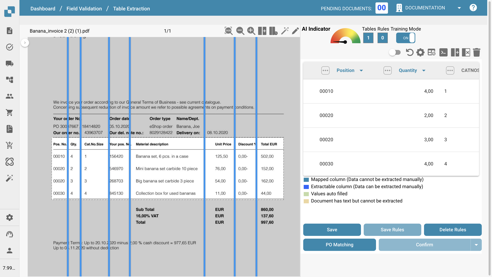

# Définition des tables et des colonnes

Utilisez ce guide pour définir manuellement les tables et les colonnes pour l'extraction des lignes d'articles dans DocBits. Cela est particulièrement utile lorsque la détection automatique ne capture pas entièrement la structure du tableau, ou lorsque vous devez ajouter des champs personnalisés.

### 1. Accéder à la vue d'extraction de tableau

Ouvrez votre document dans DocBits et cliquez sur le bouton **« Table Training »** pour accéder à la vue d'extraction de tableau.

<figure><figcaption></figcaption></figure>

### 2. Activer le mode d'entraînement

Pour définir ou modifier manuellement des tables et des colonnes, cliquez sur **« TRAINING MODE »**.

<figure><figcaption></figcaption></figure>

### 3. Définir la zone du tableau

Après être passé en mode d'entraînement, vous pouvez définir l'emplacement du tableau sur le document. Vous avez deux possibilités :

#### Option 1 : utiliser la détection automatique

Cliquez sur le bouton **« Auto-Detect Tables »** pour que DocBits tente d'identifier lui-même la zone du tableau.

<figure><figcaption></figcaption></figure>

Si la détection réussit, le contour du tableau s'affiche automatiquement. Vous pouvez alors passer à la définition des colonnes.

#### Option 2 : définir le tableau manuellement

Si la détection automatique échoue ou manque de précision, vous pouvez définir le tableau manuellement :

1. Cliquez sur le bouton **« Edit »** pour activer le mode de sélection de tableau.
2. Tracez un rectangle autour de la zone du tableau dans la vue du document à gauche.

<figure><figcaption></figcaption></figure>

### 4. Ajouter et définir les colonnes

Une fois les tables définies, vous pouvez définir manuellement les colonnes à l'aide du bouton suivant :\

<figure><figcaption></figcaption></figure>

Définissez et triez les colonnes par glisser-déposer sur le document. Répétez cette opération pour les tables des autres pages. Si les tables sont identiques sur chaque page, vous pouvez à la place utiliser le bouton suivant pour appliquer les mêmes colonnes à toutes les tables définies dans le document. Cette fonction copie les colonnes que vous avez définies sur toutes les autres pages :

<figure><figcaption></figcaption></figure>

Utilisez la fonction de **zoom** pour mieux définir les colonnes sur des documents chargés ou complexes, par exemple lorsque beaucoup d'informations sont rapprochées, ce qui rend la définition des colonnes difficile :

<figure><figcaption></figcaption></figure>

Si vous avez défini une colonne par erreur, vous pouvez la sélectionner en cliquant dessus et la supprimer à l'aide du bouton suivant :

<figure><figcaption></figcaption></figure>

<mark style="color:red;">**Remarque**</mark> : le bouton n'est visible que si la colonne est sélectionnée.

Lorsque vous avez fini de définir toutes les tables et toutes les colonnes de votre document, utilisez le bouton « Save » pour activer vos modifications et extraire les données du document :

<figure><figcaption></figcaption></figure>

Les données de toutes les zones définies sont extraites et affichées sur le côté droit :

<figure><figcaption></figcaption></figure>

### 6. Enregistrer et extraire

Cliquez sur **« Save Rules »** une fois toutes les tables et toutes les colonnes définies.

* Cela indique à DocBits où trouver les données du tableau pour ce fournisseur précis.
* La prochaine fois qu'un document du même fournisseur sera importé, DocBits extraira automatiquement le tableau à l'aide des règles enregistrées.

<mark style="color:red;">**Remarque**</mark> : cet entraînement est propre à chaque fournisseur. Il ne s'applique pas aux documents d'autres fournisseurs.
