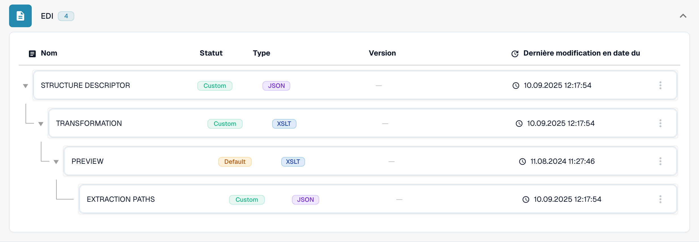

# Processus de transformation des données EDI


<figure><figcaption><p>Format EDI existant avec ses quatre attributs configurés.</p></figcaption></figure>

DocBits analyse le message EDI brut pour produire du JSON à l’aide d’un descripteur de structure JSON. Il crée ensuite un XML intermédiaire, applique XSLT pour produire le XML standard et utilise ce XML pour l’extraction des champs et des tableaux ainsi que pour l’aperçu.

Les exemples ci-dessous sont des fragments illustratifs, et non des configurations complètes prêtes à importer. Certains omettent du contenu ou contiennent des éléments de remplacement tels que `...`. Adaptez-les et testez-les avec votre message EDI réel, le XML intermédiaire et la sortie transformée ; conservez les identifiants de champs nécessaires à votre configuration.

## Étape 1 : décrire la structure EDI

Le descripteur de structure JSON définit des segments tels que SAC, N1 et PO1, leurs champs et les boucles imbriquées. Il détermine comment le message EDI brut est analysé pour obtenir du JSON structuré.

```json
{
  "SAC": {"fields": ["SAC", "DTM", "TX1", "TD5"]},
  "N1": {"fields": ["N1", "N2", "N3", "N4", "PER"]},
  "PO1": {
    "fields": ["PO1", "REF"],
    "loops": {
      "SAC": {"fields": ["SAC", "TX1", "DTM"]}
    }
  }
}
```

## Étape 2 : transformer le XML intermédiaire avec XSLT

DocBits convertit le JSON analysé en XML intermédiaire avant d’appliquer la feuille de transformation. XSLT lit ce XML intermédiaire, et non directement le JSON, et produit la structure XML standard utilisée pour la suite du traitement. L’exemple sélectionne des données d’accusé de réception et des conditions dans les nœuds XML.

```xml
<xsl:stylesheet version="1.1" xmlns:xsl="http://www.w3.org/1999/XSL/Transform">
    <xsl:output method="xml" />
    <xsl:template match="/">
        <ORDER_CONFIRMATION>
            <ACKNOWLEDGEMENT_TYPE>
                <xsl:value-of select="//BAK/VALUE_2/text()" />
            </ACKNOWLEDGEMENT_TYPE>
            <ACKNOWLEDGEMENT_TYPE_DESCRIPTION>
                <xsl:choose>
                    <xsl:when test="//BAK/VALUE_2='AD'">With detail, no change</xsl:when>
                    <xsl:when test="//BAK/VALUE_2='AC'">With detail and change</xsl:when>
                    <xsl:otherwise>Unknown</xsl:otherwise>
                </xsl:choose>
            </ACKNOWLEDGEMENT_TYPE_DESCRIPTION>
            <!-- Additional fields and conditions are similarly transformed -->
        </ORDER_CONFIRMATION>
    </xsl:template>
</xsl:stylesheet>

```

## Étape 3 : créer un aperçu HTML

Une feuille de style d’aperçu convertit en HTML le XML transformé à l’étape 2. Adaptez la mise en page et les liaisons de données au type de document, puis vérifiez que l’aperçu représente correctement les données transformées.

```xml
<xsl:stylesheet version="1.1" xmlns:xsl="http://www.w3.org/1999/XSL/Transform">
    <xsl:output method="html" />
    <xsl:template match="/">
        <html lang="en">
            <head>
                <meta charset="UTF-8" />
                <meta name="viewport" content="width=device-width, initial-scale=1.0" />
                <title>Preview of Transformed EDI Data</title>
                <!-- Styles and head elements -->
            </head>
            <body>
                <div>
                    <!-- HTML structure mimicking an invoice or other document type, with data bindings from the transformed XML -->
                </div>
            </body>
        </html>
    </xsl:template>
</xsl:stylesheet>


```

## Étape 4 : configurer l’extraction XPath

La configuration d’extraction est stockée en JSON, mais ses chemins sont des expressions XPath évaluées sur le XML transformé à l’étape 2. Les chemins de champs sélectionnent des valeurs ; le chemin des lignes d’un tableau sélectionne les lignes, et les chemins de colonnes sélectionnent des valeurs dans chaque ligne. Il ne s’agit pas d’expressions JSONPath.

```json
{
  "fields": {
    "purchase_order": "//ORDER_CONFIRMATION/PURCHASE_ORDER/text()",
    "currency": "//ORDER_CONFIRMATION/CURRENCY/text()",
    ...
  },
  "tables": [
    {
      "name": "ORDER_CONFIRMATION_TABLE",
      "row_path": "//ORDER_CONFIRMATION/ORDER_LINES/ORDER_LINE",
      "columns": [
        {"name": "POSITION", "path": "POSITION/text()"},
        ...
      ]
    }
  ]
}
```

Le parcours complet est : EDI brut → JSON structuré → XML intermédiaire → XML standard via XSLT → extraction des champs et des tableaux avec XPath et aperçu HTML. Validez la sortie et les valeurs extraites avec des messages représentatifs avant d’utiliser une configuration en production.


Les vues montrent une configuration et une version existantes. Les paramètres varient selon le type de document et le format. Validez les modifications dans un brouillon avant leur activation.

Certaines mentions, telles que Custom et Default, correspondent à l’interface actuelle du produit. Les identifiants techniques des attributs et le code de configuration restent inchangés.
