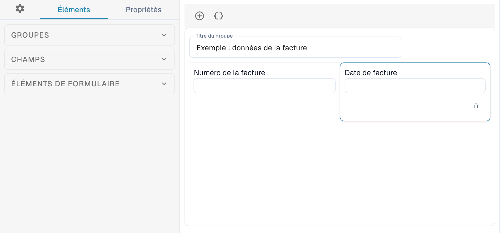
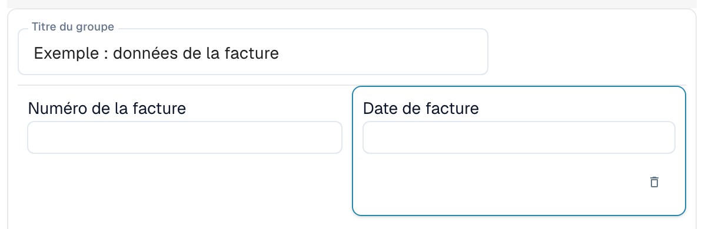
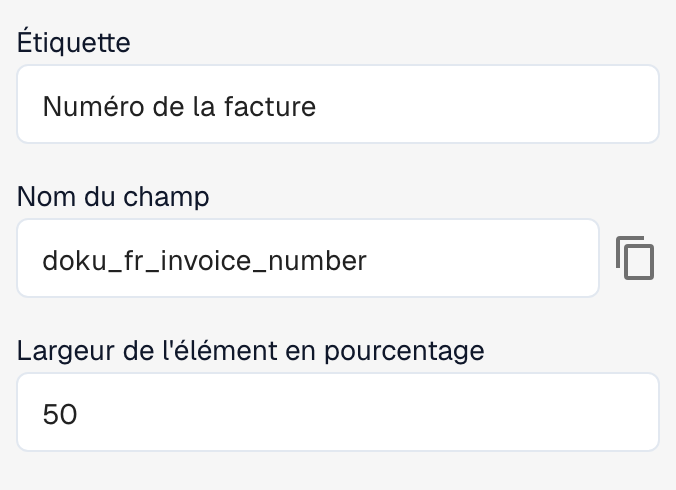

# Éditeur de mise en page

Utilisez l’éditeur de mise en page pour organiser les champs et les contrôles affichés lors de la validation ou de l’approbation d’un document. Chaque mise en page est associée à un type de document, à une origine et à un type de mise en page. Avant d’enregistrer des modifications, vérifiez quelle mise en page est ouverte.

## Ouvrir la mise en page

1. Ouvrez **Paramètres → Types de documents**.
2. Ouvrez l’éditeur de mise en page du type ou sous-type de document souhaité. Si cette action n’est pas disponible, un administrateur doit peut-être activer le module pour votre organisation.
3. Vérifiez l’origine sélectionnée dans la barre d’actions et le type d’éditeur indiqué à côté.

<figure><figcaption>
Vue partielle de l’éditeur : les sections Groupes, Champs et Éléments de formulaire à gauche, et un exemple simplifié de mise en page de facture au centre.
</figcaption></figure>

Lorsque vous changez d’**Origine**, DocBits peut créer une mise en page indépendante pour cette origine. Vérifiez l’origine avant d’apporter des modifications.

## Découvrir les zones de l’éditeur

À gauche, vous pouvez passer entre **Éléments**, **Propriétés** et les réglages généraux, représentés par un engrenage.

* L’onglet **Éléments** contient les sections **Groupes**, **Champs** et **Éléments de formulaire**. Ouvrez chaque section pour consulter les groupes, les champs et les contrôles disponibles.
* La zone centrale affiche les groupes et les champs de la mise en page. Les groupes permettent de réunir des champs liés.
* À droite se trouve la vue du document d’exemple, où vous pouvez consulter le document et régler le zoom.

Faites glisser un élément depuis la section correspondante à gauche vers la zone de mise en page pour ajouter un groupe, un champ ou un contrôle de formulaire.

<figure><figcaption>
Les champs Numéro de la facture et Date de facture du groupe d’exemple. Dans cette mise en page, chaque champ occupe 50 % de la largeur du groupe.
</figcaption></figure>

Configurez les champs réutilisables dans [Types de documents](README.md). Les champs disponibles dépendent du type de document sélectionné et de sa configuration.

## Modifier les propriétés d’un élément

Sélectionnez un groupe ou un champ dans la zone de mise en page, puis ouvrez **Propriétés** à gauche. Les options dépendent de l’élément sélectionné et comprennent, par exemple, l’étiquette, le nom technique, la largeur et le comportement.

<figure><figcaption>
Propriétés du champ sélectionné : Étiquette, Nom du champ et Largeur de l’élément en pourcentage.
</figcaption></figure>

Dans cet exemple, **Étiquette** contient « Numéro de la facture », également affiché sur le champ dans la zone centrale. **Nom du champ** affiche le nom technique `doku_fr_invoice_number` ; ce nom identifie le champ d’exemple.

Pour les champs prédéfinis, l’étiquette et le nom technique peuvent ne pas être modifiables. Selon le type d’élément, vous pouvez également régler la lecture seule, la visibilité, l’ordre de tabulation, les listes de valeurs et l’exécution d’un workflow ou d’un script lors d’un changement de valeur. Les options des groupes et des champs sont différentes.

Après avoir modifié les propriétés, vérifiez le résultat dans la zone de mise en page. La largeur est saisie en pourcentage au moyen d’un contrôle numérique ; les groupes et leurs champs peuvent avoir des largeurs différentes. Consultez [Configurer les propriétés des champs](../../settings/global-settings/document-types/layout-manager/configuring-field-properties.md).

## Modèles et JSON

Outre l’enregistrement de la mise en page, la barre d’actions propose des fonctions pour générer un modèle, appliquer la mise en page par défaut aux mises en page par origine, utiliser le modèle par défaut et modifier le JSON. Leur disponibilité dépend de l’éditeur ouvert.

Générer ou appliquer un modèle peut remplacer une mise en page personnalisée. Vérifiez d’abord le type de document, l’origine et la mise en page actuelle. **Modifier JSON** est destiné à la configuration avancée et nécessite de connaître le format du modèle. La fonction permettant de copier la configuration se trouve dans la boîte de dialogue JSON.

## Vérifier et enregistrer

Organisez les groupes et les champs et vérifiez le résultat dans la zone de mise en page. Lorsqu’il vous convient, utilisez **Enregistrer** dans la barre d’actions. Pour les mises en page propres à une origine, consultez [Mises en page par origine](origin-layouts.md).


Les illustrations utilisent un exemple simplifié de mise en page de facture. Les noms des champs et les options disponibles dépendent de la configuration.

