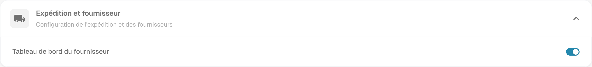
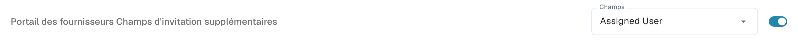
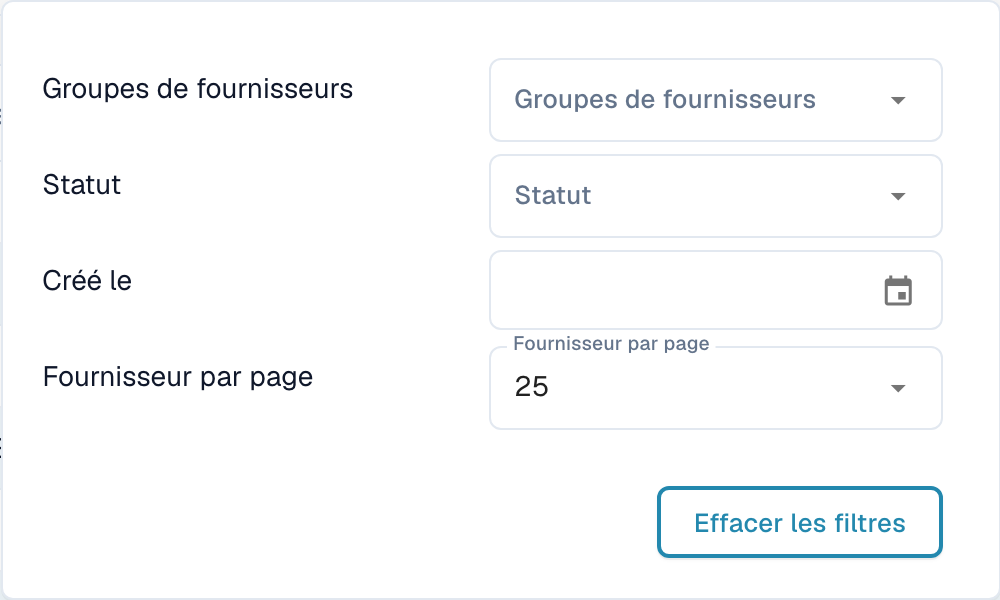
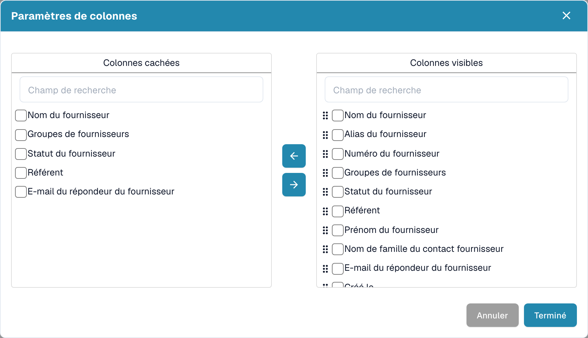
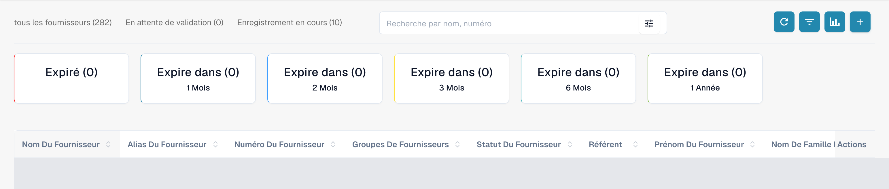
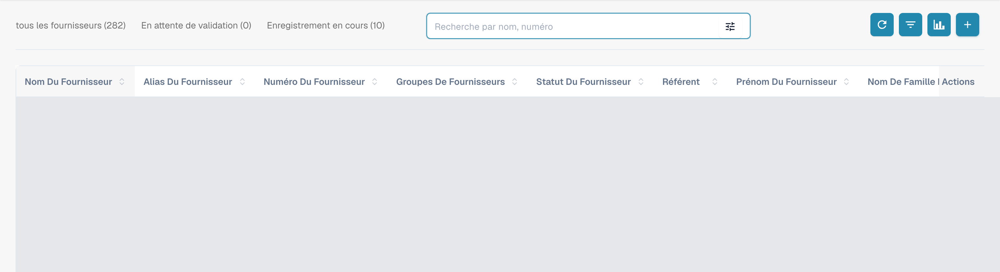
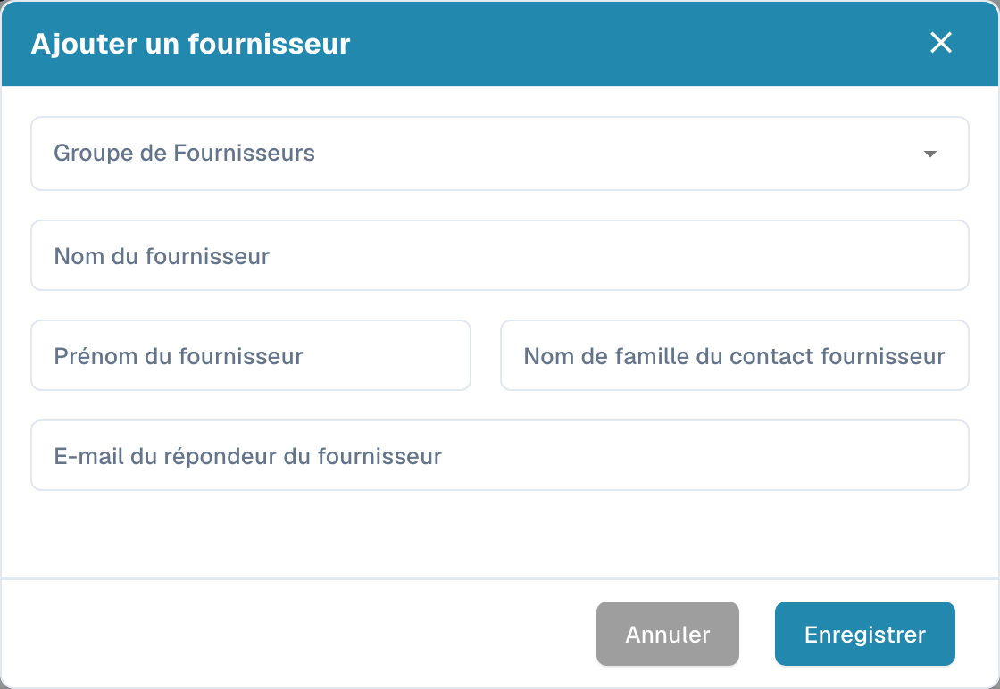

# Portail fournisseurs

Le **portail fournisseurs** permet à un administrateur de donner aux fournisseurs de son entreprise un accès à **DocBits**. L’administrateur active le portail et définit quels fournisseurs peuvent l’utiliser et quelles informations ils peuvent consulter.

Un fournisseur invité s’inscrit puis se connecte avec son propre compte. Il peut consulter les informations mises à sa disposition, par exemple le statut de ses commandes d’achat et de ses factures. Les fonctions disponibles dépendent de la configuration de l’organisation.

## Vidéo : préparer le portail fournisseurs et les accès

Un administrateur présente l’option du portail, le choix du forfait, la préparation d’une invitation et l’entrée dans l’inscription. Activation, envoi, inscription et approbation sont expliqués comme des étapes distinctes.



[Ouvrir la vidéo avec sous-titres français et sélection des chapitres](https://docbits-videos.fra1.cdn.digitaloceanspaces.com/settings-assistant/supplier-portal-access-admin/v1/fr.html)

## Admin : activer le portail

1. Dans les paramètres, ouvrez les modules puis la rubrique **Intégration de documents**.
2. Développez **Expédition et fournisseur** et activez **Tableau de bord du fournisseur**.
3. Si une fenêtre d’activation apparaît, vérifiez l’offre affichée et confirmez l’activation souhaitée.

<figure><figcaption>
Vue réelle de Dev en français, Expédition et fournisseur : Tableau de bord du fournisseur est déjà activé dans cette organisation de test. L’interrupteur n’a pas été modifié pour la capture.
</figcaption></figure>

## Admin : configurer le portail

Configurez le portail de votre organisation avant d’envoyer les premières invitations :

- [Paramètres généraux des fournisseurs](../../settings/supplier-setting/supplier-general-settings.md): Champs supplémentaires d’invitation, statuts, logo et informations de confidentialité.
- [Modèles d’e-mail](../../settings/supplier-setting/editing-email-templates.md): Contenu et présentation des messages d’invitation.
- [Mise en page fournisseur](../../settings/supplier-setting/supplier-layout.md): Champs d’inscription des fournisseurs et de gestion interne. Sélectionnez le type de mise en page approprié.
- [Autorisations des fournisseurs](../../settings/supplier-setting/supplier-permissions.md): Affectation des collaborateurs internes aux groupes de fournisseurs. Ces responsabilités internes sont distinctes de l’accès personnel du fournisseur au portail.

<figure><figcaption>
Vue réelle des champs supplémentaires d’invitation : l’option est déjà activée et Champs conserve la sélection configurée Assigned User. Aucune modification n’a été enregistrée.
</figcaption></figure>

## Admin : rechercher et filtrer les fournisseurs

Ouvrez le **tableau de bord des fournisseurs** pour la gestion interne. Les totaux **tous les fournisseurs**, **En attente de validation** et **Enregistrement en cours** permettent de limiter la liste affichée. Le champ **Recherche par nom, numéro** sert à rechercher un fournisseur par son nom ou son numéro.

Ouvrez le contrôle des filtres dans le champ de recherche pour utiliser **Groupes de fournisseurs**, **Statut** et **Créé le**. **Fournisseur par page** règle la taille de la page ; **Effacer les filtres** supprime les filtres de recherche actifs. Ces contrôles concernent la liste des fournisseurs.

<figure><figcaption>
Menu de filtres avec Groupes de fournisseurs, Statut, Créé le, Fournisseur par page et Effacer les filtres. La capture montre les contrôles disponibles sans attester un test du résultat du filtrage.
</figcaption></figure>

## Admin : choisir les colonnes visibles

À côté du bouton d’actualisation, ouvrez les paramètres de colonnes. L’infobulle indique **Définir les colonnes du tableau pour l'organisation**. Sélectionnez des champs dans **Colonnes cachées** ou **Colonnes visibles**, puis déplacez-les entre les listes avec les flèches. Utilisez les poignées pour modifier l’ordre des colonnes visibles. **Terminé** applique la sélection à l’organisation ; **Annuler** ferme la fenêtre sans l’appliquer. Le défilement horizontal permet d’atteindre les colonnes d’un tableau plus large que l’écran.

<figure><figcaption>
Paramètres de colonnes avec Colonnes cachées, Colonnes visibles, flèches, Annuler et Terminé. La fenêtre a été fermée avec Annuler sans modifier la sélection.
</figcaption></figure>

## Admin : consulter l’analytique des échéances

Utilisez **Analytique**, l’icône de graphique à côté des paramètres de colonnes, pour afficher ou masquer la synthèse des échéances. Les cartes indiquent **Expiré** et **Expire dans**, avec les périodes **1 Mois**, **2 Mois**, **3 Mois**, **6 Mois** et **1 Année**, telles qu’elles apparaissent dans l’interface. Sélectionner une carte limite la liste à la période d’échéance correspondante. Les compteurs concernent les dates d’expiration des fournisseurs.

<figure><figcaption>
Analytique affiche Expiré et Expire dans pour un, deux, trois ou six mois et une année. Les lignes sont masquées et aucune carte n’a été sélectionnée.
</figcaption></figure>

## Admin : inviter les fournisseurs

Ouvrez la gestion des fournisseurs. Avant toute invitation, vérifiez l’entreprise, le groupe, le contact et l’adresse e-mail. Lors de la création d’un fournisseur, l’enregistrement demande l’envoi de l’invitation à s’inscrire ; il ne conserve pas simplement un brouillon. Pour un fournisseur existant, utilisez l’action d’invitation correspondante. Une confirmation d’envoi ne prouve ni la réception du message ni la fin de l’inscription.

<figure><figcaption>
Tableau de bord interne avec tous les fournisseurs, En attente de validation, Enregistrement en cours, recherche et barre d’outils. Les lignes des fournisseurs existants sont masquées.
</figcaption></figure>

<figure><figcaption>
Formulaire vide Ajouter un fournisseur avec Groupe de Fournisseurs, Nom du fournisseur, coordonnées du contact, Annuler et Enregistrer. Enregistrer demande l’envoi de l’invitation à s’inscrire ; seule l’action Annuler a été utilisée pour la capture.
</figcaption></figure>

## Admin : ouvrir la fiche depuis le tableau de bord des fournisseurs

L’équipe interne peut ouvrir la fiche détaillée depuis la ligne d’un fournisseur dans le tableau de bord. Cette vue contient les six mêmes rubriques que remplit le fournisseur et affiche leur statut. Elle permet de vérifier et de tenir à jour les informations transmises, puis d’effectuer l’approbation correspondante. Aucune ligne d’un fournisseur existant n’a été ouverte pour ces captures.

## Fournisseur : s’inscrire et accéder à DocBits

Le fournisseur ouvre son invitation, crée ou utilise le compte personnel prévu et suit les étapes d’inscription configurées. Il peut ensuite consulter les informations mises à sa disposition dans DocBits. Le déroulement exact et les fonctions disponibles dépendent de l’organisation.

[Guide d’inscription des fournisseurs](supplier-registration.md).

## Comprendre les accès et les statuts

L’activation du portail, l’envoi d’une invitation, la fin de l’inscription et l’approbation sont des états distincts. Une fiche fournisseur ou des données de référence enregistrées ne prouvent pas que l’accès au portail est prêt. La vue fournisseur dépend des autorisations attribuées et diffère de la vue interne de l’administrateur.

Les captures ont été réalisées avec le compte de test Dev autorisé et l’interface en français. Les requêtes de lecture de l’interface et des listes, les contrôles visibles et les formulaires annulés sans modification ont été vérifiés. Les paramètres du portail et la sélection des colonnes n’ont pas été enregistrés ; aucun fournisseur n’a été créé ou modifié et aucune invitation, inscription ou approbation n’a été exécutée. Les résultats de recherche et de filtrage ainsi que la réception des e-mails ne sont pas attestés comme testés fonctionnellement. La vidéo existante est conservée ; aucune nouvelle vérification de l’audio, de la langue ou de la synchronisation n’a été effectuée.
