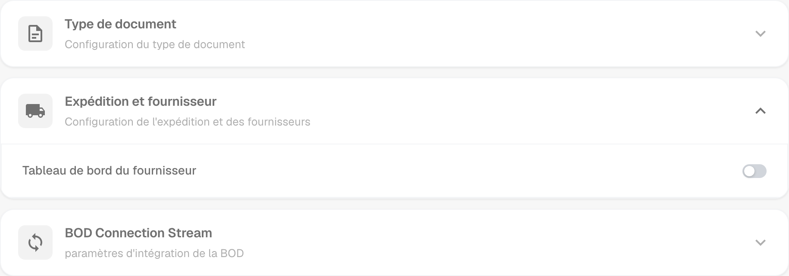
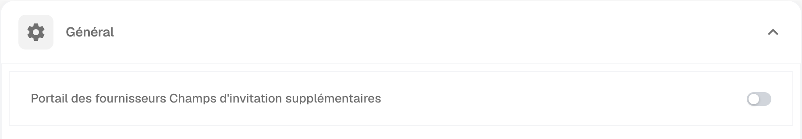
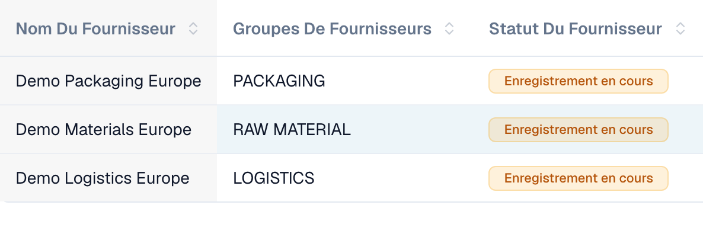
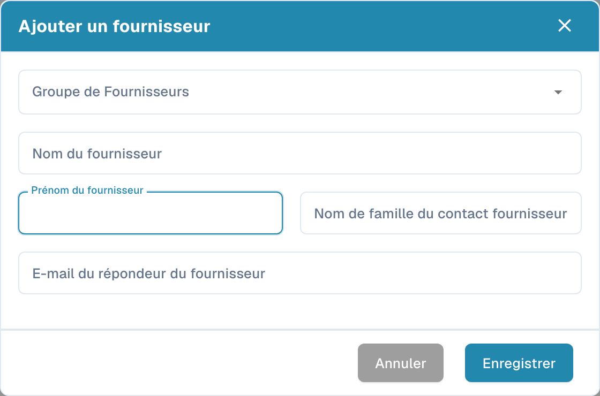

# Portail fournisseurs

Le **portail fournisseurs** permet à un administrateur de donner aux fournisseurs de son entreprise un accès à **DocBits**. L’administrateur active le portail et définit quels fournisseurs peuvent l’utiliser et quelles informations ils peuvent consulter.

Un fournisseur invité s’inscrit puis se connecte avec son propre compte. Il peut consulter les informations mises à sa disposition, par exemple le statut de ses commandes d’achat et de ses factures. Les fonctions disponibles dépendent de la configuration de l’organisation.

## Vidéo : préparer le portail fournisseurs et les accès

Un administrateur présente l’option du portail, le choix du forfait, la préparation d’une invitation et l’entrée dans l’inscription. Activation, envoi, inscription et approbation sont expliqués comme des étapes distinctes.



[Ouvrir la vidéo avec sous-titres français et sélection des chapitres](https://docbits-videos.fra1.cdn.digitaloceanspaces.com/settings-assistant/supplier-portal-access-admin/v1/fr.html)

## Admin : activer le portail

1. Dans les paramètres, ouvrez les modules puis la rubrique **Intégration de documents**.
2. Développez **Expédition et fournisseur** et activez **Tableau de bord du fournisseur**.
3. Si une fenêtre d’activation apparaît, vérifiez l’offre affichée et confirmez l’activation souhaitée.

<figure><figcaption>
Option du portail dans le module d’expédition et de fournisseurs. Cet interrupteur active la fonction pour l’organisation.
</figcaption></figure>

## Admin : configurer le portail

Configurez le portail de votre organisation avant d’envoyer les premières invitations :

- [Paramètres généraux des fournisseurs](../../settings/supplier-setting/supplier-general-settings.md): Champs supplémentaires d’invitation, statuts, logo et informations de confidentialité.
- [Modèles d’e-mail](../../settings/supplier-setting/editing-email-templates.md): Contenu et présentation des messages d’invitation.
- [Mise en page fournisseur](../../settings/supplier-setting/supplier-layout.md): Champs d’inscription des fournisseurs et de gestion interne. Sélectionnez le type de mise en page approprié.
- [Autorisations des fournisseurs](../../settings/supplier-setting/supplier-permissions.md): Affectation des collaborateurs internes aux groupes de fournisseurs. Ces responsabilités internes sont distinctes de l’accès personnel du fournisseur au portail.

<figure><figcaption>
Paramètres généraux des fournisseurs avec l’option de champs supplémentaires d’invitation.
</figcaption></figure>

## Admin : inviter les fournisseurs

Ouvrez la gestion des fournisseurs. Avant toute invitation, vérifiez l’entreprise, le groupe, le contact et l’adresse e-mail. Lors de la création d’un fournisseur, l’enregistrement demande l’envoi de l’invitation à s’inscrire ; il ne conserve pas simplement un brouillon. Pour un fournisseur existant, utilisez l’action d’invitation correspondante. Une confirmation d’envoi ne prouve ni la réception du message ni la fin de l’inscription.

<figure><figcaption>
Gestion interne de trois entreprises fictives. Les trois fournisseurs n’ont pas encore terminé leur inscription.
</figcaption></figure>

<figure><figcaption>
Formulaire de création et d’invitation d’un fournisseur. Vérifiez l’entreprise, le contact et l’adresse e-mail avant l’enregistrement.
</figcaption></figure>

## Fournisseur : s’inscrire et accéder à DocBits

Le fournisseur ouvre son invitation, crée ou utilise le compte personnel prévu et suit les étapes d’inscription configurées. Il peut ensuite consulter les informations mises à sa disposition dans DocBits. Le déroulement exact et les fonctions disponibles dépendent de l’organisation.

[Guide d’inscription des fournisseurs](supplier-registration.md).

## Comprendre les accès et les statuts

L’activation du portail, l’envoi d’une invitation, la fin de l’inscription et l’approbation sont des états distincts. Une fiche fournisseur ou des données de référence enregistrées ne prouvent pas que l’accès au portail est prêt. La vue fournisseur dépend des autorisations attribuées et diffère de la vue interne de l’administrateur.
