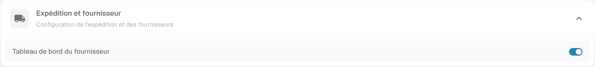
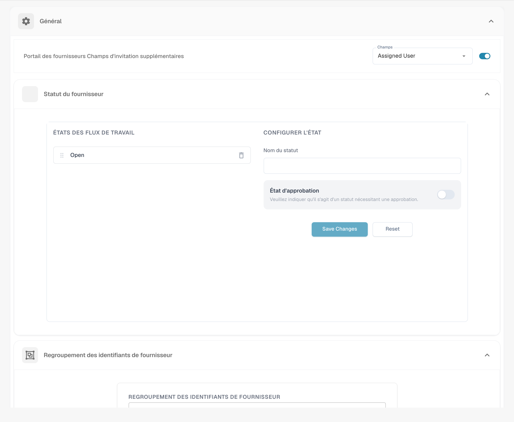
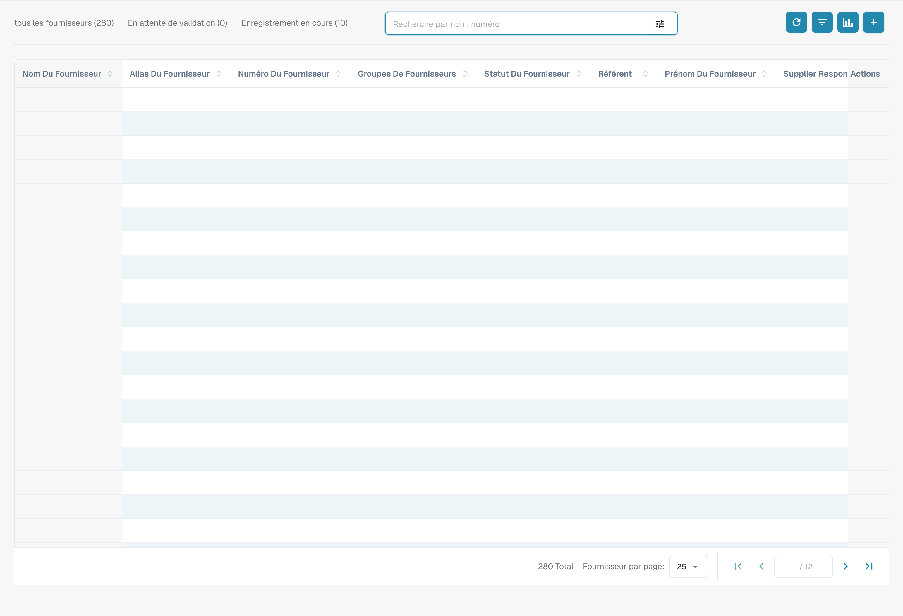
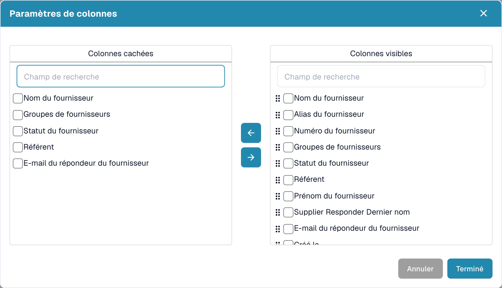

# Tableau de bord du fournisseur

## Présentation

Le portail permet de gérer l’inscription et l’accès des fournisseurs. Les informations et les actions proposées dépendent des autorisations, du modèle de portail et de l’intégration de votre organisation. Créer un enregistrement ne donne pas automatiquement accès à tous les documents de DocBits.

## Accéder à la fonction

Dans **Paramètres → Module → Intégration de documents**, examinez **Expédition et fournisseur** et **Tableau de bord du fournisseur**. Ne modifiez l’option que si votre organisation doit l’utiliser et dispose des droits nécessaires. Les images montrent l’état existant, sans activation réalisée pendant cette vérification.

<figure><figcaption>
Modules d’intégration de documents dans la version illustrée. Repérez Expédition et fournisseur pour le portail ; aucun module ni abonnement n’a été activé pendant cette vérification.
</figcaption></figure>

<figure><figcaption>
Expédition et fournisseur avec Tableau de bord du fournisseur dans son état existant. Aucun interrupteur n’a été modifié.
</figcaption></figure>

## Réglages du fournisseur

Dans la section fournisseurs des paramètres, **Général** permet d’examiner les champs supplémentaires de l’invitation, les statuts et le regroupement des identifiants. Les noms de statuts configurés, par exemple **Open**, peuvent appartenir au flux de votre organisation.

<figure><figcaption>
Réglages Général du fournisseur : champs d’invitation, statuts et regroupement des identifiants. Assigned User, Save Changes et Reset sont les libellés anglais encore affichés. Aucune invitation ni modification enregistrée.
</figcaption></figure>

Consultez les guides propres à chaque zone :

* [Paramètres généraux du fournisseur](../../settings/supplier-setting/supplier-general-settings.md) : réglages du portail et références aux éléments légaux et à l’identité visuelle.
* [Modèles de courriel](../../settings/supplier-setting/editing-email-templates.md) : contenu des invitations.
* [Mise en page du fournisseur](../../settings/supplier-setting/supplier-layout.md) : informations demandées à l’inscription.
* [Configuration d’exportation](../../settings/supplier-setting/export-configuration-for-supplier-portal-for-m3.md) : intégration et correspondances pour Infor M3.
* [Autorisations des fournisseurs](../../settings/supplier-setting/supplier-permissions.md) : accès et groupes.

L’[index des paramètres du fournisseur](../../settings/supplier-setting/) regroupe ces guides. L’illustration de Général ne montre ni exportation ni invitation envoyée.

## Vidéo : rechercher un fournisseur et mettre à jour ses données

Cette vidéo en français montre comment rechercher un fournisseur fictif, ouvrir ses détails, modifier sa ville et son code postal, puis vérifier l’enregistrement après avoir rechargé la page.


Démonstration en français avec un administrateur synthétique et l’interface de test réelle de DocBits.


[Ouvrir la vidéo avec les sous-titres français et la transcription](https://docbits-videos.fra1.cdn.digitaloceanspaces.com/settings-assistant/supplier-management-admin/v1/fr.html).

L’exemple utilise une mise en page configurée avec les champs **Nom du fournisseur**, **Ville** et **Code postal**. Les valeurs **Köln** et **50667** sont visibles à l’écran ; les champs disponibles dépendent de la configuration de votre organisation. **Enregistrer** met à jour les données de base sans approuver le fournisseur ni envoyer d’invitation. Le message de confirmation de l’interface présentée reste actuellement en anglais.

## Tableau de bord 

Ouvrez le tableau depuis la navigation fournisseurs. La liste montre les enregistrements accessibles à votre utilisateur ; les compteurs et la disposition appartiennent à l’environnement illustré.

<figure><figcaption>
Tableau des fournisseurs avec les données des lignes masquées. Les compteurs concernent l’environnement de test. Le libellé de nom de contact Supplier Responder Dernier nom reste partiellement anglais.
</figcaption></figure>

## Filtrer les fournisseurs

Utilisez **Recherche par nom, numéro**, le contrôle des critères et les catégories **tous les fournisseurs**, **En attente de validation** ou **Enregistrement en cours**. Examinez les critères actifs avant d’interpréter les résultats. La pagination détermine le nombre de lignes affichées.

## Comprendre les statuts

Les étapes d’inscription et d’approbation dépendent du flux configuré. Un statut d’inscription en attente n’est pas une approbation, et un statut unique ne démontre pas à lui seul l’étendue des accès. Vérifiez les contrôles et les permissions prévus par votre organisation.

## Outils du tableau

### Actualiser la liste 

La flèche circulaire recharge les données. Actualiser la liste n’envoie pas une invitation et ne modifie pas le statut d’un fournisseur.

### Configurer les colonnes 

Ouvrez la configuration de colonnes près de la recherche. Ce dialogue concerne les **fournisseurs**, pas les commandes. Les cases et flèches déplacent les champs entre **Colonnes cachées** et **Colonnes visibles**. Vous pouvez réorganiser les colonnes visibles ; **Terminé** confirme les changements et **Annuler** ferme sans confirmation. Examinez le périmètre de la préférence avant de l’enregistrer.

<figure><figcaption>
Paramètres de colonnes des fournisseurs, avec Colonnes cachées et Colonnes visibles. Supplier Responder Dernier nom est un libellé natif incorrect. Aucune sélection ni disposition n’a été enregistrée.
</figcaption></figure>

### Analyse 

Le bouton de graphique ouvre les informations d’échéance disponibles. Les périodes et compteurs dépendent des données de l’organisation ; ils ne représentent pas nécessairement une expiration de l’accès à DocBits. Vérifiez le filtre sélectionné pour comprendre la liste résultante.

## Créer un fournisseur et demander son inscription

1. Ouvrez **+** pour afficher **Ajouter un fournisseur**.
2. Vérifiez le groupe, le nom du fournisseur et les coordonnées de contact. Les champs supplémentaires dépendent de la configuration.
3. Avant **Enregistrer**, vérifiez le destinataire et l’autorisation d’envoyer une invitation. Cette action peut demander l’envoi du lien d’inscription ; ce n’est pas nécessairement un simple brouillon sans communication externe.
4. Examinez le résultat. Une demande acceptée ne garantit pas que le message a été remis au destinataire ; contrôlez la livraison en cas d’absence de réception.

<figure><figcaption>
Formulaire initial Ajouter un fournisseur, vide. Supplier Responder Dernier nom désigne le nom du contact. Enregistrer peut demander l’envoi du lien d’inscription ; aucun fournisseur ni courriel n’a été créé pour cette illustration.
</figcaption></figure>

Le champ natif **Supplier Responder Dernier nom** désigne le nom du contact ; son libellé reste incorrect. Le formulaire illustré est vide : aucun fournisseur n’a été créé et aucun courriel n’a été envoyé pendant la prise de vue.

## Inviter un fournisseur existant

Repérez le bon enregistrement et l’action **Magic Link**, si elle est disponible pour votre rôle et son statut. Vérifiez les coordonnées avant de confirmer **Envoyer**. Cette opération demande un courriel d’inscription ; elle n’a pas été exécutée pour cette documentation.

## Inscription du fournisseur

Après réception d’une invitation valide, le fournisseur suit le lien et complète les informations et étapes demandées. Consultez le [processus d’inscription](supplier-registration.md). L’accès final dépend des autorisations et des approbations configurées.
