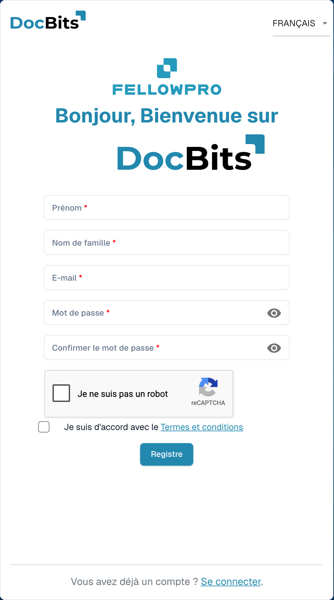

# Inscription des fournisseurs

Ce guide s’adresse aux fournisseurs invités au portail DocBits d’une organisation. Utilisez le lien de votre invitation. Vous disposez de votre propre compte fournisseur ; l’organisation qui vous invite détermine les informations accessibles et les étapes d’inscription requises.

## 1. Ouvrir l’invitation

Vérifiez l’organisation à l’origine de l’invitation et l’adresse e-mail du destinataire. Ouvrez le lien d’inscription de cette invitation. Si le lien a expiré ou concerne une autre personne, demandez une nouvelle invitation à l’organisation.

## 2. Créer son accès personnel

Vérifiez les noms et l’adresse e-mail préremplis. Saisissez les données de compte demandées et respectez les règles de mot de passe affichées. Lisez les conditions et les informations de confidentialité. Terminez la création du compte avec la commande d’inscription. Un compte existant et une nouvelle inscription sont deux cas différents ; suivez le parcours prévu pour votre invitation.

<figure><figcaption>
Formulaire d’inscription au compte fournisseur. Cet exemple est vide ; une invitation peut préremplir certaines informations.
</figcaption></figure>

## 3. Compléter les informations fournisseur

Renseignez les données et, le cas échéant, les justificatifs demandés. Les champs et sections dépendent de la mise en page configurée par l’organisation. Les indications et messages de validation précisent les données obligatoires. Enregistrez votre progression si cette option est proposée ; cet enregistrement ne constitue pas automatiquement l’envoi final.

## 4. Vérifier l’inscription et l’approbation

Transmettez vos informations avec la commande de finalisation prévue. Si une vérification ou une approbation est configurée, attendez son résultat. Connectez-vous ensuite avec votre propre compte. L’organisation détermine les commandes, factures et autres informations que vous pouvez consulter.

## En cas de problème d’accès

Contactez l’organisation qui vous invite si le lien est invalide, si des autorisations manquent ou si les données obligatoires sont ambiguës. Une fiche fournisseur interne ne remplace ni votre inscription ni l’approbation d’accès nécessaire.

[Configuration du portail fournisseurs](README.md).

[Vidéo : préparer l’accès au portail et l’inscription – avec sous-titres français](https://docbits-videos.fra1.cdn.digitaloceanspaces.com/settings-assistant/supplier-portal-access-admin/v1/fr.html)
