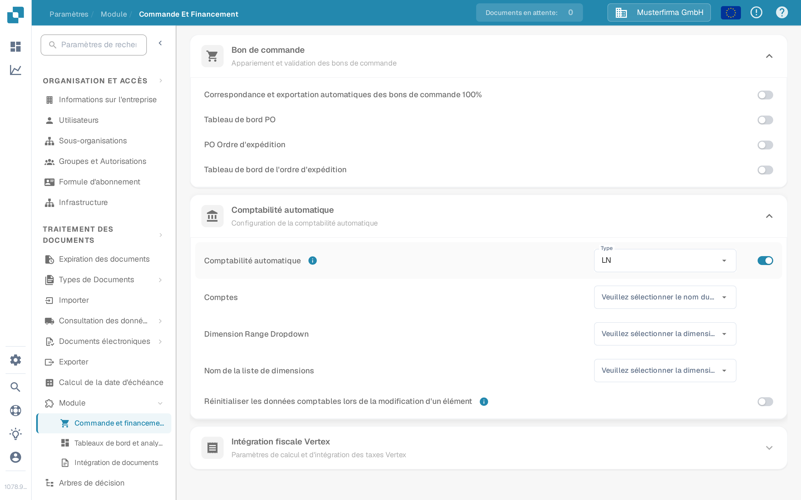

# Tester la comptabilité automatique

Auto Accounting nécessite un module activé, des données comptables maîtresses et une facture avec des montants ou des lignes utilisables. Ce guide sépare les paramètres que vous pouvez vérifier avant d'ouvrir une facture des contrôles qui nécessitent une connexion LN ou M3 configurée.

## Vérifier les paramètres du module

1. Ouvrez **Paramètres → Module → Commande et financement** et développez **Comptabilité automatique**. L'ancien chemin **Document Processing → Module → Purchase Order / Auto Accounting** n'est plus le chemin affiché dans l'application actuelle.
2. Choisissez le **Type** correspondant à votre système connecté (**LN** ou **M3**). Activez **Comptabilité automatique** uniquement lorsque les données maîtresses requises et la connexion sont prêtes.
3. Une fois activé, sélectionnez la liste **Comptes** et les listes de dimensions appropriées à votre système. Pour LN, les champs visibles incluent **Dimension Range Dropdown** et **Nom de la liste de dimensions**. M3 propose d'autres champs. N'utilisez **Réinitialiser les données comptables lors de la modification d'un élément** que si un recalcul après la modification d'un élément est souhaité.

<figure><figcaption>
La comptabilité automatique est désactivée dans l'organisation de test Sandbox.
</figcaption></figure>

<figure><figcaption>
Les champs affichés lorsque le paramètre est activé. Il a été désactivé à nouveau après cette capture ; aucun compte ni dimension n'a été configuré.
</figcaption></figure>

## Tester avec une facture configurée

Utilisez une facture dont les lignes et les données comptables maîtresses sont disponibles. Ouvrez-la dans l'[Écran de validation](../../../../end-user-and-partner-section/end-user-section/validation-screen/README.md) et sélectionnez **Auto Accounting**. Si l'action est absente, vérifiez le paramètre du module et si cette facture est éligible. Validez la facture avant de naviguer ; l'application enregistre et valide lorsque l'action est sélectionnée.

Sur l'écran de comptabilisation, vérifiez les points suivants avec vos propres données LN ou M3 :

1. Exécutez **Validate Setup** lorsque disponible et corrigez toute configuration de compte ou de dimension manquante avant de continuer. Un résultat vert décrit uniquement les contrôles de votre environnement.
2. Vérifiez si la facture doit être attribuée par son **montant total** ou par **chaque ligne individuelle**. Comparez les montants comptabilisés avec la facture d'origine.
3. Si vous répartissez un montant, sélectionnez le compte prévu pour chaque ligne de répartition. Saisissez des montants ou des pourcentages et vérifiez que les valeurs allouées totalisent le montant parent. Ajoutez ou supprimez une ligne uniquement lorsque cela est nécessaire.
4. Vérifiez tout **Unsettled amount** ou avertissement de validation et corrigez-le avant d'enregistrer ou d'exporter. Confirmez le résultat dans le système connecté séparément.

L'organisation de test Sandbox utilisée pour les captures d'écran ci-dessus n'a aucun compte configuré, aucune liste de dimensions ni aucune ligne de facture pour ce flux. L'écran de comptabilisation, la répartition et l'export n'ont donc **pas été testés ni illustrés ici**. N'utilisez pas les captures d'écran des paramètres comme preuve que la comptabilisation ou l'export a réussi.

Pour la configuration propre à chaque système, continuez avec le [guide LN](ln.md) ou le [guide M3](m3.md).
