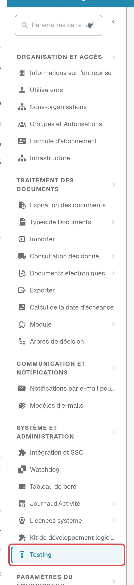
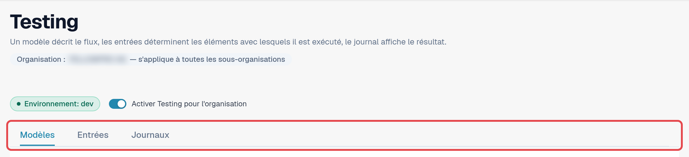
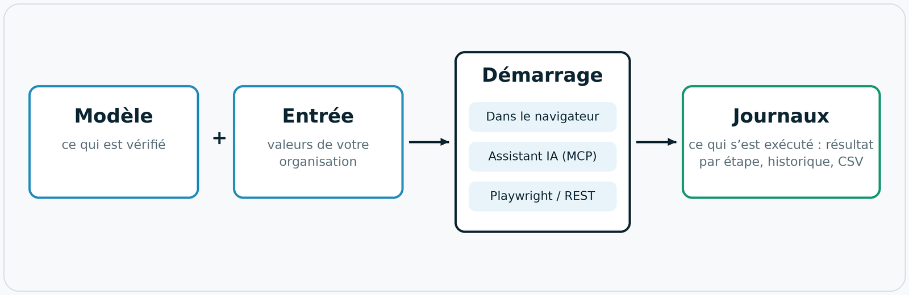
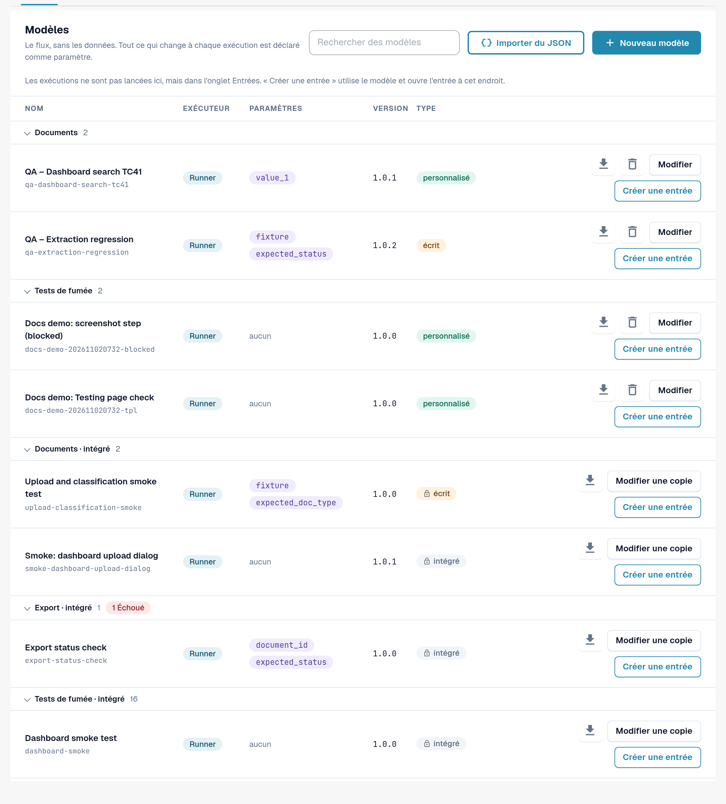

# Module Testing

## Tutoriel vidéo : exécuter un premier test dans le navigateur



[Ouvrir la vidéo en français avec sous-titres, chapitres et transcription](https://docbits-videos.fra1.cdn.digitaloceanspaces.com/settings-assistant/testing-module-overview-preview-admin/v1/fr.html).

**Durée: 2:33.** Interface, narration et sous-titres en français.

Le tutoriel utilise le **Live testing self-check** intégré dans l’environnement de développement : examiner ses trois étapes, créer et enregistrer une entrée nommée, lancer le test dans le navigateur, puis ouvrir le journal enregistré de cette même exécution. Le modèle ne demande aucun paramètre et ne modifie aucune donnée métier. Sa réussite confirme ces trois contrôles ; elle ne valide ni l’extraction des factures, ni leur approbation, ni un export ERP.

**Version de révision :** l’écoute humaine complète et la validation fonctionnelle restent à effectuer.


**Vérifiez le résultat enregistré.** Dans les enregistrements anglais et allemand de la version 11.21.2, l’indicateur d’une entrée affichait un blocage alors que l’exécution et son journal enregistré indiquaient une réussite. Rouvrir l’entrée rétablissait l’indicateur correspondant. En cas d’écart, consultez le journal de cette même exécution. La réouverture est un contournement observé, pas une correction confirmée.


## À quoi sert le module Testing

Le module **Testing** exécute des tests de navigateur dans votre propre session DocBits connectée. Un test pilote les
vrais écrans plutôt qu'une maquette : il ouvre le tableau de bord, téléverse un exemple de facture, vérifie qu'un
nouveau document arrive en validation ou confirme qu'une exportation signale le statut attendu. Il vérifie que DocBits se
comporte correctement **dans votre organisation** et enregistre le résultat de chaque étape.

Vous trouvez le module sous **Paramètres → Testing**. Il s'adresse aux administrateurs qui gèrent les suites de tests
d'une organisation.

Utilisez-le lorsque vous souhaitez :

* confirmer que tout fonctionne encore après une version, une modification de configuration ou une importation de paramètres ;
* répéter le même contrôle de recette pour plusieurs organisations lors d'un déploiement ;
* donner à l'assurance qualité une liste de contrôles que chacun peut lancer et dont chacun peut lire les résultats ;
* laisser votre automatisation de tests ou un assistant IA lancer les mêmes contrôles et en lire les résultats.

## Qui peut l'utiliser

Le module est disponible pour les **administrateurs de l'organisation** (voir [Privilèges d'administration](../../../settings/global-settings/groups-users-and-permissions/users/admin-privileges.md)).
Il est désactivé pour toutes les organisations tant qu'un administrateur de l'organisation ne l'a pas activé.

1. Ouvrez **Paramètres**. Dans la barre latérale, sous **Système et administration**, sélectionnez **Testing**.
2. Activez **Activer Testing pour l'organisation**.

<figure><figcaption>
Barre latérale des paramètres avec l'entrée Testing mise en évidence.
</figcaption></figure>

<figure><figcaption>
En-tête de la page Testing avec le badge d'environnement, l'interrupteur et les trois onglets.
</figcaption></figure>

Sous le titre, **Organisation : … — s'applique à toutes les sous-organisations** indique l'organisation pour laquelle cette page fonctionne. Ce que vous configurez ici s'applique à cette organisation et à toutes ses sous-organisations.

Tant que l'interrupteur est désactivé, la page affiche uniquement *Testing est désactivé. Rien ne s'exécute tant qu'un administrateur de l'organisation ne l'active pas.* Le désactiver de nouveau met également fin à tous les onglets de navigateur qui étaient enregistrés pour des démarrages depuis l'extérieur.

Le badge **Environnement** indique où vous vous trouvez. Dans un environnement client (sandbox ou production), il est rouge,
et DocBits applique une protection supplémentaire : les tests qui modifient des données nécessitent une confirmation explicite, et les
étapes d'exportation, de suppression ou d'approbation sont bloquées tant que le modèle ne déclare pas qu'il écrit des données.

## Fonctionnement : modèle, entrée, démarrage, journal

La page comporte trois onglets : **Modèles**, **Entrées** et **Journaux**. Un modèle décrit le déroulement, une entrée détermine
avec quoi il s'exécute, et le journal affiche le résultat.

<figure><figcaption>
Schéma : modèle plus entrée donne un test ; il est lancé dans le navigateur, par un assistant IA ou depuis l'extérieur ; chaque exécution se termine dans les journaux.
</figcaption></figure>

| Élément | Onglet | De quoi s'agit-il |
|---|---|---|
| **Modèle** | **Modèles** | Une définition de test réutilisable : *ce qui* est vérifié, étape par étape. Elle ne contient aucune donnée de votre organisation. Tout ce qui change d'une organisation à l'autre est un **paramètre**. |
| **Entrée** | **Entrées** | Les valeurs enregistrées par votre organisation pour les paramètres d'un modèle, par exemple le document à ouvrir. **Modèle + entrée = un test que vous pouvez démarrer.** |
| **Démarrage** | **Entrées** | Le module exécute et pilote le test. Il existe trois façons équivalentes de le démarrer : dans le navigateur, depuis un assistant IA via MCP, ou depuis l'extérieur avec Playwright ou un appel REST. |
| **Journal** | **Journaux** | Ce qui s'est réellement exécuté, quelle que soit la façon dont il a été démarré : le résultat, chaque étape, les paramètres utilisés. Un graphique d'historique montre les résultats dans le temps ; vous pouvez exporter les journaux en CSV. |

DocBits fournit des **modèles par défaut** (leurs ID commencent par `default-smoke-`) et quelques modèles intégrés. Ils sont
identiques pour toutes les organisations et ne peuvent être ni modifiés ni supprimés. Un modèle par défaut peut s'exécuter dans n'importe quelle organisation ; l'entrée
fournit ce qui est propre à la vôtre. Vous pouvez aussi créer vos propres modèles et les supprimer à nouveau.

## Démarrage rapide : exécuter un test par défaut

1. Ouvrez **Paramètres → Testing**, onglet **Modèles**.
2. Dans le groupe **Tests de fumée**, repérez un modèle par défaut sans paramètres (la colonne **Paramètres** affiche *aucun*), par exemple *Default smoke: log metrics*.
3. Sélectionnez **Créer une entrée**. L'onglet **Entrées** s'ouvre avec une nouvelle entrée pour ce modèle.
4. Saisissez un **Nom de l'entrée** et sélectionnez **Enregistrer l'entrée**.
5. Sélectionnez **Démarrer**. Le test s'exécute dans cet onglet du navigateur ; ne rechargez pas et ne fermez pas l'onglet pendant l'exécution.
6. Ouvrez l'onglet **Journaux**. La ligne la plus récente affiche le résultat : **Réussi**, **Échoué** ou **Bloqué**.

<figure><figcaption>
Onglet Modèles avec le groupe Tests de fumée.
</figcaption></figure>

Pour aller plus loin :

* [Modèles](templates.md) : modèles par défaut, vos propres modèles, importation et suppression
* [Étapes et blocs prêts à l'emploi](steps-and-blocks.md) : groupes d'étapes, paramètres avancés, nettoyage, valeurs mémorisées
* [Sélectionner un élément dans l'application](pick-in-app.md) : choisir un élément en le désignant
* [Rechargement et reprise](reload-and-resume.md) : recharger la page au milieu d'un test
* [Entrées](inputs.md) : enregistrer les valeurs de votre organisation
* [Démarrer un test](start-a-test.md) : dans le navigateur, depuis un assistant IA ou depuis Playwright
* [Journaux et historique](logs.md) : résultats, graphique et export CSV
* [Dépannage](troubleshooting.md)
* [Pour les développeurs](for-developers.md)
