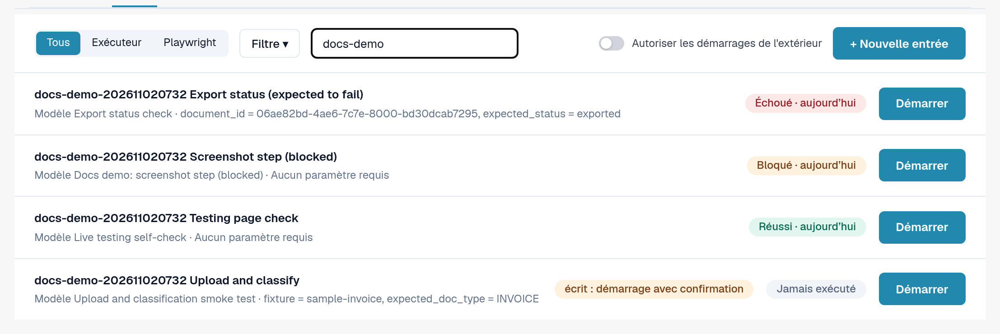
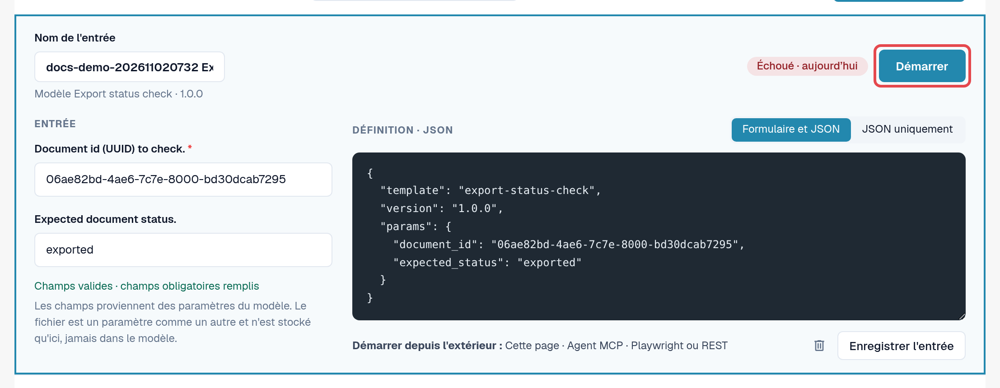
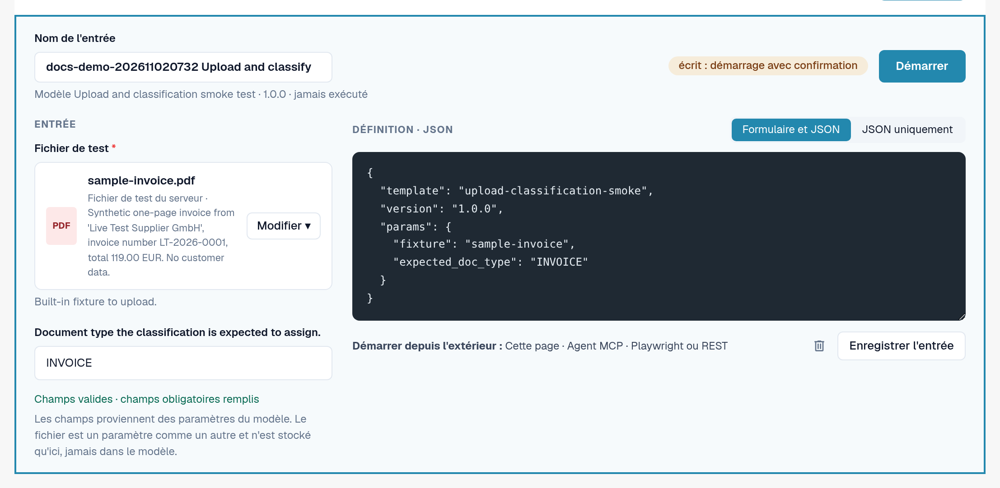

# Entrées

Une entrée enregistre **les valeurs de votre organisation** pour les paramètres d'un modèle, sous un nom de votre choix.
Un modèle plus une entrée forment un test que vous pouvez démarrer encore et encore, à la main ou automatiquement.

Exemple : le modèle par défaut *Default smoke: validation contract* ouvre un document et vérifie son statut et son
type de document. Il a besoin d'un ID de document. Votre entrée *Facture LT-2026-0001 prête pour la validation* enregistre l'ID d'un
document de votre organisation et le statut que vous attendez.

Ouvrez **Paramètres → Testing**, onglet **Entrées**.

<figure><figcaption>
Onglet Entrées avec les entrées enregistrées et leurs derniers résultats.
</figcaption></figure>

Chaque ligne affiche le nom de l'entrée, son modèle et sa version, le dernier résultat et **Démarrer**. **Mise à jour disponible**
signifie que le modèle a une version plus récente que celle pour laquelle cette entrée a été enregistrée. Une pastille **écrit : démarrage avec confirmation**
signale les entrées dont le modèle modifie des données.

## Créer une entrée

1. Dans l'onglet **Modèles**, sélectionnez **Créer une entrée** sur le modèle. (Ou, dans l'onglet **Entrées**, sélectionnez
   **+ Nouvelle entrée** et choisissez le modèle.)
2. Saisissez un **Nom de l'entrée**, par exemple l'objet et l'organisation.
3. Renseignez les paramètres. Les champs obligatoires sont marqués d'un astérisque. Vous pouvez passer de **Formulaire et JSON**
   à **JSON uniquement** ; les deux restent synchronisés.
4. Vérifiez la ligne sous le formulaire : *Champs valides · champs obligatoires remplis* signifie que l'entrée peut être démarrée.
5. Sélectionnez **Enregistrer l'entrée**.

<figure><figcaption>
Éditeur d'entrée avec nom, paramètres et ligne de validité.
</figcaption></figure>

### Fichiers comme paramètres

Certains modèles téléversent un document. Leur paramètre de fichier propose des **Fichiers d'organisation** (PDF, PNG ou JPEG jusqu'à 10 Mo
que votre organisation a téléversés pour les tests) et des **Fichiers de test du serveur** (fichiers de test synthétiques fournis par DocBits).
Le fichier est stocké dans votre organisation, jamais dans le modèle.

<figure><figcaption>
Paramètre de fichier avec fichiers d'organisation et fichiers de test du serveur.
</figcaption></figure>

### Valeurs qui ne sont jamais enregistrées

Les paramètres marqués comme confidentiels (par exemple un mot de passe pour un système externe) ne sont jamais stockés. L'entrée
retient seulement que la valeur est nécessaire ; vous la saisissez à chaque démarrage (*Envoyé uniquement au démarrage ; jamais enregistré.*).
Les journaux affichent ces valeurs sous la forme *Fourni au démarrage*.

## Modifier ou supprimer une entrée

Ouvrez l'entrée depuis la liste, modifiez-la et sélectionnez **Enregistrer l'entrée**. Pour la supprimer, sélectionnez l'icône de corbeille dans
l'éditeur et confirmez. La suppression d'une entrée ne supprime pas ses journaux.


Si votre organisation gère des **cas de test**, le lien **Cas de test** du menu de filtre de l'onglet Entrées liste leurs
cas et indique lesquels ont un modèle. Un cas sans modèle peut être confirmé manuellement par une personne autorisée.

