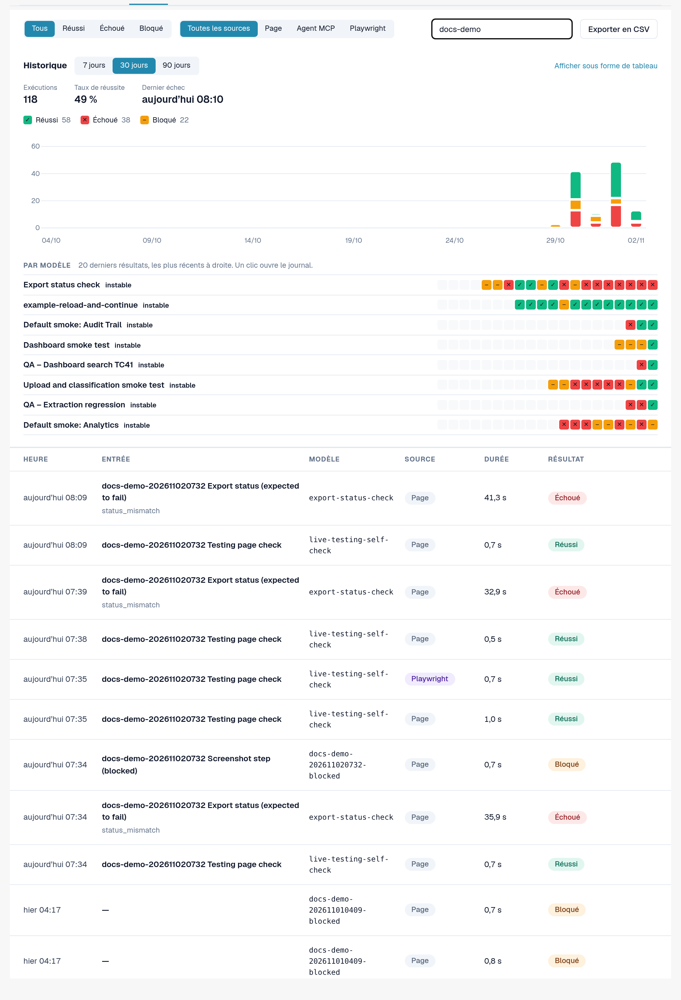
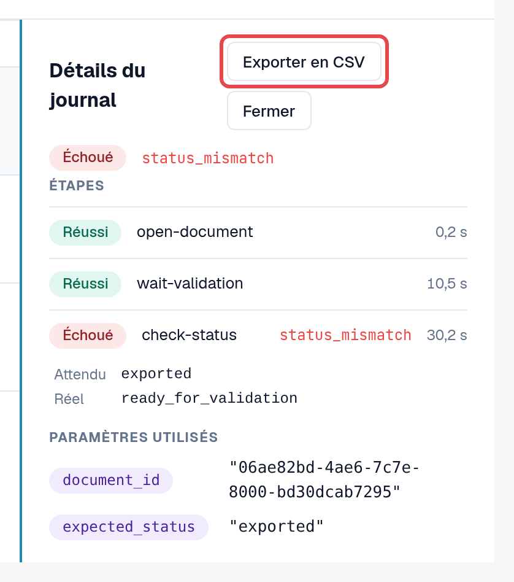
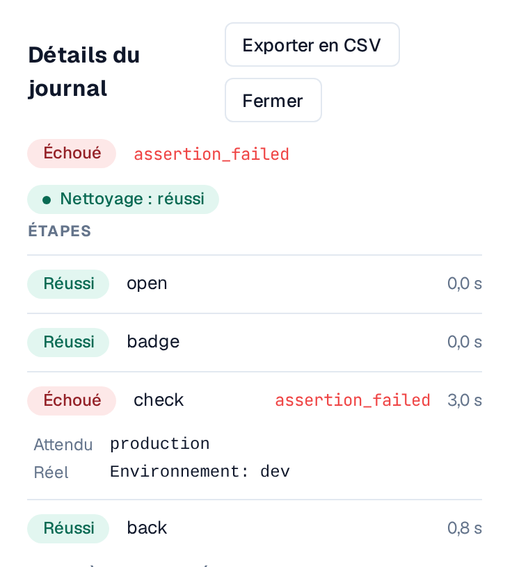
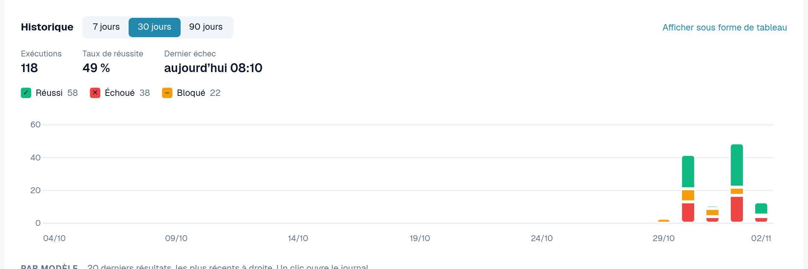
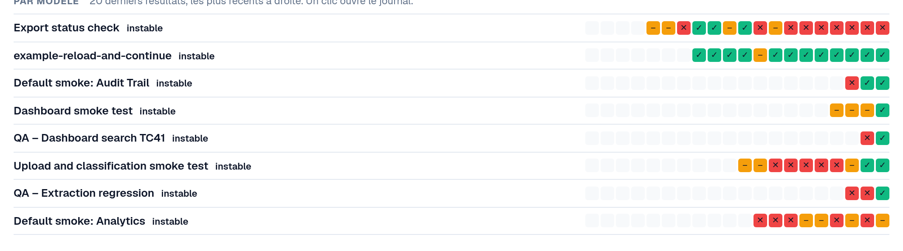
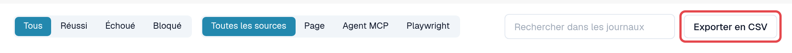

# Journaux et historique

Chaque exécution, quelle que soit la façon dont elle a été démarrée, aboutit dans l'onglet **Journaux** : le résultat, les étapes, le code d'erreur d'une
étape en échec et les paramètres utilisés. Les journaux ne stockent ni contenu de page ni capture d'écran.

Ouvrez **Paramètres → Testing**, onglet **Journaux**.

<figure><figcaption>
Onglet Journaux avec des résultats et des sources variés.
</figcaption></figure>

## Lire la liste

| Colonne | Signification |
|---|---|
| **Heure** | Le moment où l'exécution a démarré. |
| **Entrée** | L'entrée qui a été démarrée (ou le cas du plan de test). |
| **Modèle** | L'ID du modèle. |
| **Source** | **Page** (démarré dans le navigateur), **Agent MCP**, **Playwright**, **Manuel** (un cas confirmé à la main). |
| **Durée** | La durée de l'exécution. |
| **Résultat** | **Réussi** : toutes les étapes ont réussi. **Échoué** : une étape a échoué. **Bloqué** : l'exécution n'a pas pu être évaluée, par exemple parce que des étapes ont été ignorées ; une exécution composée uniquement d'étapes ignorées n'est jamais affichée comme réussie. |

Filtrez avec **Tous / Réussi / Échoué / Bloqué**, avec **Toutes les sources / Page / Agent MCP / Playwright**, ou avec
**Rechercher dans les journaux**.

## Ouvrir un journal

Sélectionnez une ligne. **Détails du journal** affiche chaque étape avec son résultat, le code d'erreur d'une étape en échec et les
**Paramètres utilisés** (les valeurs confidentielles uniquement sous la forme *Fourni au démarrage*). **Ouvrir le cas** mène au cas du plan de test, s'il
en existe un.

<figure><figcaption>
Détails du journal d'une exécution échouée.
</figcaption></figure>

### Valeur attendue et valeur réelle

Sous une vérification en échec, **Détails du journal** affiche ce que la vérification attendait et ce qu'elle a trouvé :

* **Attendu** : la valeur que le modèle demande.
* **Réel** : la valeur qui se trouvait sur la page.

Les deux n'apparaissent que dans les **environnements de développement et de test**, sont tronquées à 120 caractères et sont omises lorsque
l'étape utilise une valeur confidentielle. Dans un environnement client (sandbox, production), le journal ne conserve que le code d'erreur.

### Nettoyage

Si le modèle comporte des [étapes de nettoyage](steps-and-blocks.md), la pastille à côté du résultat indique comment elles se sont terminées :
**Nettoyage : réussi**, **Nettoyage : échoué** ou **Nettoyage : ignoré** (par exemple parce que l'exécution a été arrêtée). Les étapes de nettoyage
s'exécutent même après une vérification en échec. Un nettoyage en échec ne modifie pas le résultat de l'exécution, mais des données de test, par exemple un
document téléversé, peuvent subsister. Ouvrez le journal pour voir quelle étape de nettoyage a échoué.

<figure><figcaption>
Détails du journal : la vérification en échec avec Attendu et Réel, et la pastille Nettoyage : réussi.
</figcaption></figure>

## Graphique d'historique

Au-dessus de la liste, **Historique** montre l'évolution des tests dans le temps. Basculez entre **Afficher sous forme de graphique** et **Afficher sous forme de tableau**.

* **Résultats par jour** : combien d'exécutions ont réussi, échoué ou ont été bloquées chaque jour, dans votre fuseau horaire. Choisissez la
  **Période** (7 à 90 jours, 30 par défaut). Sélectionnez un jour pour y filtrer la liste ; **Afficher à nouveau tous les jours** supprime le filtre.
* Le **Taux de réussite** et le **Dernier échec** résument la période. Les exécutions encore en cours comptent comme *sans résultat pour l'instant*.
* **Par modèle** : les 20 derniers résultats de chaque modèle, le plus récent à droite, avec une étiquette : **stable** (uniquement
  réussis), **instable** (résultats mixtes) ou **en échec** (uniquement échoués ou bloqués). Sélectionnez un résultat pour ouvrir son journal.
  Les modèles instables sont listés en premier.

<figure><figcaption>
Historique : résultats par jour.
</figcaption></figure>

<figure><figcaption>
Par modèle : 20 derniers résultats et stabilité.
</figcaption></figure>

## Exporter en CSV

Sélectionnez **Exporter en CSV** dans la barre d'outils pour télécharger les journaux correspondant au résultat et à la source sélectionnés (5 000 au maximum ;
le texte de recherche n'est pas appliqué). Dans **Détails du journal**, **Exporter en CSV** télécharge un seul journal avec toutes ses étapes.

Le fichier s'ouvre directement dans Excel (UTF-8). Les heures sont en UTC. Il contient les mêmes informations que la page : aucune valeur
confidentielle, aucun contenu de page.

<figure><figcaption>
Exporter en CSV dans la barre d'outils des journaux.
</figcaption></figure>
