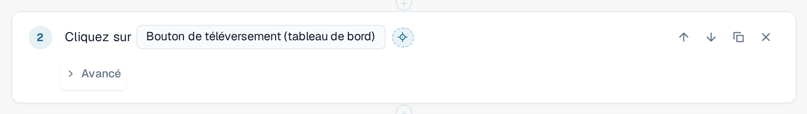
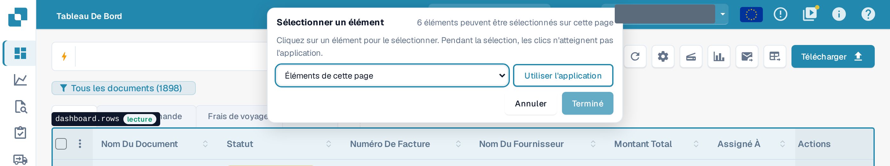
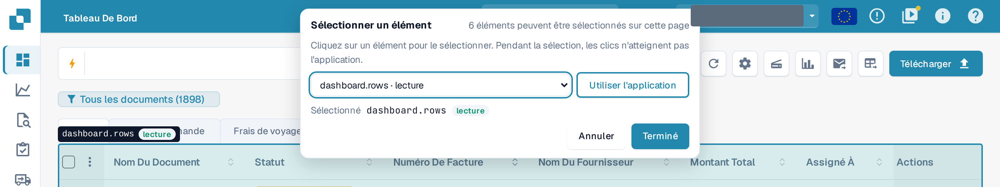
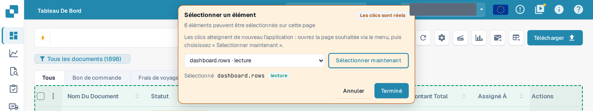

# Sélectionner un élément dans l'application

Chaque étape doit savoir sur **quel élément** de la page elle agit : un bouton, un champ, un tableau. Plutôt que de le chercher
dans une longue liste, vous pouvez le désigner dans la véritable application.

## Sélectionner un élément

1. Dans l'éditeur de modèle, sélectionnez le bouton en forme de viseur **Sélectionner dans l'application** à côté de l'élément d'une étape.

<figure><figcaption>
Le bouton Sélectionner dans l'application à côté de l'élément d'une étape Cliquez
</figcaption></figure>

2. DocBits ouvre la page sur laquelle se trouve le test à cette étape : la page de l'étape **Ouvrir la page** précédente la plus proche.
   Si cette étape utilise une valeur d'entrée, DocBits demande quelle page ouvrir. Votre brouillon est conservé, non enregistré, et l'application
   reste dans cet onglet du navigateur.
3. Une barre **Sélectionner un élément** apparaît en haut. Elle indique combien d'éléments peuvent être sélectionnés sur cette page. Déplacez la
   souris sur la page : DocBits entoure l'élément situé sous le pointeur et le nomme, avec sa classe :
   **lecture** (lit uniquement), **modifie des données**, **irréversible** ou **inconnu**.

<figure><figcaption>
Survol de la liste des documents : le contour nomme l'élément dashboard.rows et sa classe lecture
</figcaption></figure>

4. Cliquez sur l'élément. La barre l'affiche sous **Sélectionné**. Vous pouvez aussi choisir un élément dans la liste
   **Éléments de cette page** de la barre, ce qui fonctionne au clavier et avec un lecteur d'écran.

<figure><figcaption>
La barre après un clic : dashboard.rows est sélectionné, Terminé est activé
</figcaption></figure>

5. Sélectionnez **Terminé**. L'éditeur se rouvre avec votre brouillon et l'élément dans l'étape. Sélectionnez **Annuler** pour revenir
   sans modification. Dans les deux cas, le brouillon reste non enregistré : sélectionnez **Enregistrer** dans l'éditeur lorsque vous en êtes satisfait.

Pendant la sélection, **l'application ne voit pas vos clics.** Sélectionner un bouton **Supprimer** ne supprime rien. Quittez le
sélecteur avec **Terminé** ou **Annuler** ; aucune touche (pas même Échap) ne le ferme. Le bouton est désactivé pendant qu'un test
s'exécute dans cet onglet.

## Sélectionner un tableau, une colonne ou une action de ligne

Les étapes du groupe **Tableau** (**Vérifier la ligne du tableau**, **Cliquer sur la ligne du tableau**, **Mémoriser la valeur** à partir d'une cellule de tableau) n'acceptent
que des tableaux. Cliquez sur une cellule du tableau : DocBits prend le tableau et propose la colonne de cette cellule ainsi que les autres
colonnes de la ligne comme suggestions pour les champs de colonne de l'étape. Pour **Cliquer sur la ligne du tableau**, cliquez sur le bouton
situé dans la ligne afin de retenir cette action de ligne. **Vérifier le nombre** accepte n'importe quel élément, y compris un tableau.

## Utiliser l'application pendant la sélection

L'élément dont vous avez besoin peut se trouver sur une autre page. Sélectionnez **Utiliser l'application**. La barre devient orange et affiche **Les clics sont
réels** : désormais, vos clics atteignent de nouveau l'application, ce qui vous permet d'ouvrir l'autre page par son menu habituel.
La barre reste affichée et sa liste suit la page. Sélectionnez **Sélectionner maintenant** pour sélectionner à nouveau.

<figure><figcaption>
Mode Utiliser l'application : les clics sont réels, Sélectionner maintenant revient à la sélection
</figcaption></figure>


En mode **Utiliser l'application**, un clic est un vrai clic : il peut enregistrer, supprimer ou envoyer des données dans votre organisation.
Revenez avec **Sélectionner maintenant** avant de cliquer sur quoi que ce soit que vous ne souhaitez pas faire.

