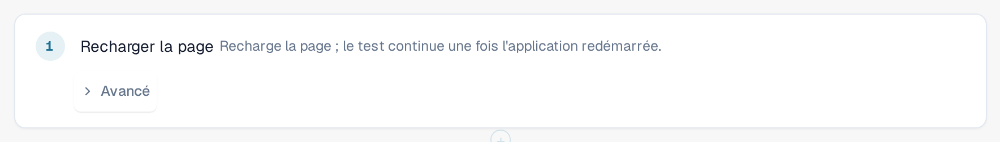

# Rechargement et reprise

Certaines choses ne peuvent être vérifiées qu'après un nouveau chargement de la page, par exemple qu'un paramètre est toujours présent
après un rechargement. L'étape **Recharger la page** recharge la page du navigateur au milieu d'un test, et le test se poursuit
ensuite.

## Ajouter une étape de rechargement

1. Dans l'éditeur de modèle, sélectionnez **+ Ajouter une étape**, puis le groupe **Page**, puis **Recharger la page**.
2. Placez l'étape à l'endroit où le rechargement doit avoir lieu. Les étapes qui suivent s'exécutent dans la page rechargée.

<figure><figcaption>
L'étape Recharger la page dans l'éditeur de modèle
</figcaption></figure>

## Ce qui se passe pendant une exécution

1. L'onglet enregistre la progression du test, puis recharge la page.
2. Pendant que l'application redémarre, un bandeau en haut indique **Page rechargée, le test continue**, suivi du
   nom du test. Ne fermez pas l'onglet.
3. La page rechargée reprend l'exécution et passe à l'étape suivante. Les étapes précédant le rechargement conservent leurs
   résultats, l'étape **Recharger la page** est affichée comme réussie, et le chronomètre du test continue de tourner pendant le rechargement.

<figure><figcaption>
Bandeau après un rechargement : Page rechargée, le test continue
</figcaption></figure>

Les valeurs mémorisées sont conservées pendant le rechargement, sauf celles que vous avez marquées comme secrètes (voir
[Étapes et blocs prêts à l'emploi](steps-and-blocks.md)). Veillez à ce qu'aucune étape située après le rechargement n'ait besoin d'une valeur secrète.

## Bon à savoir

* Seule cette étape recharge la page sans mettre fin au test. Si vous rechargez ou fermez vous-même l'onglet, l'exécution se termine
  avec le statut **Annulé**.
* La page doit revenir en deux minutes environ. Sinon, l'exécution se termine avec le statut **Annulé** ou **Non transmissible**.
* Un test peut contenir jusqu'à cinq étapes de rechargement.
* Le test se poursuit dans le même onglet du navigateur et avec le même utilisateur. Si le navigateur ne permet pas à l'onglet d'enregistrer la
  progression (par exemple parce que le stockage est bloqué), l'étape de rechargement échoue avant que la page ne soit rechargée.
* Le test nécessite le schema 1.3 du modèle, que l'éditeur définit lorsque vous ajoutez l'étape.
