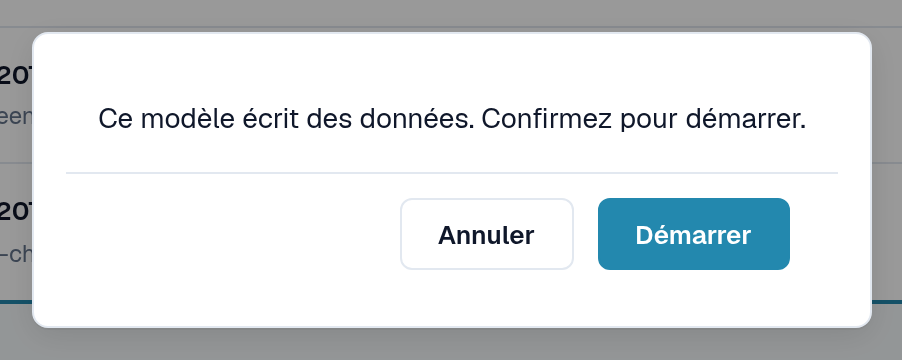
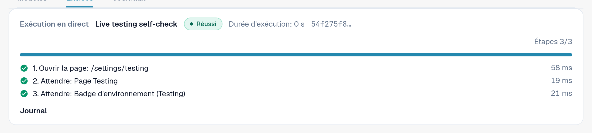
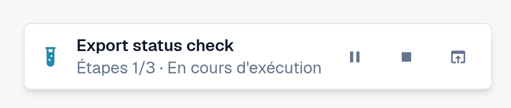
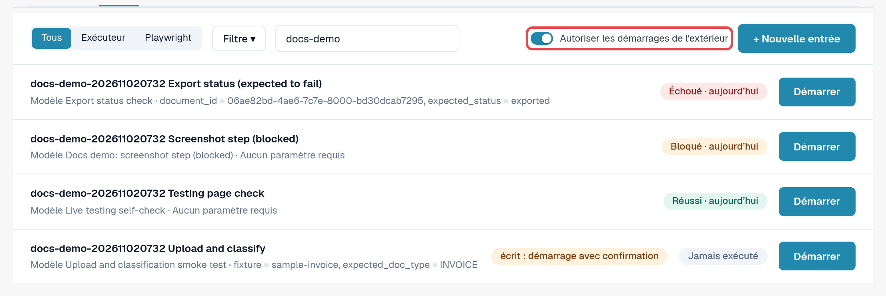
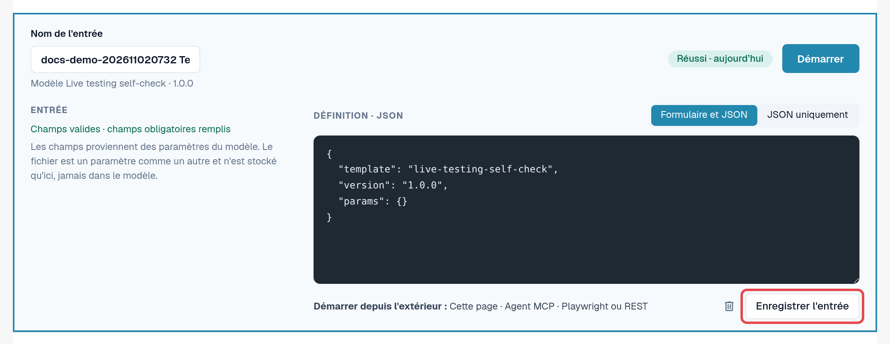

# Démarrer un test

Un test est un modèle plus une entrée. Le module Testing l'exécute et le pilote ; vous choisissez comment le démarrer. Les trois
façons sont équivalentes et chaque exécution aboutit dans les [Journaux](logs.md).

| Méthode | Quand l'utiliser | Affiché dans les journaux comme |
|---|---|---|
| **Dans le navigateur** | Vous voulez exécuter un contrôle maintenant et le suivre. | **Page** |
| **Assistant IA (MCP)** | Vous travaillez avec un assistant IA connecté à DocBits et souhaitez qu'il exécute et évalue des contrôles. | **Agent MCP** |
| **Depuis l'extérieur (Playwright ou REST)** | Votre automatisation de tests ou votre pipeline CI lance des contrôles, par exemple après un déploiement. | **Playwright** |

Dans tous les cas, les clics ont lieu dans **un onglet de navigateur DocBits d'un administrateur de l'organisation**, avec les
autorisations de cette personne. L'onglet doit rester ouvert ; le recharger ou le fermer met fin à l'exécution. La seule exception est une étape **Recharger la page** du
test lui-même (voir [Rechargement et reprise](reload-and-resume.md)).

## Démarrer dans le navigateur

1. Ouvrez **Paramètres → Testing**, onglet **Entrées**.
2. Sélectionnez **Démarrer** sur l'entrée (ou ouvrez l'entrée et sélectionnez **Démarrer**).
3. Si le modèle modifie des données, DocBits demande : *Ce modèle écrit des données. Confirmez pour démarrer.* Sélectionnez **Démarrer** pour continuer.
4. Le test s'exécute dans cet onglet. Sur la page Testing, le panneau **Exécution en direct** affiche le statut, l'**Action actuelle**,
   la progression des étapes ainsi que **Pause**, **Reprendre** et **Arrêter**. Lorsque le test ouvre une autre page, un petit indicateur dans
   le coin inférieur droit y affiche la progression. Lorsque le test se termine, l'indicateur affiche le résultat avec
   **Ouvrir le journal** et **Masquer**.
5. Lorsque le test se termine, ouvrez l'onglet **Journaux** pour lire le résultat.

<figure><figcaption>
Confirmation avant un test qui écrit des données.
</figcaption></figure>

<figure><figcaption>
Panneau Exécution en direct une fois le test réussi.
</figcaption></figure>

<figure><figcaption>
Indicateur d'exécution dans le coin inférieur droit sur une autre page.
</figcaption></figure>


**Téléversements pendant un test :** si votre organisation comporte des sous-organisations et que le tableau de bord les affiche toutes, la boîte de dialogue
de téléversement demande normalement à quelle sous-organisation le document appartient. Pendant qu'un test s'exécute, le téléversement va vers la
**première sous-organisation proposée par la boîte de dialogue**, sans poser la question. Pour téléverser dans une sous-organisation précise, démarrez le
test depuis la vue de cette sous-organisation.


## Autoriser les démarrages depuis l'extérieur

Un assistant IA ou un script Playwright ne peut pas cliquer lui-même ; il demande à DocBits d'exécuter un test **dans un onglet de navigateur que
vous avez enregistré** :

1. Ouvrez **Paramètres → Testing**, onglet **Entrées**, dans l'onglet du navigateur qui doit exécuter les tests.
2. Activez **Autoriser les démarrages de l'extérieur**. L'onglet accepte désormais les démarrages et affiche son ID de session.
3. Laissez l'onglet ouvert. L'enregistrement prend fin lorsque l'onglet est rechargé ou fermé.

<figure><figcaption>
Autoriser les démarrages de l'extérieur activé, avec l'ID de session.
</figcaption></figure>

L'éditeur d'entrée vous rappelle les trois méthodes sous **Démarrer depuis l'extérieur :** **Cette page**, **Agent MCP**,
**Playwright ou REST**.

<figure><figcaption>
Ligne Démarrer depuis l'extérieur dans l'éditeur d'entrée.
</figcaption></figure>

## Démarrer depuis un assistant IA (MCP)

Si votre assistant IA est connecté à DocBits (voir [DocBits MCP](../../../../advanced-functions-and-tools/docbits-mcp/README.md)
et [Configurer DocBits avec Claude ou Codex](../../../../advanced-functions-and-tools/docbits-mcp/configuration-with-claude-or-codex.md)) :

1. Autorisez les démarrages depuis l'extérieur dans un onglet du navigateur (voir ci-dessus).
2. Demandez par exemple à l'assistant : *« Liste mes entrées de test DocBits et démarre 'Facture LT-2026-0001 prête pour la validation'
   dans mon onglet de navigateur enregistré. Donne-moi ensuite le résultat. »*
3. L'assistant demande quel onglet utiliser si plusieurs sont enregistrés, et vous interroge avant de démarrer un test qui
   modifie des données. Il lit ensuite le journal et vous communique le résultat.

## Démarrer depuis Playwright ou un autre outil (REST)

Votre automatisation de tests démarre une entrée avec un seul appel d'API, puis lit son journal. Elle a besoin de :

* un jeton d'administrateur de l'organisation (voir [Clé API](../../../settings/global-settings/integration/api-key.md)) ;
* l'ID de l'entrée ;
* l'ID de session d'un onglet de navigateur pour lequel **Autoriser les démarrages de l'extérieur** est activé.

L'appel et un exemple figurent sur la page [Pour les développeurs](for-developers.md).

## Environnements clients

En sandbox et en production, le badge **Environnement** est rouge. Les tests qui modifient des données nécessitent une confirmation explicite à
chaque démarrage, et les étapes d'exportation, de suppression ou d'approbation sont bloquées tant que le modèle ne déclare pas qu'il écrit des données. Exécutez
si possible les tests d'écriture dans un environnement de test.
