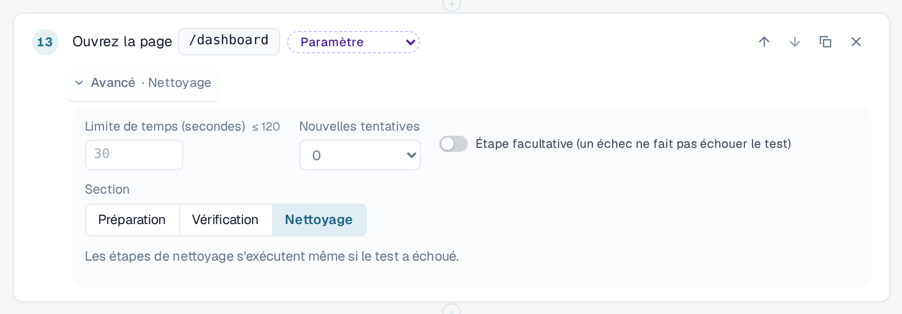
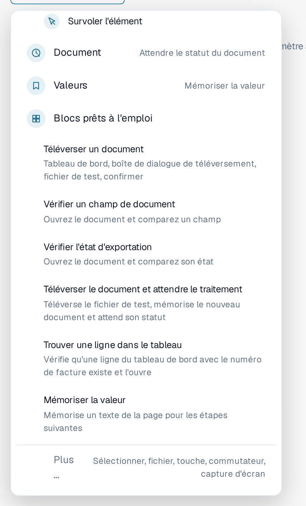
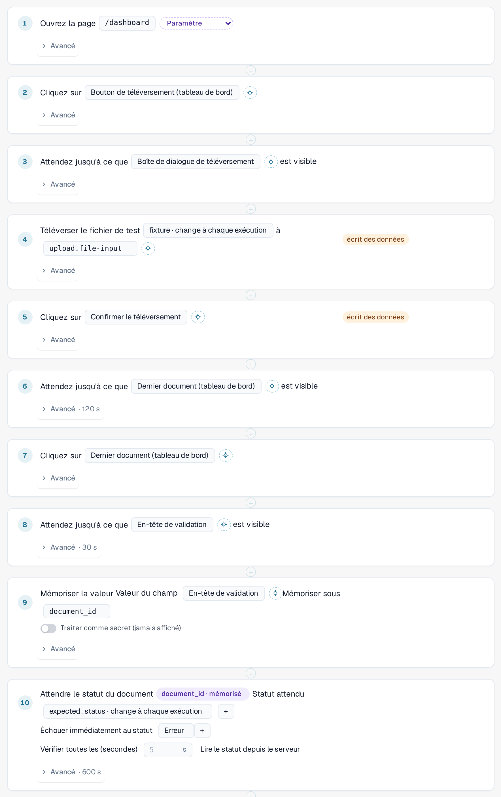
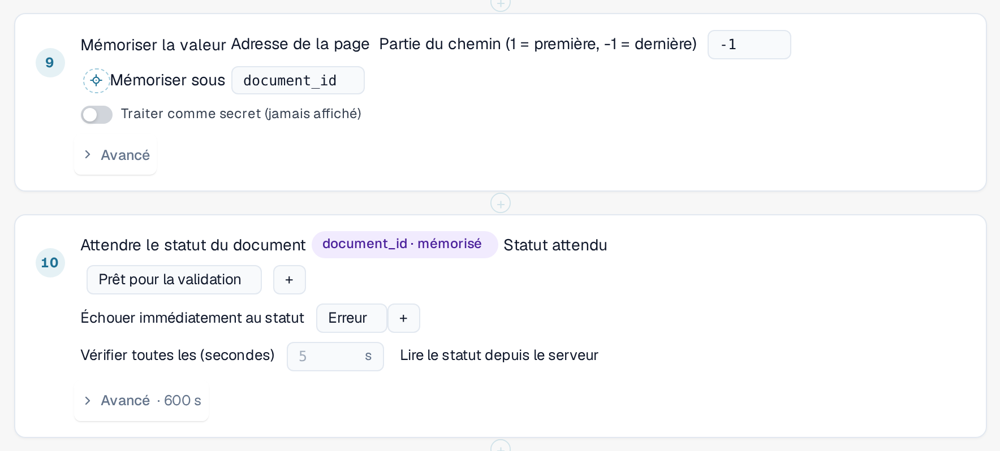
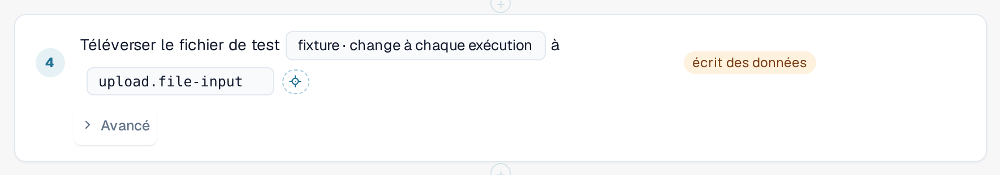

# Étapes et blocs prêts à l'emploi

Cette page explique comment construire un modèle dans l'éditeur ([Modèles](templates.md)) : les groupes d'étapes, les
paramètres **Avancé** d'une étape, les blocs prêts à l'emploi et la façon dont un test transmet des valeurs d'une étape à la suivante.

## Ajouter une étape

Dans l'éditeur de modèle, sélectionnez **+ Ajouter une étape**. Le menu **Que devrait-il se passer ensuite ?** liste les étapes. Les cinq
étapes de base sont **Ouvrir la page**, **Cliquez**, **Saisissez quelque chose**, **Attendez que quelque chose soit visible** et **Vérifier**.
Quatre **groupes** contiennent les étapes plus spécialisées. Sélectionnez un groupe pour voir ses étapes :

| Groupe | Étapes |
|---|---|
| **Tableau** | **Vérifier la ligne du tableau**, **Cliquer sur la ligne du tableau**, **Vérifier le nombre**. Pour les listes telles que la liste des documents du tableau de bord. |
| **Page** | **Vérifier l'adresse de la page**, **Recharger la page** (voir [Rechargement et reprise](reload-and-resume.md)), **Survoler l'élément**. |
| **Document** | **Attendre le statut du document** : attend qu'un document atteigne un statut, par exemple *Prêt pour la validation*. |
| **Valeurs** | **Mémoriser la valeur** : conserve un texte de la page pour les étapes suivantes. |

Les **Blocs prêts à l'emploi** ajoutent plusieurs étapes à la fois (voir ci-dessous). **Plus …** propose d'autres étapes : sélectionner une option, téléverser un fichier, appuyer sur une touche,
basculer un commutateur et prendre une capture d'écran (les étapes de capture d'écran sont ignorées par l'exécuteur du navigateur).

<figure><figcaption>
Menu Ajouter une étape avec les groupes Tableau, Page, Document et Valeurs ; le groupe Page est ouvert
</figcaption></figure>

Pour orienter une étape vers un élément de la page, sélectionnez-le dans la liste ou utilisez **Sélectionner dans l'application**
([Sélectionner un élément dans l'application](pick-in-app.md)).

## Paramètres avancés d'une étape

Chaque étape comporte une ligne **Avancé**. Sélectionnez-la pour ouvrir les paramètres de cette étape. La ligne repliée indique ce que vous avez
modifié, par exemple *Avancé · 120 s* ou *Avancé · Nettoyage*.

| Paramètre | Signification |
|---|---|
| **Limite de temps (secondes)** | La durée maximale de l'étape, jusqu'à 120 secondes. Laissez le champ vide pour la valeur par défaut de 30 secondes. Les étapes qui attendent un document ont leur propre limite, plus longue. |
| **Nouvelles tentatives** | Le nombre de fois où DocBits répète l'étape en cas d'échec (0 à 3). |
| **Étape facultative (un échec ne fait pas échouer le test)** | Si l'étape échoue, le journal l'affiche comme ignorée avec son erreur, et le test se poursuit. |
| **Section** | **Préparation**, **Vérification** ou **Nettoyage**. **Vérification** est la valeur par défaut. |

Les étapes de **Préparation** mettent le test en place. Les étapes de **Vérification** constituent le test lui-même. Les étapes de **Nettoyage** suppriment ce que le test a laissé
derrière lui, par exemple un document qu'il a téléversé. **Les étapes de nettoyage s'exécutent même lorsque le test a échoué** ou a expiré, et
une étape de nettoyage en échec ne modifie jamais le résultat du test. Elles doivent être les dernières étapes du modèle ; l'éditeur signale une erreur si une étape
normale suit une étape de nettoyage. Elles ne s'exécutent pas si vous arrêtez le test ou fermez l'onglet.
Un modèle comportant des étapes de nettoyage est enregistré en schema 1.3 (voir [Pour les développeurs](for-developers.md)).

<figure><figcaption>
Paramètres avancés d'une étape : limite de temps, nouvelles tentatives, étape facultative et section, avec Nettoyage sélectionné
</figcaption></figure>

## Blocs prêts à l'emploi

Sélectionnez **+ Ajouter une étape**, puis **Blocs prêts à l'emploi**. Un bloc ajoute les étapes d'une séquence courante avec les
paramètres dont elle a besoin. Vous pouvez ensuite modifier chaque étape.

| Bloc | Ce qu'il ajoute |
|---|---|
| **Téléverser un document** | Ouvre le tableau de bord, ouvre la boîte de dialogue de téléversement, sélectionne le fichier de test et confirme. |
| **Vérifier un champ de document** | Ouvre un document et compare un champ à une valeur attendue. |
| **Vérifier l'état d'exportation** | Ouvre un document et compare son statut. |
| **Téléverser le document et attendre le traitement** | Téléverse le fichier de test, mémorise le nouveau document et attend son statut. |
| **Trouver une ligne dans le tableau** | Vérifie qu'une ligne de la liste du tableau de bord portant un numéro de facture donné existe et l'ouvre. |
| **Mémoriser la valeur** | Mémorise un texte de la page pour les étapes suivantes. |

<figure><figcaption>
Blocs prêts à l'emploi dans le menu Ajouter une étape
</figcaption></figure>

### Téléverser le document et attendre le traitement

Utilisez ce bloc lorsqu'une étape ultérieure a besoin du document que le test vient de téléverser. Il reconnaît le nouveau document
par lui-même, et non d'après la ligne du haut de la liste, de sorte qu'un document plus ancien n'est jamais choisi par erreur. Il lit ensuite l'ID du
document dans l'adresse de la page et attend que le document atteigne le statut attendu
(par défaut *Prêt pour la validation*, jusqu'à 10 minutes ; il s'arrête immédiatement si le document passe au statut *Erreur*).
Il ajoute les valeurs d'entrée **fixture** (le fichier de test) et **expected_status**, et porte la durée de l'ensemble du test à 15 minutes au moins.

<figure><figcaption>
Étapes du bloc Téléverser le document et attendre le traitement
</figcaption></figure>


**Où vont les téléversements :** si votre organisation comporte des sous-organisations et que le tableau de bord les affiche toutes, la boîte de dialogue
de téléversement demande normalement à quelle sous-organisation le document appartient. Un test ne peut pas répondre à cette question. Pendant qu'un
test s'exécute dans l'onglet, le téléversement va vers la **première sous-organisation proposée par la boîte de dialogue**, sans poser la question.
En dehors d'un test, rien ne change. Pour téléverser dans une sous-organisation précise, démarrez le test depuis la vue de cette
sous-organisation.


### Trouver une ligne dans le tableau

Le bloc vérifie que la liste du tableau de bord comporte une ligne avec le numéro de facture indiqué (la valeur d'entrée **row_value**)
et l'ouvre. Pour rechercher dans une autre colonne, modifiez la colonne et la valeur dans l'étape. Les deux étapes appartiennent au
groupe **Tableau** ; **Vérifier le nombre** compte les lignes ou tout autre élément.

## Mémoriser une valeur et l'utiliser plus tard

Un test a souvent besoin d'une valeur qui n'existe que pendant son exécution, par exemple l'ID d'un document qu'il vient de téléverser.

1. Ajoutez **Mémoriser la valeur** (groupe **Valeurs**). Choisissez l'origine de la valeur : un texte de la page, l'adresse de la page
   (une partie du chemin ou un paramètre de requête) ou une cellule d'une ligne de tableau. Saisissez un nom sous **Mémoriser sous**,
   par exemple `document_id`. Activez **Traiter comme secret (jamais affiché)** pour les valeurs qui ne doivent apparaître nulle part.
2. Dans une étape ultérieure, choisissez la valeur mémorisée au lieu d'en saisir une. L'étape affiche une pastille telle que
   *document_id · mémorisé*. Dans le JSON du modèle, elle s'écrit `{{vars.document_id}}`.

Deux types de valeurs peuvent être utilisés dans une étape :

| Type | Écrit sous la forme | Provenance | Exemple |
|---|---|---|---|
| **Entrée** | `{{params.name}}` | L'[entrée](inputs.md) enregistrée : elle est identique pour chaque exécution de cette entrée. Créez-la avec le bouton de paramètre à côté d'une valeur. | *fixture · change à chaque exécution* |
| **Valeur mémorisée** | `{{vars.name}}` | Une étape **Mémoriser la valeur** antérieure de la même exécution. | *document_id · mémorisé* |

<figure><figcaption>
Mémoriser la valeur enregistre l'ID du document ; l'étape suivante attend ce document
</figcaption></figure>

<figure><figcaption>
Une étape qui utilise la valeur d'entrée fixture
</figcaption></figure>

Une valeur mémorisée n'existe que pour l'exécution en cours et n'est jamais enregistrée dans le modèle ni dans le journal. Les valeurs mémorisées
survivent à un [rechargement de la page](reload-and-resume.md) au sein du test, sauf si elles sont marquées comme secrètes.
