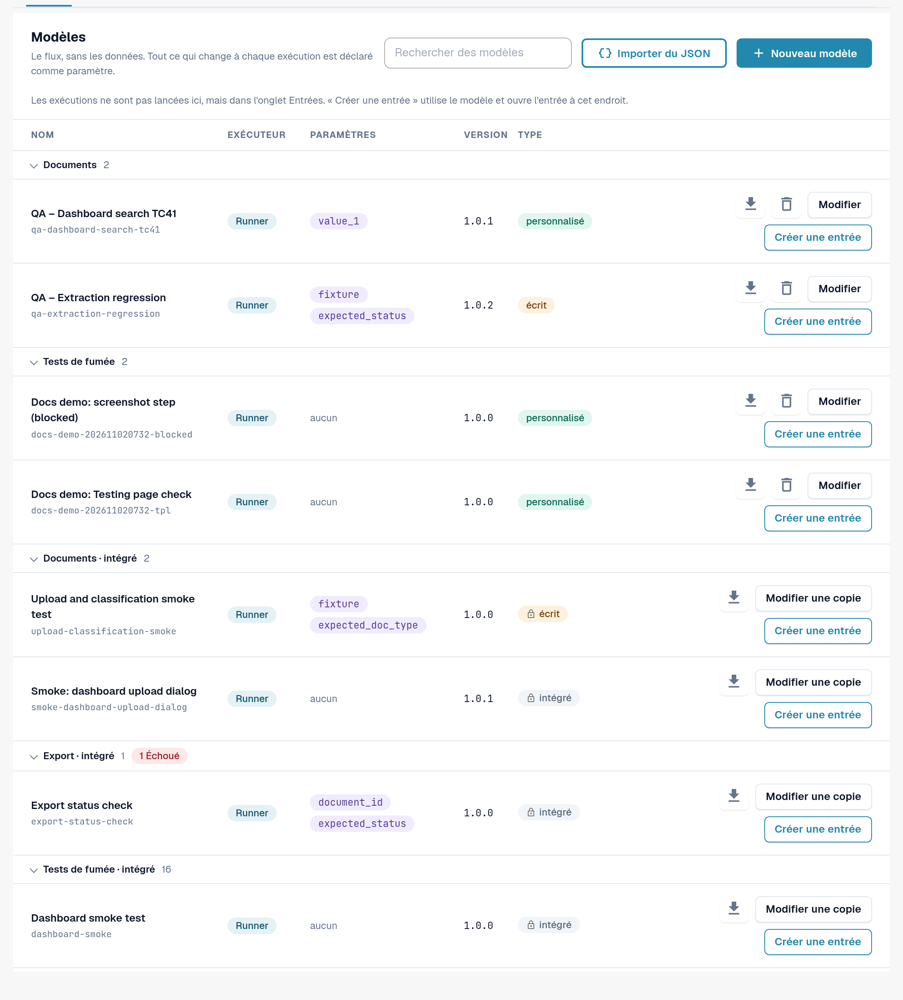
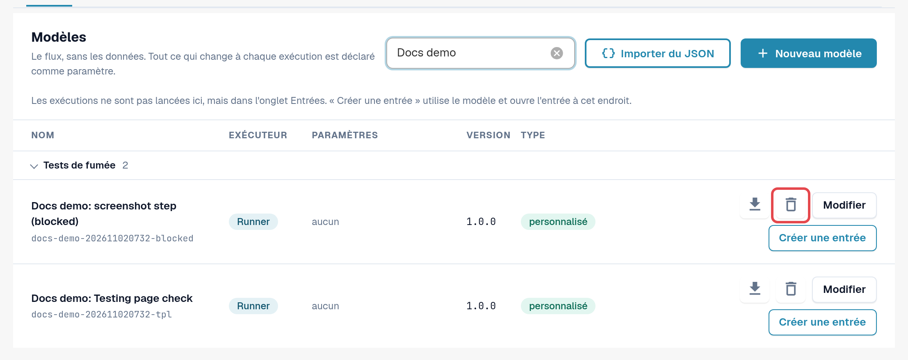
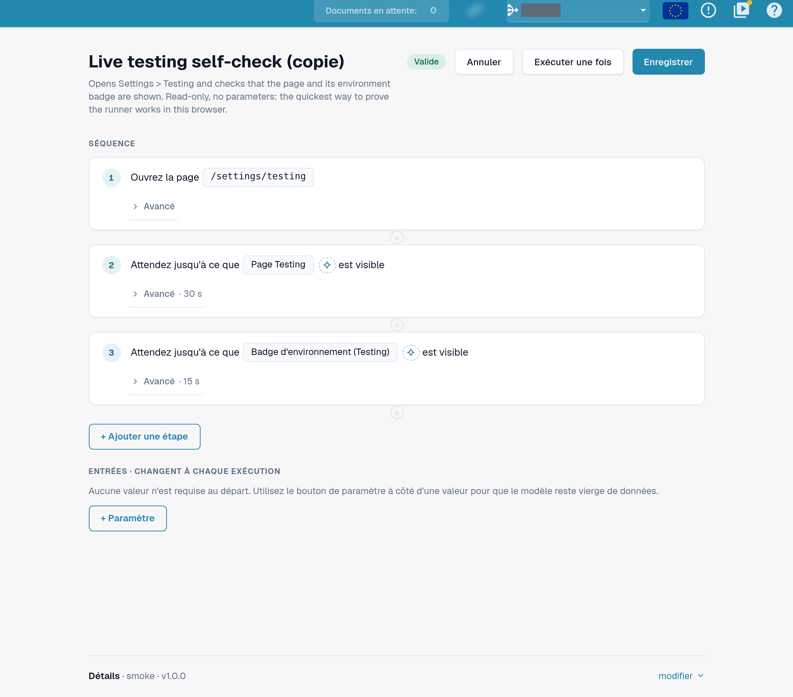
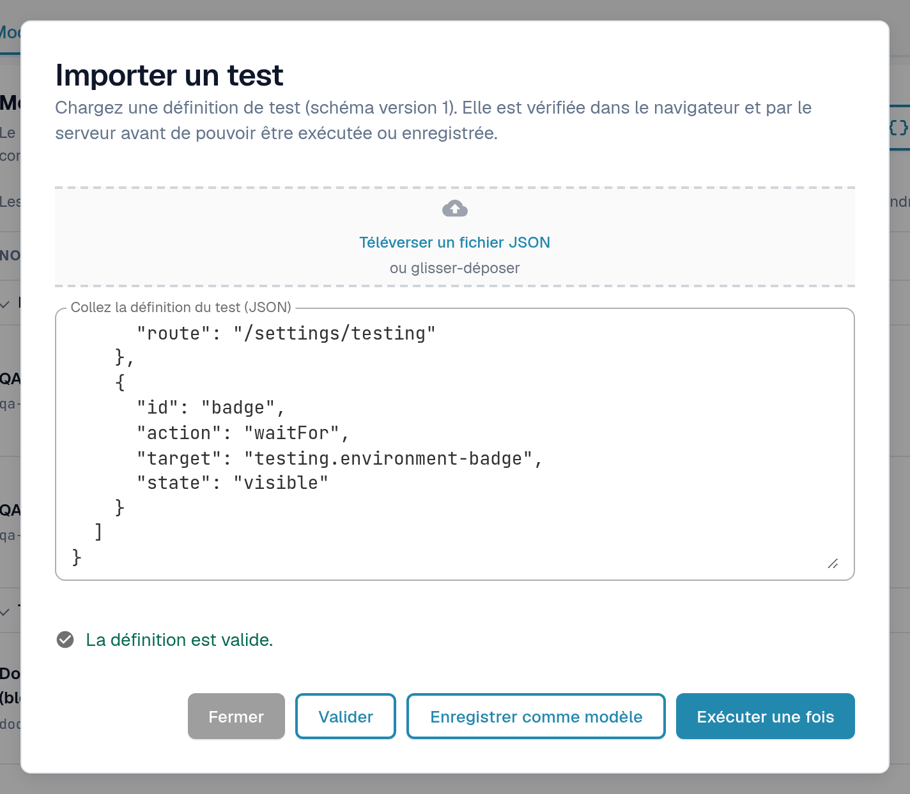
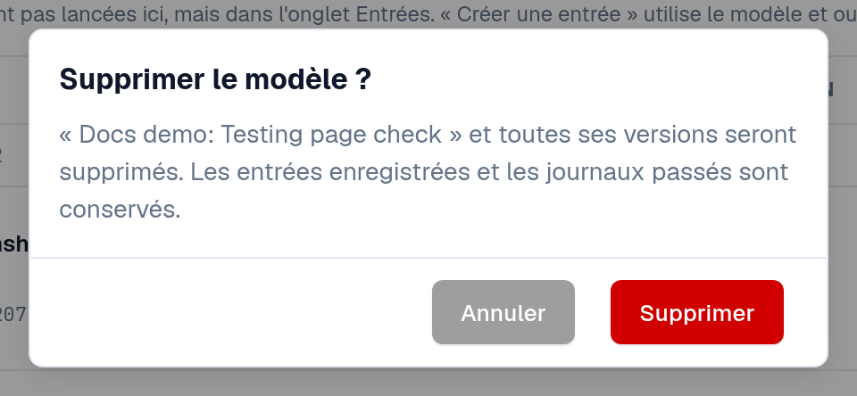

# Modèles

Un modèle décrit **ce qui** est vérifié : quelle page s'ouvre, sur quoi l'on clique ou ce que l'on remplit, et ce qui doit être
visible ou vrai à la fin. Il ne contient aucune donnée de votre organisation. Les valeurs qui diffèrent selon l'organisation ou selon
l'exécution, comme un ID de document, sont déclarées comme **paramètres** et renseignées par une [entrée](inputs.md).

Ouvrez **Paramètres → Testing**, onglet **Modèles**.

<figure><figcaption>
Onglet Modèles : groupes, colonnes et actions de ligne.
</figcaption></figure>

## Lire la liste

Les modèles sont regroupés par catégorie (par exemple **Tests de fumée**, **Validation**, **Documents**, **Export**).
Sélectionnez le nom d'un groupe pour le replier ; une pastille rouge sur le groupe compte les modèles dont la dernière exécution a échoué.
**Rechercher des modèles** filtre par nom.

| Colonne | Signification |
|---|---|
| **Nom** | Le nom du modèle et, en dessous, son ID. |
| **Exécuteur** | Valeur **Exécuteur** : s'exécute dans l'onglet de votre navigateur depuis cette page. Valeur **Playwright** : un contrôle exécuté par votre automatisation de tests ; il peut être documenté ici, mais pas démarré depuis cette page. |
| **Paramètres** | Les valeurs qu'une entrée doit fournir. *aucun* signifie que le modèle s'exécute tel quel. |
| **Version** | Les versions enregistrées ne changent jamais. Une modification est enregistrée comme une nouvelle version. |
| **Type** | **intégré** (icône de cadenas) : fait partie de l'ensemble par défaut, identique pour toutes les organisations, en lecture seule. **personnalisé** : le modèle propre à votre organisation. **écrit** : le modèle modifie des données (par exemple téléverse un document) et nécessite une confirmation avant de démarrer. |

Actions de ligne :

| Action | Ce qu'elle fait |
|---|---|
| Icône de téléchargement (**Exporter au format JSON**) | Télécharge la définition du modèle sous forme de fichier JSON, par exemple pour la conserver ou l'importer dans une autre organisation. |
| **Modifier une copie** (intégré) / **Modifier** (personnalisé) | Ouvre l'éditeur de modèle avec une copie que vous pouvez modifier et enregistrer comme votre propre modèle. |
| **Créer une entrée** | Ouvre l'onglet [Entrées](inputs.md) avec une nouvelle entrée pour ce modèle. Les tests se démarrent là, pas ici. |
| Icône de corbeille (**Supprimer le modèle**) | Uniquement sur vos propres modèles. Voir *Supprimer votre propre modèle* ci-dessous. |

<figure><figcaption>
Une ligne par défaut et une ligne de modèle personnel avec leurs actions.
</figcaption></figure>

## Créer votre propre modèle

Vous avez besoin de votre propre modèle lorsqu'aucun modèle par défaut ne vérifie ce dont vous avez besoin, ou lorsque vous souhaitez une copie modifiée d'un modèle par défaut.

**Partir d'un modèle par défaut :** sélectionnez **Modifier une copie** sur sa ligne. **Partir de zéro :** sélectionnez **Nouveau modèle**.

Dans l'éditeur de modèle :

1. Saisissez un **Nom du modèle** et, si vous le souhaitez, l'objet du modèle.
2. Sélectionnez **+ Ajouter une étape** et choisissez un bloc, par exemple **Ouvrir la page**, **Cliquez**, **Remplir**, **Sélectionner**,
   **Attendre**, **Vérifier le texte**, **Vérifier le champ** ou **Vérifier l'état**. Les **Blocs prêts à l'emploi** ajoutent d'un coup une séquence courante, par exemple
   **Téléverser un document** ou **Téléverser le document et attendre le traitement**. Voir [Étapes et blocs prêts à l'emploi](steps-and-blocks.md)
   pour les groupes d'étapes, les paramètres **Avancé** et les étapes de nettoyage.
3. Pour chaque valeur qui diffère selon l'organisation ou selon l'exécution, utilisez le bouton de paramètre à côté de la valeur. La valeur
   devient un paramètre sous **Entrées · changent à chaque exécution**, avec un type (**Texte**, **Nombre**, **Oui/Non**,
   **Fichier de test du serveur**), une **Valeur par défaut** et **Requis** si elle doit être renseignée.
4. Sélectionnez **Enregistrer**. Pour essayer le brouillon une fois sans l'enregistrer, sélectionnez **Exécuter une fois**.

Pour choisir l'élément d'une étape en le désignant dans l'application, utilisez **Sélectionner dans l'application**
([Sélectionner un élément dans l'application](pick-in-app.md)).

Les étapes qui modifient des données (par exemple le téléversement d'un document) sont marquées **écrit des données**. Un modèle comportant de telles étapes
demande une confirmation à chaque démarrage.

<figure><figcaption>
Éditeur de modèle avec deux étapes et un paramètre.
</figcaption></figure>

Si quelqu'un a entre-temps enregistré la même version de ce modèle (par exemple dans un autre onglet), DocBits conserve votre
brouillon et propose **Enregistrer comme prochaine version libre** ou **Rechargez la dernière version**.

## Importer un modèle depuis du JSON

1. Sélectionnez **Importer du JSON**.
2. Sélectionnez **Téléverser un fichier JSON**, ou collez la définition dans **Collez la définition du test (JSON)**.
3. Sélectionnez **Valider**. DocBits vérifie la définition dans le navigateur et sur le serveur, et liste les éventuels problèmes.
4. Sélectionnez **Enregistrer comme modèle** pour l'ajouter à vos modèles, ou **Exécuter une fois** pour l'essayer sans l'enregistrer.

<figure><figcaption>
Boîte de dialogue Importer un test avec une définition validée.
</figcaption></figure>

Le format est décrit dans [Pour les développeurs](for-developers.md).

## Supprimer votre propre modèle

1. Sur la ligne de votre propre modèle, sélectionnez l'icône de corbeille (**Supprimer le modèle**).
2. Lisez la confirmation **Supprimer le modèle ?** et sélectionnez **Supprimer**.

Le modèle et **toutes ses versions** sont supprimés. Les entrées enregistrées et les journaux passés sont conservés, de sorte que l'historique reste lisible.
Les entrées qui pointaient vers le modèle restent dans la liste ; modifiez-les ou supprimez-les. Vous pouvez enregistrer ultérieurement un modèle avec le
même ID. Les modèles intégrés et par défaut ne peuvent pas être supprimés.

<figure><figcaption>
Confirmation de suppression du modèle.
</figcaption></figure>
