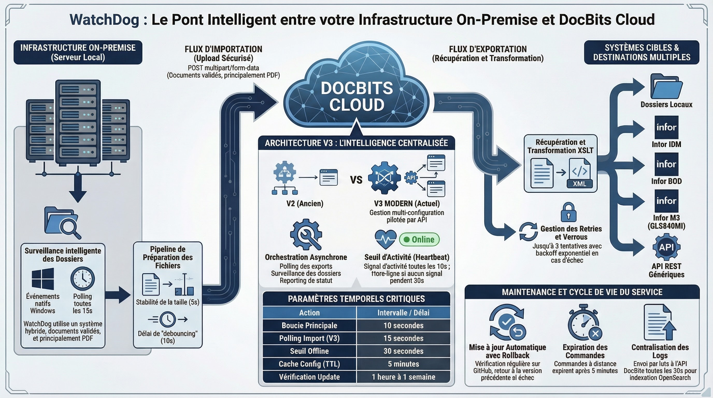

# WatchDog

<figure><figcaption><p>WatchDog : surveillance des dossiers, traitement dans DocBits et destinations d’export.</p></figcaption></figure>

<figure><figcaption></figcaption></figure>

**WatchDog** est un service Windows installé sur site qui surveille des dossiers locaux à la recherche de documents entrants, les téléverse vers le DocBits Cloud pour traitement, puis exporte les documents terminés vers des dossiers locaux ou des systèmes ERP.

## Fonctionnalités principales

* **Surveillance automatique des dossiers** — surveille les chemins locaux et les chemins réseau UNC à la recherche de nouveaux PDF
* **Prise en charge de plusieurs configurations** — plusieurs configurations d'import/export par instance
* **6 méthodes d'export** — Local Folder, Infor IDM, Infor BOD, ION API, GLS840MI, REST API
* **Auto-Update** — mises à jour automatiques de version avec retour arrière en cas d'échec
* **Gestion à distance** — redémarrage, mise à jour et configuration via l'interface DocBits

## Démarrage rapide

<figure><figcaption></figcaption></figure>

### 1. Télécharger WatchDog

Téléchargez `WatchDog.exe` depuis **Settings → Document Processing → WatchDog → General Tab** dans l'application DocBits.

### 2. Configurer via la clé d'API

Ouvrez l'**Invite de commandes en tant qu'administrateur** et exécutez :

```powershell
WatchDog.exe -api YOUR_API_KEY
```

> **Remarque :** la clé d'API est disponible dans vos paramètres DocBits, sous l'onglet General de WatchDog. Elle relie WatchDog à votre organisation DocBits.

### 3. Installer en tant que service Windows

```powershell
WatchDog.exe install
WatchDog.exe start
```

### 4. Créer les configurations dans DocBits

Toutes les configurations d'import et d'export sont créées directement dans l'**application DocBits** :

**Paramètres → Traitement des documents → WatchDog → Onglet Configurations**

* **Import Configurations** — définissent les dossiers surveillés et les types de document
* **Export Configurations** — définissent les destinations d'export, les modèles XSLT et les méthodes d'export

> **Important :** les configurations d'export nécessitent un **type de document** (`doc_type`). Les configurations sans type de document seront rejetées.

### 5. Démarrage automatique (facultatif)

Pour démarrer WatchDog automatiquement au démarrage du système :

1. Ouvrez **Services** (`Win + R` → `services.msc`)
2. Recherchez **WatchDog** dans la liste
3. Réglez **Startup Type** sur **Automatic (Delayed Start)**

## Référence des commandes

| Commande | Description |
| :--- | :--- |
| `WatchDog.exe -api KEY` | Configure la clé d'API et se connecte à DocBits |
| `WatchDog.exe install` | Installe en tant que service Windows |
| `WatchDog.exe start` | Démarre le service |
| `WatchDog.exe stop` | Arrête le service |
| `WatchDog.exe debug` | Exécute en mode console pour le dépannage |
| `WatchDog.exe --version` | Affiche la version actuelle |
| `WatchDog.exe --list-folders` | Liste les dossiers surveillés configurés |
| `WatchDog.exe remove` | Désinstalle le service |

## Ressources complémentaires

* [WatchDog Installation](watchdog-installation.md)
* [WatchDog Configuration](watchdog-v2-configuration.md)
* [WatchDog Admin FAQ](watchdog-admin-faq.md)
