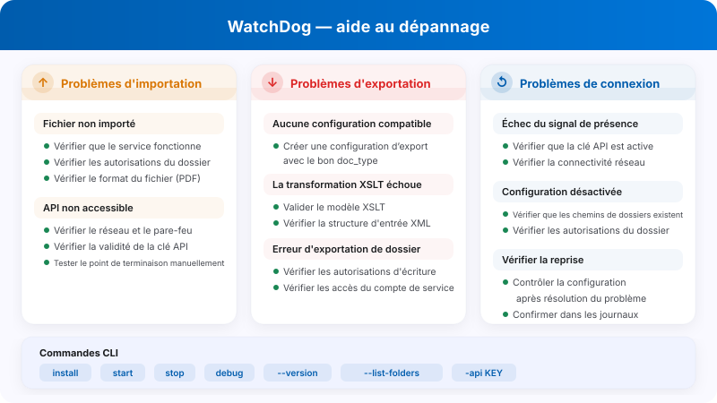

# FAQ administrateur et dépannage de WatchDog

<figure><figcaption><p>Aide au diagnostic des imports, exports et connexions WatchDog.</p></figcaption></figure>

Cette documentation aide les administrateurs à comprendre les messages d'erreur de WatchDog et à résoudre les problèmes.

**Emplacement dans l'interface :** Paramètres → Traitement des documents → WatchDog

---

## 1. Zones de l’interface

### 1.1 Général

<figure><figcaption><p>Vue Général avec les quatre onglets actuels et l’état Hors ligne de l’environnement de test. La clé API, les commandes sensibles et le chemin d’installation sont masqués. Cette image ne prouve pas une installation ou une connexion réussie.</p></figcaption></figure>

Général réunit l’état, la version, le téléchargement et les instructions de l’environnement. Utilisez une clé API autorisée et ne partagez pas les commandes contenant des secrets. Il n’y a pas d’onglet de statut distinct.

### 1.2 Configurations

Les importations définissent les dossiers et le périmètre des documents ; les exportations définissent la méthode et la destination. Une exportation nécessite un type de document valide (`doc_type`). Les champs de l’assistant dépendent de la méthode. Examinez séparément la portée des actions de copie ou d’importation/exportation des configurations.

### 1.3 Journaux

<figure><figcaption><p>Onglet Journaux avec Niveau de journalisation, Période et recherche. Les valeurs des événements sont masquées ; la période illustrée ne définit pas une règle universelle de conservation et ne prouve pas la santé du service.</p></figcaption></figure>

Limitez la consultation avec **Niveau de journalisation**, **Période** et recherche de texte. Les événements peuvent inclure `FILE_IMPORT_STARTED`, `FILE_IMPORT_COMPLETED`, `FILE_IMPORT_FAILED`, `EXPORT_STARTED`, `EXPORT_COMPLETED`, `EXPORT_FAILED`, `FOLDER_VALIDATION_FAILED`, `CONFIG_LOADED`, `SERVICE_RESTART_INITIATED` et `SERVICE_RESTART_COMPLETED`.

### 1.4 Modèles XSLT

<figure><figcaption><p>Onglet Modèles XSLT avec Nouveau modèle et des modèles existants dont les noms sont masqués. Aucun menu de ligne n’a été ouvert et aucune transformation n’a été exécutée.</p></figcaption></figure>

**Nouveau modèle** ouvre le gestionnaire. Vous pouvez y préparer un éditeur vide et examiner **Valider par rapport à** et **Valider XSLT** avant de sauvegarder un modèle. La configuration d’exportation détermine son utilisation.

---

## 2. Messages d'erreur de validation des dossiers

| Erreur | Signification | Solution |
| :--- | :--- | :--- |
| `not_found` | Le dossier n'existe pas | Créer le dossier ou corriger le chemin |
| `no_read_access` | Aucune autorisation de lecture | Définir les autorisations pour le compte de service WatchDog |
| `no_write_access` | Aucune autorisation d'écriture | Accorder les droits d'écriture au compte de service |
| `not_configured` | Chemin du dossier non configuré | Saisir le chemin dans la configuration |

**Dossiers concernés :**

* **Watch Folder (Import) :** où WatchDog recherche les nouveaux fichiers
* **Success Folder :** où les fichiers importés avec succès sont déplacés
* **Export Folder :** où les fichiers XML/PDF exportés sont écrits

---

## 3. Messages d'erreur d'importation

| Erreur | Signification | Solution |
| :--- | :--- | :--- |
| `file_not_found` | Le fichier a été supprimé avant l'importation | Fournir de nouveau le fichier |
| `invalid_file_type` | Seuls les fichiers PDF sont pris en charge | Retirer les autres types de fichiers |
| `api_not_accessible` | L'API DocBits est inaccessible | Vérifier le réseau/pare-feu, contrôler l'URL de l'API |
| `api_check_failed` | Échec du contrôle d'état de l'API | Vérifier l'API Key et la connexion |
| `upload_failed` | Échec du téléversement vers l'API | Vérifier l'API Key, le réseau et l'état du serveur |

---

## 4. Messages d'erreur d'exportation

| Erreur | Signification | Solution |
| :--- | :--- | :--- |
| `transformation_error` | Échec de la transformation XSLT | Vérifier le modèle XSLT, valider la structure XML |
| `folder_error` | Dossier d'exportation inaccessible | Créer le dossier, vérifier les autorisations |
| `file_write_error` | Le fichier n'a pas pu être écrit | Vérifier l'espace disque, les autorisations et les verrous de fichiers |
| `permission_denied` | Aucune autorisation d'écriture | Définir les autorisations du compte de service |
| `creation_failed` | Le dossier n'a pas pu être créé | Vérifier les autorisations du dossier parent |
| `no_config_match` | Aucune configuration d'exportation correspondante | Créer une configuration d'exportation avec le bon type de document |

> **Remarque :** les configurations d'exportation exigent un `doc_type`. Si vous voyez `no_config_match`, vérifiez qu'une configuration d'exportation active existe pour le type du document.

---

## 5. Configuration désactivée — motifs

Lorsqu'une configuration est désactivée, l'un de ces motifs apparaît :

| Motif de désactivation | Signification |
| :--- | :--- |
| `Watch folder: not_found` | Le dossier d'importation n'existe pas |
| `Watch folder: no_read_access` | Le dossier d'importation n'est pas lisible |
| `Export folder: not_found` | Le dossier d'exportation n'existe pas |
| `Export folder: no_write_access` | Le dossier d'exportation n'est pas accessible en écriture |
| `Success folder: not_found` | Le dossier de succès n'existe pas |
| `Success folder: no_write_access` | Le dossier de succès n'est pas accessible en écriture |

**Réactivation automatique :** WatchDog vérifie de nouveau les dossiers. La fréquence et la reprise dépendent de la version et de l’état du service. Après correction des chemins ou autorisations, confirmez dans les journaux que la configuration reprend son activité.

---

## 6. Dossier d'erreurs (`_error`)

Les fichiers en échec sont déplacés dans le dossier `_error` :

**Emplacement :** `{import_folder}/_error/{error_type}/`

**Format de fichier :** `{original_name}_{YYYYMMDD_HHMMSS}.pdf`

**Fichier annexe :** chaque fichier en échec s'accompagne d'un fichier `.error` contenant :

```
Error Type: transformation_error
Error Message: XSLT template not found
Timestamp: 2026-03-26 08:30:15
Original File: invoice_001.pdf
Original Path: C:\WatchDog\Import\invoice_001.pdf
```

---

## 7. Heartbeat et état de la connexion

WatchDog communique son état à DocBits par des signaux de présence (heartbeats). Selon la version, les informations peuvent comprendre :

| Données envoyées | Description |
| :--- | :--- |
| Timestamp | Heure actuelle |
| Version | Version de WatchDog installée |
| Last Restart | Heure du dernier redémarrage du service |
| Auto-Update Enabled | Indique si la mise à jour automatique est active |
| Latest Version | Version disponible la plus récente |
| Installation Path | Emplacement d'installation de WatchDog |
| Free RAM / Disk | Ressources système disponibles |

### État de la connexion

| État | Signification |
| :--- | :--- |
| ✅ **Online** | WatchDog est connecté et actif |
| ⚠️ **Offline** | Aucune communication récente : examinez sa date et les journaux |
| ❌ **Not Installed** | WatchDog ne s'est jamais connecté |

**Erreurs de heartbeat :**

* `Heartbeat failed - invalid API key` → l'API Key n'est pas valide
* `Heartbeat failed: 401` → échec de l'authentification
* `Heartbeat failed: 5xx` → problème côté serveur

---

## 8. Problèmes courants et solutions

### Problème : WatchDog n'importe pas les fichiers

1. Vérifiez que le service est en cours d'exécution : `services.msc` → WatchDog
2. Consultez les journaux : Settings → WatchDog → onglet Journaux
3. Vérifiez les autorisations des dossiers pour le compte de service WatchDog
4. Testez la connexion à l'API : `WatchDog.exe debug` dans CMD
5. Vérifiez que le type de fichier est PDF

### Problème : l'exportation ne fonctionne pas

1. Une configuration d'exportation avec le bon type de document existe-t-elle ?
2. Le type de document correspond-il entre le document et la configuration ?
3. Un modèle XSLT est-il associé (pour l'exportation vers un dossier) ?
4. Le dossier d'exportation est-il accessible en écriture pour le compte de service ?
5. Pour les exportations Infor : les identifiants ION sont-ils correctement configurés ?

### Problème : la configuration est désactivée

1. Le chemin du dossier existe-t-il ?
2. Les autorisations sont-elles définies pour `NT AUTHORITY\LOCAL SERVICE` ou le compte de service ?
3. Le lecteur réseau est-il accessible ? (vérifiez les chemins UNC)
4. Après rétablissement des accès, vérifiez que la configuration reprend son activité

### Problème : la transformation XSLT échoue

1. Le modèle XSLT est-il valide ? (utilisez l'onglet Modèles XSLT → gestionnaire → Valider XSLT)
2. Le modèle correspond-il au type de document ?
3. Vérifiez la structure XML du document
4. L'exportation vers un dossier V3 utilise une transformation côté serveur — vérifiez la connectivité à l'API

### Problème : l'exportation via REST API échoue

1. Les identifiants ION OAuth sont-ils configurés dans la configuration d'exportation ?
2. Le point de terminaison de l'API cible est-il accessible depuis le serveur WatchDog ?
3. Vérifiez que le format de la charge utile correspond aux attentes de l'API cible
4. Examinez la configuration de la chaîne de requêtes pour détecter d'éventuelles erreurs JSONPath

---

## 9. Commandes en ligne de commande

```bash
# Configure API connection
WatchDog.exe -api YOUR_API_KEY

# Install Service
WatchDog.exe install

# Start Service
WatchDog.exe start

# Stop Service
WatchDog.exe stop

# Run in debug mode (console output)
WatchDog.exe debug

# Uninstall Service
WatchDog.exe remove

# Show version
WatchDog.exe --version

# List watch folders
WatchDog.exe --list-folders

# Add/remove watch folder
WatchDog.exe --add-folder "C:\Import\Invoices"
WatchDog.exe --remove-folder "C:\Import\Invoices"

# Check Windows service status
sc query WatchDog
```

---

## 10. Fichiers journaux

**Emplacement :** `C:\WatchDog\logs\{module}\`

**Format des journaux :**
```
INFO  - 2026-03-26 10:00:00 - module_name - Message - function=func_name - line=42
```

**Niveau de journalisation :** DEBUG, INFO, WARNING, ERROR

**Journaux distants :** WatchDog envoie également ses journaux à DocBits (consultables dans l'onglet Journaux) et, en option, au service de journalisation cloud Logtail.
