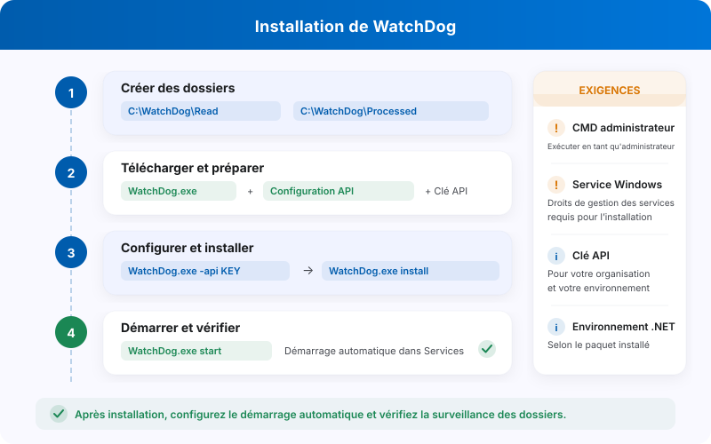

# Installation de WatchDog

<figure><figcaption><p>Installation de WatchDog et principaux prérequis.</p></figcaption></figure>

## Prérequis

Préparez un système Windows compatible avec le paquet installé, les droits administrateur et les autorisations de la future identité de service. Vérifiez la connectivité à l’API de DocBits et une clé API autorisée pour la bonne organisation et le bon environnement. Les dépendances d’exécution dépendent du paquet de votre version.

## Étapes d’installation

### 1. Préparer les dossiers

Choisissez les dossiers et leurs autorisations. Les noms ci-dessous sont des exemples ; ils doivent correspondre aux chemins configurés dans votre installation.

```
C:\WatchDog\              ← WatchDog executable
C:\WatchDog\Import\       ← Watch folder for incoming documents
C:\WatchDog\Processed\    ← Success folder for processed documents
C:\WatchDog\Export\        ← Export folder for exported files
```

Les chemins réseau UNC, comme `\\server\share`, nécessitent l’accès de la véritable identité de service. Une unité accessible à votre utilisateur ne prouve pas que le service peut la lire ou y écrire.

### 2. Télécharger WatchDog

Dans **Paramètres → WatchDog → Général**, téléchargez le paquet adapté à l’environnement et placez l’exécutable dans le dossier prévu.

### 3. Configurer la connexion à l’API

Ouvrez un terminal administrateur et remplacez le marqueur par une clé autorisée :

```powershell
cd C:\WatchDog
WatchDog.exe -api YOUR_API_KEY
```

Le résultat dépend de la clé, de l’environnement et de la connectivité. Ne partagez pas les commandes contenant des secrets.

### 4. Installer le service

```powershell
WatchDog.exe install
```

### 5. Démarrer le service

```powershell
WatchDog.exe start
```

### 6. Définir les importations et exportations

Ouvrez **Paramètres → WatchDog → Configurations**. **Nouvelle configuration d’importation** définit notamment les dossiers et le périmètre ; **Nouvelle configuration d’exportation** ouvre l’assistant d’exportation. Choisissez un type de document pour l’exportation et vérifiez les paramètres propres à la méthode sélectionnée.

### 7. Configurer le démarrage automatique

Dans `services.msc`, choisissez le type de démarrage du service adapté à votre exploitation. Vérifiez aussi l’identité du service et ses accès aux dossiers et au réseau.

## Vérifier l’installation

Dans **Général**, examinez l’état, l’âge de la dernière communication et les informations de version disponibles. Consultez aussi les journaux et réalisez un test autorisé avec des fichiers de démonstration avant de vous fier au fonctionnement.

<figure><figcaption><p>Vue Général avec les quatre onglets actuels et l’état Hors ligne de l’environnement de test. La clé API, les commandes sensibles et le chemin d’installation sont masqués. Cette image ne prouve pas une installation ou une connexion réussie.</p></figcaption></figure>

Cette vue montre Hors ligne dans l’environnement de test ; elle ne constitue pas la preuve d’une installation ou d’une connexion réussie.

## Référence des commandes

| Commande | Description |
| :--- | :--- |
| `WatchDog.exe -api KEY` | Configurer l'API Key |
| `WatchDog.exe install` | Installer en tant que service Windows |
| `WatchDog.exe start` | Démarrer le service |
| `WatchDog.exe stop` | Arrêter le service |
| `WatchDog.exe debug` | Exécuter en mode console (pour le dépannage) |
| `WatchDog.exe remove` | Désinstaller le service |
| `WatchDog.exe --version` | Afficher la version actuelle |
| `WatchDog.exe --list-folders` | Lister les dossiers surveillés configurés |
| `WatchDog.exe --add-folder PATH` | Ajouter un dossier surveillé |
| `WatchDog.exe --remove-folder PATH` | Supprimer un dossier surveillé |

---


## Ancienne configuration V1

Le fichier local `watchdog-config.json` appartient aux anciennes configurations V1. Il n’est pas un fichier à télécharger obligatoirement pour la configuration moderne par API illustrée ici. Si vous maintenez une installation ancienne, identifiez sa version et son mode de configuration avant une migration. Les anciennes captures V1 ne décrivent pas les formulaires actuels.
