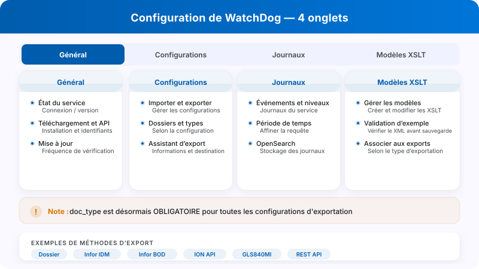
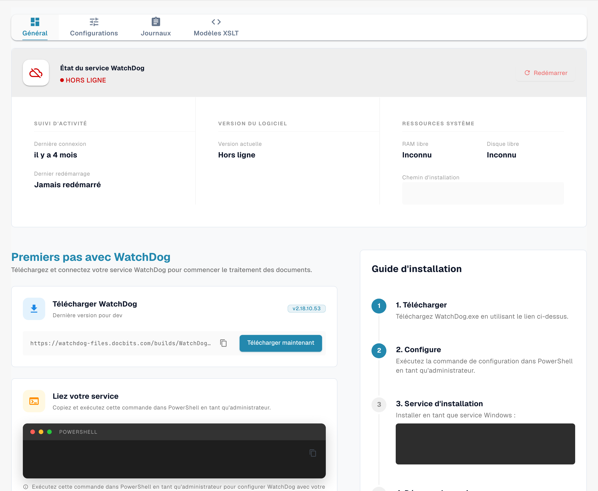
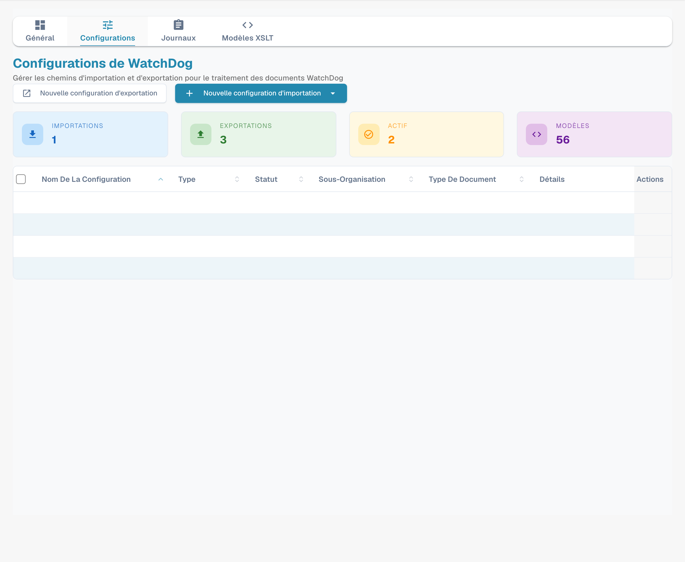
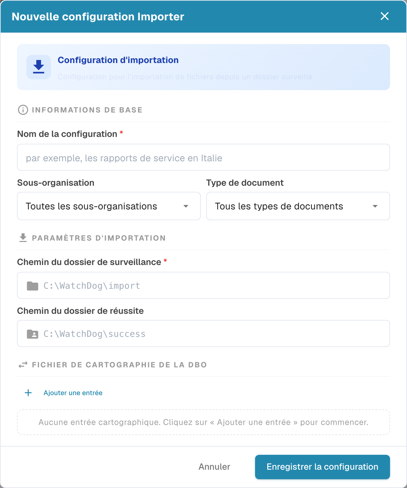
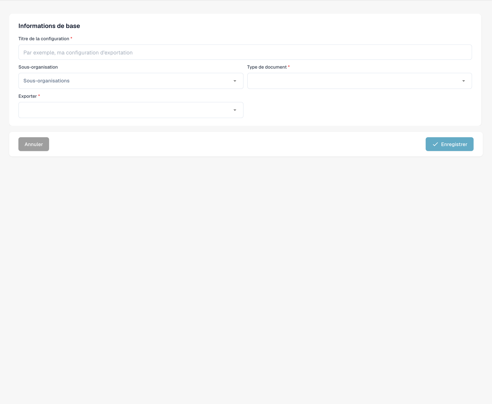
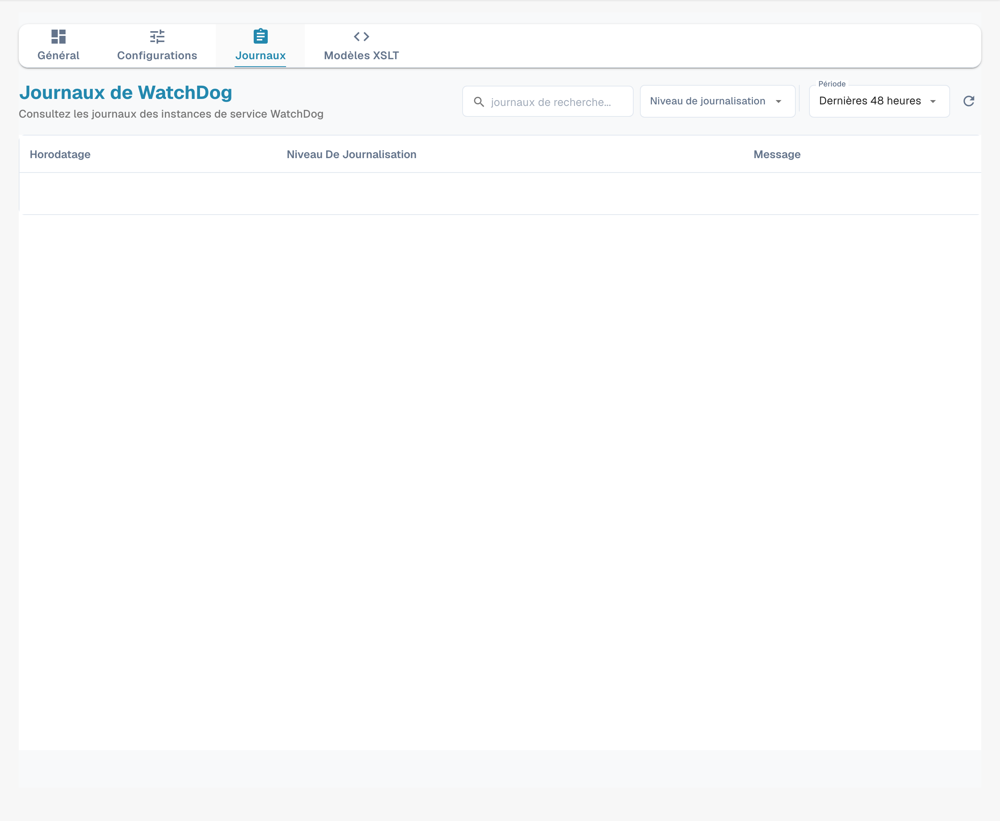
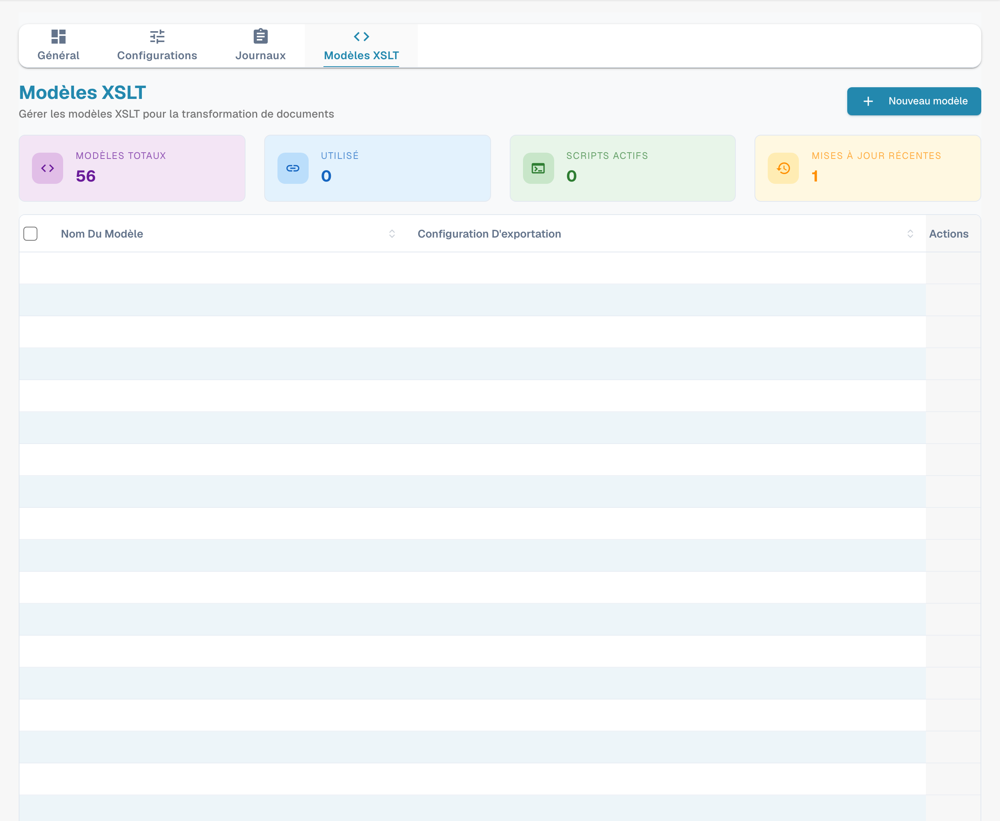
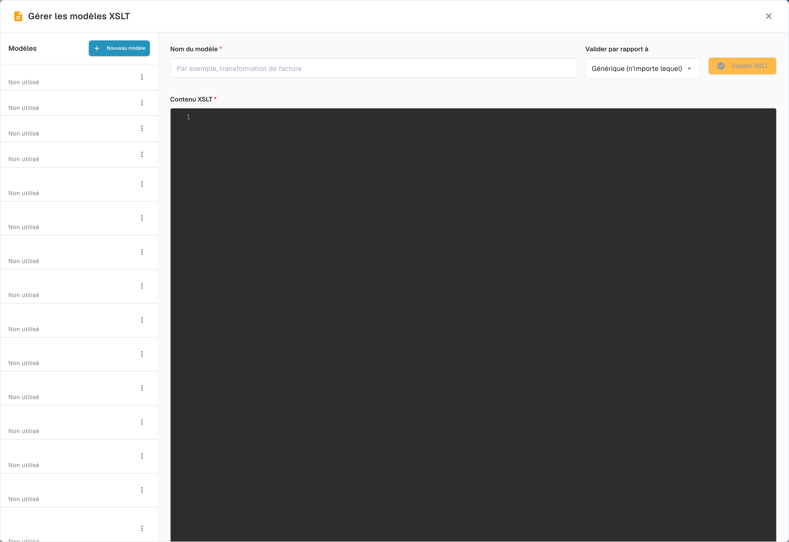

# Configuration de WatchDog

Ouvrez **Paramètres → WatchDog**. La vue actuelle comprend quatre onglets : **Général**, **Configurations**, **Journaux** et **Modèles XSLT**. Le statut du service figure dans Général et les exportations se gèrent depuis Configurations.

<figure><figcaption><p>Configuration de WatchDog : fonctions des quatre onglets.</p></figcaption></figure>

## 1. Général : service, téléchargement et connexion

Examinez l’état de la connexion et les informations de version disponibles. Les instructions et le téléchargement correspondent à l’environnement actuel. Un état Hors ligne ne prouve pas une installation correcte.

<figure><figcaption><p>Vue Général avec les quatre onglets actuels et l’état Hors ligne de l’environnement de test. La clé API, les commandes sensibles et le chemin d’installation sont masqués. Cette image ne prouve pas une installation ou une connexion réussie.</p></figcaption></figure>

Utilisez une clé API autorisée de votre organisation et remplacez le marqueur dans un terminal administrateur :

```powershell
WatchDog.exe -api YOUR_API_KEY
```

Ne publiez pas une clé ni une commande qui la contient. Examinez les options de programmation de mise à jour de votre version avant de choisir une fréquence.

## 2. Configurations : importations et exportations

Les compteurs et les lignes concernent votre organisation ; ce ne sont pas des valeurs par défaut universelles.

<figure><figcaption><p>Onglet Configurations avec les actions de nouvelle importation et de nouvelle exportation. Les listes contiennent des configurations existantes dont les noms et les valeurs sont masqués ; les compteurs appartiennent à cet environnement.</p></figcaption></figure>

### 2.1 Créer une configuration d’importation

Ouvrez **Nouvelle configuration d’importation** et l’action de création. Le formulaire permet d’indiquer le nom, la sous-organisation, le type de document et les chemins de surveillance et de réussite. Les options qui couvrent toutes les sous-organisations ou tous les types ont un périmètre plus large qu’une sélection précise : vérifiez ce périmètre avant de sauvegarder.

<figure><figcaption><p>Formulaire initial d’importation, sans enregistrement. Nouvelle configuration Importer est le titre maladroit affiché ; l’acronyme DBO du bloc de correspondances doit être compris comme BOD. Les chemins visibles sont des exemples du formulaire.</p></figcaption></figure>

Les chemins `C:\WatchDog\import` et `C:\WatchDog\success` sont des exemples. Les dossiers doivent exister et être accessibles à l’identité du service. Le titre **Nouvelle configuration Importer** est une formulation native incorrecte ; le formulaire concerne l’importation. L’acronyme **DBO** affiché dans le bloc de correspondances désigne ici **BOD**.

### 2.2 Créer une configuration d’exportation

**Nouvelle configuration d’exportation** ouvre l’assistant. Commencez par **Informations de base** : titre, périmètre de sous-organisation, **Type de document** et méthode du sélecteur **Exporter**.

<figure><figcaption><p>Première étape d’une exportation : Informations de base, Titre de la configuration, Type de document et sélecteur Exporter. Les champs suivants dépendent de la méthode choisi. Aucun type ni destinataire n’a été sélectionné et rien n’a été enregistré.</p></figcaption></figure>

Un type de document (`doc_type`) est obligatoire pour l’exportation. Les champs suivants dépendent de la méthode : dossier, transformation XSLT ou identifiants ne figurent pas nécessairement dans ce premier écran. Contrôlez la destination et le périmètre avant de sauvegarder.

Les exemples de méthodes comprennent le dossier local (`Folder`/`watcher`), Infor IDM, Infor BOD, ION API, GLS840MI et REST API. Ce sont des noms techniques ; leur disponibilité et les champs dépendent de la version et de la configuration. Infor BOD exige un message et un flux adaptés au système cible : sélectionner cette méthode ne convertit pas automatiquement tout document pour n’importe quel ERP. Pour REST, vérifiez le contrat et l’authentification de l’API concernée.

Des fonctions comme **Barcode Divider** ou **DocBits Operator** appartiennent à leur configuration respective, pas à des onglets supplémentaires de WatchDog.

## 3. Journaux : diagnostic

Utilisez **Niveau de journalisation**, **Période** et la recherche pour limiter les événements disponibles. La période sélectionnée définit la requête affichée, pas une politique universelle de conservation.

<figure><figcaption><p>Onglet Journaux avec Niveau de journalisation, Période et recherche. Les valeurs des événements sont masquées ; la période illustrée ne définit pas une règle universelle de conservation et ne prouve pas la santé du service.</p></figcaption></figure>

Les messages peuvent contenir des identifiants techniques tels que `FILE_IMPORT_STARTED`, `FILE_IMPORT_COMPLETED`, `FILE_IMPORT_FAILED`, `EXPORT_STARTED`, `EXPORT_COMPLETED`, `EXPORT_FAILED`, `FOLDER_VALIDATION_FAILED`, `CONFIG_LOADED`, `SERVICE_RESTART_INITIATED` et `SERVICE_RESTART_COMPLETED`. Leur présence dans cette référence n’affirme pas que chacun de ces événements a été exécuté dans votre environnement. La recherche de texte n’est pas un sélecteur distinct de type d’événement.

## 4. Modèles XSLT : gestion et édition

**Modèles XSLT** affiche les modèles disponibles. **Nouveau modèle** ouvre le gestionnaire ; dans ce gestionnaire, **Nouveau modèle** ouvre un éditeur vide.

<figure><figcaption><p>Onglet Modèles XSLT avec Nouveau modèle et des modèles existants dont les noms sont masqués. Aucun menu de ligne n’a été ouvert et aucune transformation n’a été exécutée.</p></figcaption></figure>

Renseignez **Nom du modèle** et **Contenu XSLT**. **Valider par rapport à** choisit le contexte de **Valider XSLT**. Évaluez la validation avec des données et une structure compatibles ; ouvrir un éditeur ne démontre pas une transformation réussie.

<figure><figcaption><p>Éditeur initial de Gérer les modèles XSLT, avec Nom du modèle, Contenu XSLT et Valider par rapport à. Les noms des modèles existants sont masqués ; l’éditeur est vide et aucune validation ni sauvegarde n’a été exécutée.</p></figcaption></figure>

Associez le modèle depuis la configuration d’exportation lorsque la méthode le demande. Examinez les utilisations d’un modèle partagé avant de le modifier. Les images montrent des vues initiales ; aucune configuration n’a été enregistrée, aucune transformation n’a été exécutée et aucune exportation n’a été lancée pendant la prise de vue.
