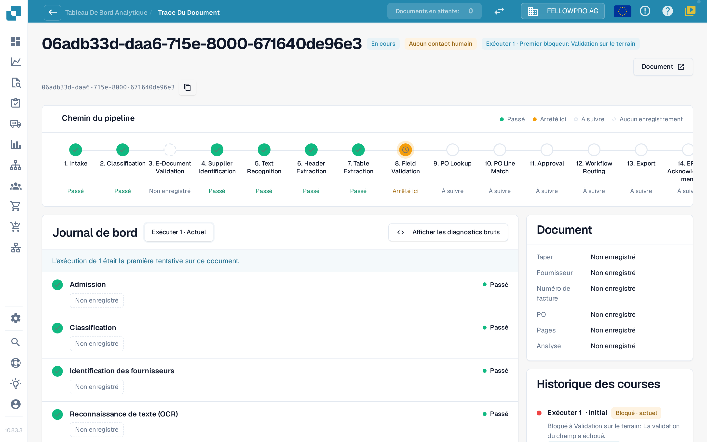
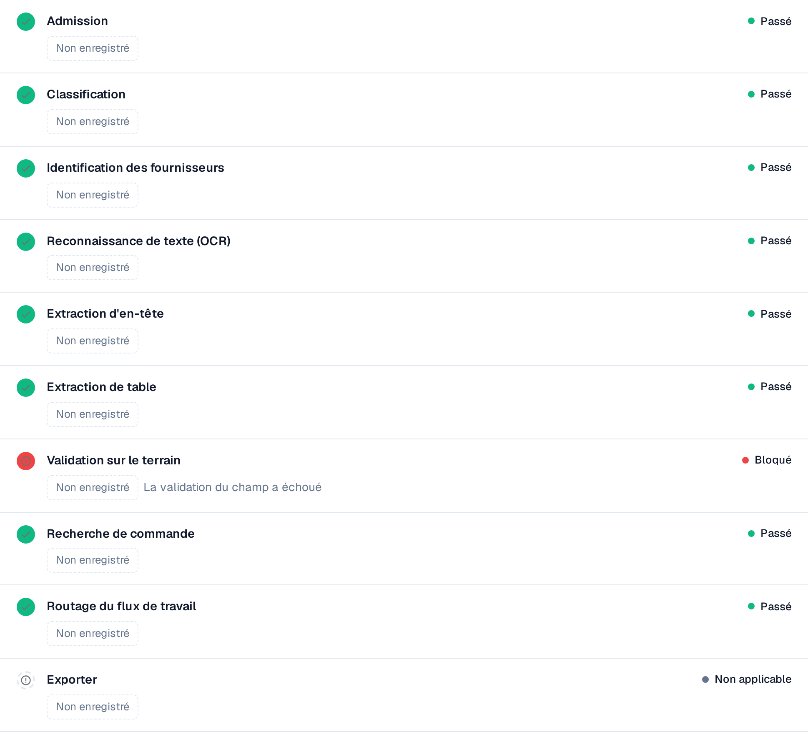

# Touchless Intelligence : Trace du document

Saisissez un ID de document dans **ID du document** (Document ID), ou ouvrez un document d'exemple depuis un cluster, pour voir **ce qui est arrivé à ce document**.

L'en-tête affiche le fichier, son statut (par exemple **En cours**), l'exécution que vous consultez et son premier bloqueur, ainsi qu'un bouton **Document** avec l'ID du document.

<figure><figcaption>
La trace du document : le chemin du pipeline avec toutes les étapes, et le journal des étapes avec ce que chacune a enregistré.
</figcaption></figure>

Le **Chemin du pipeline** affiche 14 étapes : Réception, Classification, Validation du document électronique, Identification du fournisseur, Reconnaissance de texte, Extraction de l'en-tête, Extraction du tableau, Validation des champs, Recherche du BC, Rapprochement des lignes de BC, Approbation, Routage du workflow, Exportation, Accusé de réception de l'ERP. Chaque étape porte un seul état :

| État | Signification |
| --- | --- |
| **Passé** (vert) | L'étape s'est bien déroulée |
| **Arrêté ici** (orange) | L'étape a bloqué le document |
| **À suivre** | Le document n'est jamais allé aussi loin |
| **Aucun enregistrement** (en pointillés) | Aucune donnée n'a été enregistrée pour cette étape |
| **Sans objet** | L'étape ne s'applique pas à ce document |

### Journal des étapes

Le **journal des étapes** sous le chemin liste les mêmes étapes avec ce que chacune a enregistré. Un point de statut et le mot de statut se trouvent à gauche et à droite de chaque ligne.

* Chaque valeur est une **puce de valeur** : un nombre avec son unité, par exemple **Confiance 100 %**, **Seuil 60 %**, **Règles en échec 0**, **8 champs manquants** ou **0 écart de correspondance**. Les pourcentages sont affichés en `97 %`, jamais en `0.97`.
* **Détails** ouvre la liste complète des valeurs enregistrées par une étape, y compris les alternatives qu'elle a envisagées.
* L'étape qui a bloqué le document en indique la raison, par exemple **Échec de la validation des champs**.
* Une valeur qu'aucune étape n'a enregistrée s'affiche comme **Non enregistré**, jamais comme une valeur inventée. Les valeurs sont des nombres et des termes fixes, jamais du texte du document.
* **Afficher les diagnostics bruts** active les données brutes lorsque le support les demande.

<figure><figcaption>
Chaque étape montre ce qu'elle a enregistré ; l'étape bloquée nomme sa cause.
</figcaption></figure>

### Exécutions et changements

Le sélecteur d'exécution en haut du journal des étapes (**Exécuter 1 · Actuel**) permet de passer d'une exécution du document à l'autre. L'**historique des exécutions** à droite liste chaque exécution avec son résultat et l'endroit où elle s'est arrêtée. Lorsqu'un document a été exécuté plusieurs fois, choisissez une exécution dans le sélecteur pour la comparer à l'exécution actuelle : les valeurs modifiées portent alors un badge indiquant l'écart et son unité, par exemple **−2 champs** ou **+3 %**.

La carte **Document** à côté du journal des étapes indique le type de document, le fournisseur, le numéro de facture, le bon de commande, le nombre de pages et si l'analyse est **basée sur des règles** ou rédigée par l'IA.

**Exemple.** Les documents d'un fournisseur s'arrêtent tous à l'étape 8. Dans la trace, vous voyez à chaque fois les mêmes champs manquants. Ce n'est pas un problème d'extraction de documents isolés, mais une valeur par défaut manquante dans votre configuration de champs : corrigez-la une fois et tout le cluster est récupérable.

## Pages connexes

* [Touchless Intelligence](touchless-intelligence.md)
* [Diagnostic fournisseur et clusters de problèmes](touchless-supplier-diagnosis.md)
* [Diagnostic du rapprochement avec le BC](touchless-po-matching-diagnosis.md)

Les captures d'écran de cette page montrent l'interface en français.
