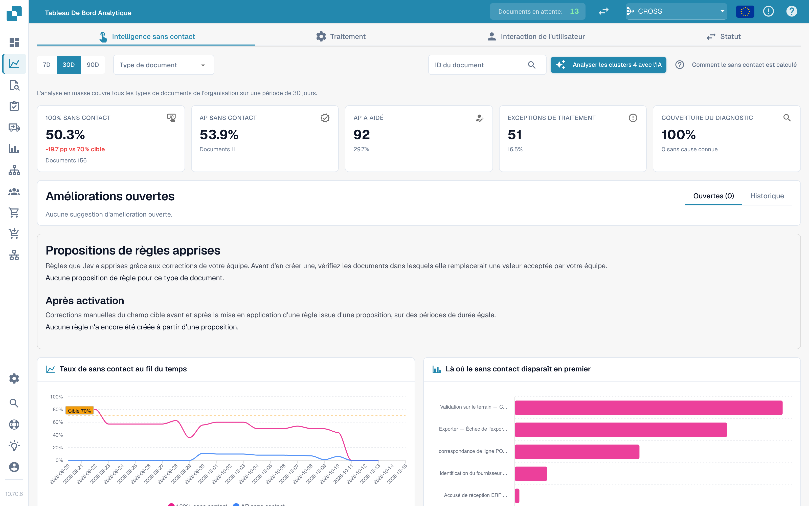
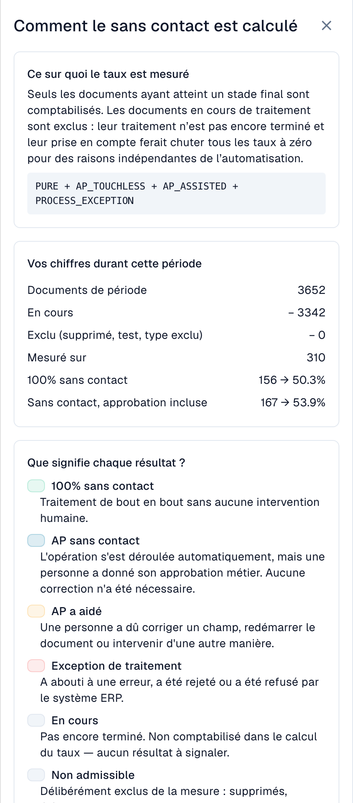
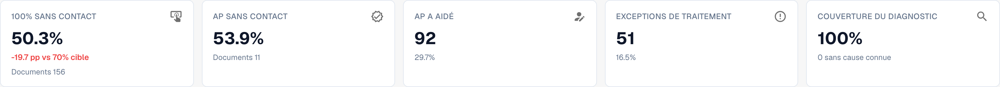
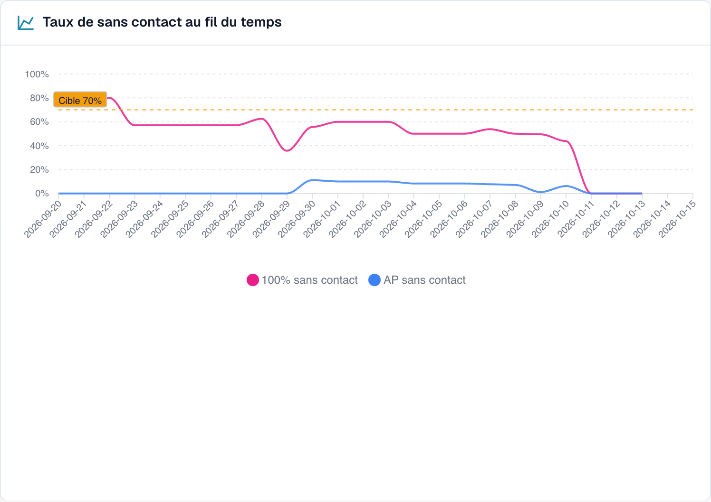
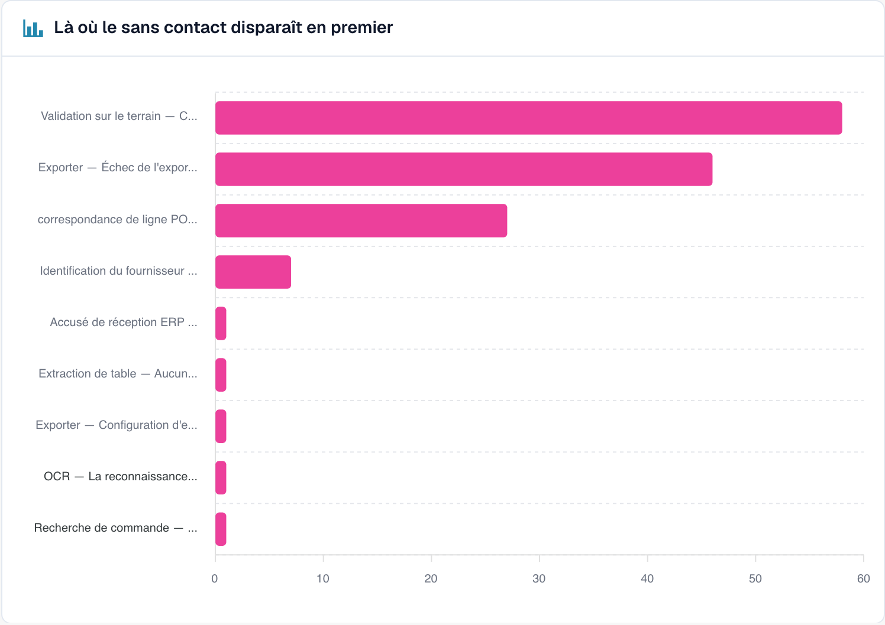
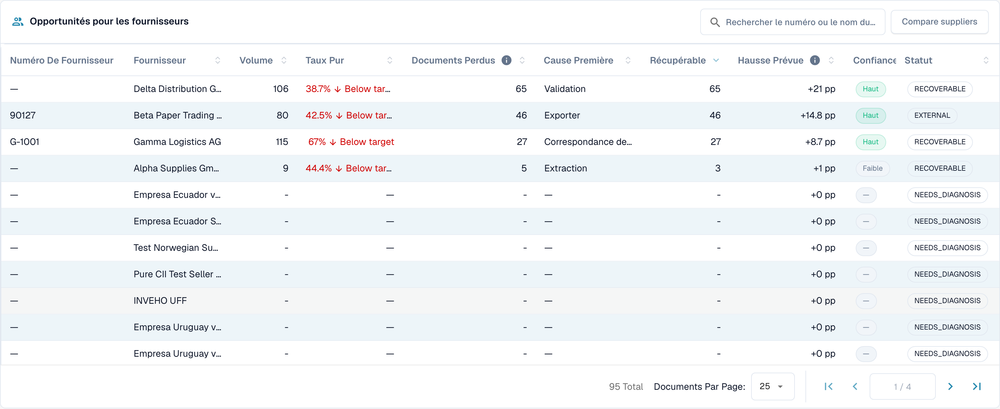
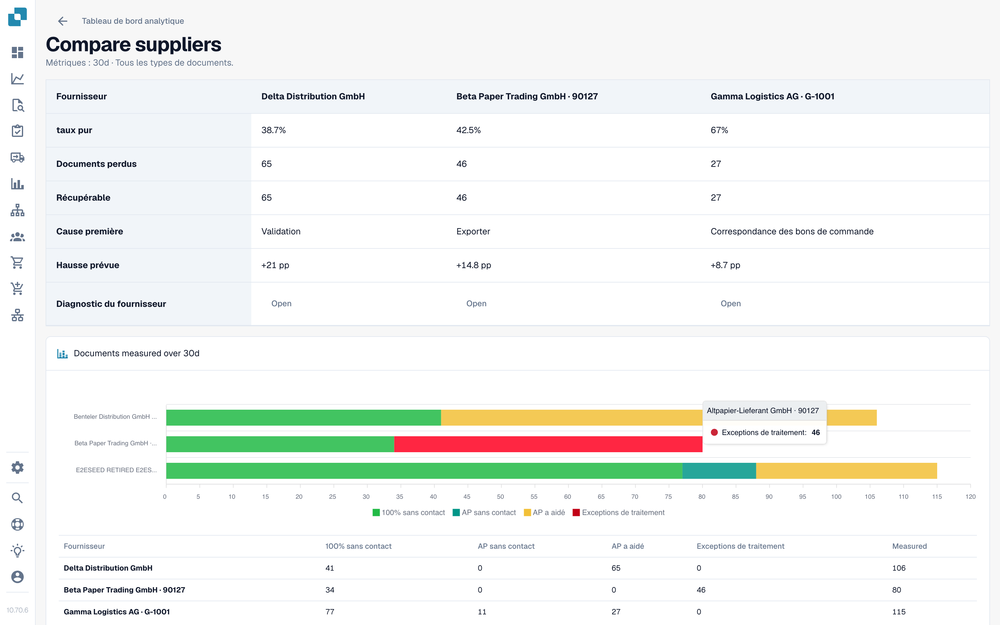

# Touchless Intelligence

## Vue d'ensemble

**Touchless Intelligence** répond à deux questions sur le traitement de vos documents :

1. **Combien de documents traversent DocBits sans que personne n'intervienne ?** C'est votre *taux touchless*.
2. **Pourquoi les autres s'arrêtent-ils, et que devons-nous changer pour qu'il y en ait moins ?** C'est le *diagnostic*.

C'est un onglet du [Tableau de bord analytique](analytics-dashboard.md). Il n'ajoute aucun travail pour votre équipe : DocBits enregistre ce qui arrive à chaque document dans le pipeline de traitement et évalue le résultat toutes les 15 minutes.

<figure><figcaption><p>L'onglet Touchless Intelligence : chiffres clés, améliorations, le taux dans le temps et le graphique de la première perte. Organisation d'exemple avec des données de démonstration ; les noms de fournisseurs sont fictifs.</p></figcaption></figure>

### Ce que vous pouvez en faire

| Vous voulez… | Utilisez | Exemple |
| --- | --- | --- |
| Voir votre niveau d'automatisation | Les cinq **chiffres clés** en haut | « 63,2 % de nos documents ont été traités sans intervention le mois dernier » |
| Voir la tendance | **Taux touchless dans le temps** (Touchless rate over time) | « Le taux est passé de 55 % à 68 % depuis la correction des données de base fournisseurs » |
| Savoir où les documents restent bloqués | **Où le touchless est perdu en premier** (Where touchless is lost first) | « La plupart des documents s'arrêtent à la validation des champs » |
| Décider quel fournisseur corriger en premier | **Opportunités fournisseurs** (Supplier opportunities) | « Le fournisseur A nous apporterait +4,0 points de pourcentage » |
| Comprendre un fournisseur | Page **Diagnostic fournisseur** (Supplier Diagnosis) | « Ses factures n'ont pas de numéro de BC, donc le rapprochement avec le BC échoue » |
| Comprendre un document | **Trace du document** (Document Trace) | « Cette facture s'est arrêtée à l'étape 8, Validation des champs » |
| Comparer des fournisseurs | **Comparer les fournisseurs** (Compare suppliers) | « Les fournisseurs A et B utilisent le même modèle, mais seul B échoue » |
| Modifier un paramètre utile | **Propositions de modification** (Change proposals) | « Activer le rapprochement automatique avec le BC : aperçu, application, mesure, annulation » |

## Qui peut le voir

* L'onglet fait partie du Tableau de bord analytique. Votre administrateur l'active pour l'organisation. Si l'onglet est absent, demandez à votre administrateur.
* Les **administrateurs de l'organisation** le voient toujours.
* Les autres utilisateurs le voient lorsqu'un administrateur a accordé à leur rôle l'onglet **Tableau de bord analytique** (**Paramètres → Rôles**). Sans cette autorisation, seuls les administrateurs y ont accès.
* Certaines actions sont réservées aux administrateurs : l'**analyse par IA**, l'**application et l'annulation d'une modification**, les **propositions de règles apprises** et le **rapport de conseil** (Consulting report).

Si vous n'y êtes pas autorisé, la page affiche *Action non autorisée, veuillez contacter l'administrateur* (Action not allowed, please contact the administrator).

## Ce que « touchless » signifie

Chaque document se termine par exactement **un** résultat :

| Résultat | Signification | Compte dans le taux |
| --- | --- | --- |
| **Touchless pur** (Pure touchless) | Traité de l'importation à l'exportation **sans aucune intervention humaine** | Oui, comme un succès |
| **Touchless AP** (AP touchless) | Traité automatiquement, et une personne a seulement donné l'**approbation métier**. Aucune correction n'a été nécessaire | Oui, comme un succès |
| **AP assisté** (AP assisted) | Une personne a dû **corriger un champ, redémarrer le document** ou intervenir d'une autre manière | Oui, comme un échec. Ce n'est pas une défaillance, seulement une automatisation qui n'a pas mené le document jusqu'au bout |
| **Exception de processus** (Process exception) | S'est terminé par une **erreur**, a été **rejeté**, a été **refusé par l'ERP** ou s'est **bloqué** dans le pipeline | Oui, comme un échec |
| **En cours** (In progress) | Pas encore terminé | **Non**. Il n'a pas encore de résultat |
| **Non éligible** (Not eligible) | Supprimé, archivé, document de test ou type de document exclu | **Non** |

Le **taux touchless** est :

```
rate = (Pure touchless + AP touchless)
       ÷ (Pure touchless + AP touchless + AP assisted + Process exception)
```

Les documents encore **en cours** ou **non éligibles** n'entrent jamais dans le calcul. Cela protège le taux : un document arrivé il y a cinq minutes ne peut pas le faire baisser.


**Une intervention compte définitivement.** Dès qu'une personne a touché un document, il reste compté comme traité manuellement, même si un traitement automatique ultérieur n'aurait eu besoin de personne. **Redémarrer un document ne le rend pas à nouveau touchless.** Le taux reflète le travail qui a eu lieu.


### Exemple de calcul (chiffres à titre d'illustration)

En 30 jours, 200 documents sont arrivés :

| Résultat | Documents |
| --- | --- |
| Touchless pur | 120 |
| Touchless AP | 30 |
| AP assisté | 30 |
| Exception de processus | 10 |
| En cours | 8 |
| Non éligible (documents de test) | 2 |

* Dénominateur : 120 + 30 + 30 + 10 = **190**. Les 8 documents en cours et les 2 documents non éligibles sont exclus.
* **Touchless pur** : 120 ÷ 190 = **63,2 %**
* **Touchless AP** : 30 ÷ 190 = **15,8 %**
* **Taux touchless** : (120 + 30) ÷ 190 = **78,9 %**

L'onglet affiche un **objectif** (70 % sauf si votre organisation en utilise un autre). Dans cet exemple, le taux est supérieur à l'objectif.

Cliquez sur **Comment le touchless est calculé** (How touchless is calculated) en haut à droite pour ouvrir cette explication dans DocBits, avec les chiffres de votre propre période (documents de la période, encore en cours, exclus, mesurés).

<figure><figcaption><p>Le panneau <strong>Comment le touchless est calculé</strong> : la formule, <strong>Vos chiffres sur cette période</strong> (Your numbers in this period ; ici 2 425 documents, 2 115 encore en cours, 310 mesurés) et la signification de chaque résultat. Organisation d'exemple avec des données de démonstration ; les noms de fournisseurs sont fictifs.</p></figcaption></figure>

### Quelle est l'actualité des chiffres

Les résultats sont **recalculés toutes les 15 minutes**. Le résultat d'un document peut encore changer après son apparition : l'ERP peut confirmer une exportation plusieurs heures plus tard. La ligne **Données au …** (Data as of …) en bas de l'onglet indique quand les chiffres ont été calculés pour la dernière fois.

## L'onglet de vue d'ensemble

### Filtres

| Filtre | Ce qu'il fait |
| --- | --- |
| **7J / 30J / 90J** (7D / 30D / 90D) | La période pour les chiffres clés et la file d'attente. La valeur par défaut est de 30 jours |
| **Type de document** (Document Type) | Limite chaque chiffre à un seul type, par exemple INVOICE |
| **Champ de segment / Valeur de segment** (Segment field / Segment value) | Uniquement si votre organisation fait passer plusieurs processus par un même type de document (par exemple des commandes directes, indirectes et EAM dans le champ `order_type`). Choisissez un champ pour voir la répartition, choisissez une valeur pour y limiter tous les chiffres |
| **ID du document** (Document ID) | Ouvre la **Trace du document** pour un document |

La **sous-organisation** que vous avez sélectionnée en haut de DocBits limite les chiffres clés et la file d'attente des fournisseurs. Les clusters de problèmes et l'analyse par IA couvrent toujours toute l'organisation.

### Les cinq chiffres clés

<figure><figcaption><p>Les cinq chiffres clés. Ici, le taux pur est de 50,3 % (156 documents), soit 19,7 points sous l'objectif de 70 %, et la couverture du diagnostic est de 100 %. Organisation d'exemple avec des données de démonstration ; les noms de fournisseurs sont fictifs.</p></figcaption></figure>

| Carte | Affiche | Exemple (illustratif) |
| --- | --- | --- |
| **Touchless pur** | Le pourcentage et l'écart par rapport à l'objectif | **63,2 %** · « 120 documents » · « −6,8 pp par rapport à l'objectif de 70 % » (en rouge, sous l'objectif) |
| **Touchless AP** | Le pourcentage | **15,8 %** · « 30 documents » |
| **AP assisté** | Le nombre de documents et leur part | **30** · 15,8 % |
| **Exceptions de processus** | Le nombre de documents et leur part | **10** · 5,3 % |
| **Couverture du diagnostic** (Diagnosis coverage) | Combien de documents bloqués ont une cause **connue** | **80 %** · « 10 sans cause connue » |

* Une carte affiche un tiret (—) au lieu de **0 %** lorsqu'il n'y a rien à mesurer. Un tiret signifie « pas de données », pas « zéro ».
* **Couverture du diagnostic** = documents avec un motif de blocage connu ÷ tous les documents bloqués. Exemple : 50 documents bloqués, dont 10 avec une cause inconnue → 40 ÷ 50 = **80 %**. Une valeur faible signifie « nous ne comprenons pas encore pourquoi les documents s'arrêtent ». Améliorez-la avant d'essayer de corriger des causes individuelles.
* **Cliquez sur une carte** pour ouvrir dans un nouvel onglet la liste des documents derrière le chiffre (« Voir les documents derrière ce chiffre »). Les cartes avec 0 document ne sont pas cliquables.

### Taux touchless dans le temps

<figure><figcaption><p>Le taux par jour avec la ligne d'objectif. Ici, le taux reste entre 40 et 60 % et chute fortement à partir du 10 octobre. Organisation d'exemple avec des données de démonstration ; les noms de fournisseurs sont fictifs.</p></figcaption></figure>

Un graphique avec une courbe pour **Touchless pur**, une pour **Touchless AP** et la **ligne d'objectif**. Les périodes courtes affichent des points quotidiens, les périodes longues des points hebdomadaires.

**Exemple.** Après avoir activé le rapprochement automatique avec le BC le 1er octobre, le taux pur passe de 55 % à 68 % en deux semaines. Le graphique montre le jour où la courbe s'infléchit, ce qui vous permet de le rapprocher de votre modification.

### Où le touchless est perdu en premier

<figure><figcaption><p>Documents bloqués par étape et par motif où ils se sont arrêtés en premier. Ici, <strong>Validation des champs : champ obligatoire manquant</strong> coûte le plus de documents (58), suivi de <strong>Échec du mappage d'exportation</strong> (46) et de <strong>Écart d'article du BC</strong> (27). Organisation d'exemple avec des données de démonstration ; les noms de fournisseurs sont fictifs.</p></figcaption></figure>

Un graphique en barres des **Documents bloqués** (Blocked documents) par étape du pipeline : la **première** étape qui a arrêté un document.

**Exemple.** Barres : Identification du fournisseur 12, Validation des champs 41, Rapprochement des lignes de BC 7. La barre la plus grande vous indique de regarder d'abord la **Validation des champs**, généralement parce qu'un champ obligatoire n'est pas extrait.

### Opportunités fournisseurs

<figure><figcaption><p>La file d'attente des fournisseurs (raccourcie aux quatre premières lignes). Le premier fournisseur compte 106 documents, un taux pur de 38,7 % et 65 documents récupérables ; le corriger vaut donc <strong>+21 pp</strong>. Organisation d'exemple avec des données de démonstration ; les noms de fournisseurs sont fictifs.</p></figcaption></figure>

La file d'attente répond à la question **« Quel fournisseur devons-nous corriger en premier ? »** Elle est triée par documents **Récupérables**, du plus élevé au plus bas, avec 25 lignes par page.

| Colonne | Signification |
| --- | --- |
| **Numéro de fournisseur / Fournisseur** (Supplier Number / Supplier) | Le fournisseur. Les documents sans fournisseur reconnu apparaissent sous **Aucun fournisseur identifié (n documents)** |
| **Volume** | Documents éligibles du fournisseur sur la période |
| **Taux pur** (Pure Rate) | Part des documents touchless purs. Vert s'il atteint ou dépasse l'objectif, rouge s'il est en dessous |
| **Documents perdus** (Lost Documents) | Documents qui se sont terminés en AP assisté ou en exception de processus. Pas toujours une personne : un rejet de l'ERP ou un document bloqué pendant sept jours compte aussi |
| **Cause racine** (Root Cause) | Qui est responsable de la correction : Configuration, Intégration ERP, Exportation, Extraction, Données de base, Mesure, Rapprochement avec le BC, Processus utilisateur, Validation ou Inconnue |
| **Récupérables** (Recoverable) | Documents perdus dont DocBits peut corriger la cause : configuration, données de base ou modèle du fournisseur |
| **Gain attendu** (Expected Lift) | Combien de **points de pourcentage** le taux de votre organisation gagnerait si chaque document récupérable de ce fournisseur était traité en touchless (**+x pp**) |
| **Confiance** (Confidence) | **Élevée**, **Moyenne** ou **Faible** : le degré de certitude du diagnostic |
| **Statut** (Status) | Nouveau, Ouvert, En cours d'analyse, En cours, Confirmé, Résolu, Écarté. Un fournisseur avec trop peu de documents affiche **NEEDS_DIAGNOSIS** |

**Exemple.** Votre organisation a 1 000 documents éligibles sur la période. Le fournisseur A a 40 documents récupérables, le fournisseur B a 90 documents perdus mais seulement 10 récupérables (son problème est de son côté).

* Fournisseur A : 40 ÷ 1 000 = **+4,0 pp de gain attendu**
* Fournisseur B : 10 ÷ 1 000 = **+1,0 pp**, bien que B ait plus de documents perdus

La file d'attente classe A avant B parce que le **gain attendu** est mesuré par rapport à toute votre organisation, pas par rapport au fournisseur. Un fournisseur avec quatre mauvais documents ne peut pas passer devant un fournisseur avec quatre cents.

Utilisez le champ de recherche (« Rechercher un numéro ou un nom de fournisseur ») pour trouver un fournisseur. Cliquez sur une ligne pour ouvrir le **Diagnostic fournisseur**.

### Comparer les fournisseurs

<figure><figcaption><p>Trois fournisseurs côte à côte : taux pur, documents perdus et récupérables, cause racine, gain attendu et un graphique en barres des résultats. Chaque bouton <strong>Ouvrir</strong> mène au Diagnostic fournisseur. Organisation d'exemple avec des données de démonstration ; les noms de fournisseurs sont fictifs.</p></figcaption></figure>

Cliquez sur **Comparer les fournisseurs**, cochez **deux à cinq** fournisseurs (chacun est listé avec son nombre de documents bloqués) et cliquez sur **Comparer**.

La comparaison affiche les fournisseurs côte à côte : **Taux pur**, **Documents perdus**, **Récupérables**, **Cause racine**, **Gain attendu**, un graphique en barres des résultats et un lien vers chaque **Diagnostic fournisseur**.

**Exemple.** Les fournisseurs A et B envoient la même mise en page de facture. B a un taux pur de 80 %, A seulement 35 %. Les deux ont la cause racine « Données de base ». La comparaison montre que la mise en page est correcte et que la fiche fournisseur de A est incomplète. Corrigez les données de base de A au lieu de modifier le modèle.

### Analyser avec l'IA

Le bouton **Analyser n clusters avec l'IA** (Analyse n clusters with AI) analyse les clusters de problèmes ayant le plus fort potentiel touchless (au moins un nombre minimal de documents chacun). Cela prend environ 13 secondes par cluster et couvre **toute l'organisation**. Seuls les administrateurs peuvent le lancer.

Pendant l'exécution, vous voyez **En file d'attente**, **En cours**, **Terminé**, **Déjà analysé** ou **Erreur** pour chaque cluster, avec un lien **Ouvrir le cluster**. Si l'IA est désactivée ou n'est pas configurée dans l'environnement, le bouton est désactivé avec la raison, et **tout le reste de la page continue de fonctionner**.

## Aller plus loin

| Page | Ce qu'elle couvre |
| --- | --- |
| [Diagnostic fournisseur et clusters de problèmes](touchless-supplier-diagnosis.md) | Un fournisseur en détail : tuiles de résultats, tendance, clusters de problèmes, origine d'une recommandation |
| [Diagnostic du rapprochement avec le BC](touchless-po-matching-diagnosis.md) | Pourquoi les documents s'arrêtent à la recherche du BC ou au rapprochement des lignes de BC, et le flux de décision qui montre comment DocBits rapproche les lignes de facture des lignes de BC |
| [Trace du document](touchless-document-trace.md) | Ce qui est arrivé à un document, étape par étape |
| [Propositions de modification et rapports](touchless-change-proposals.md) | Aperçu, application, mesure et annulation d'une modification ; propositions de règles apprises ; le rapport de conseil |

## Travailler avec Touchless Intelligence : une routine

1. **Chaque semaine** : ouvrez l'onglet et comparez le **taux** et la **tendance** à l'objectif.
2. Regardez la **Couverture du diagnostic**. En dessous d'environ 80 %, cherchez d'abord pourquoi les documents s'arrêtent.
3. Lisez **Où le touchless est perdu en premier** et choisissez l'étape la plus importante.
4. Ouvrez **Opportunités fournisseurs**. Triez par **Gain attendu** et prenez le premier fournisseur avec le statut **RECOVERABLE**.
5. Lisez les **clusters de problèmes**, vérifiez **Preuves manquantes**, puis suivez **Que modifier**.
6. Appliquez une seule modification à la fois avec un **aperçu**, afin que l'**Historique des modifications** puisse la mesurer.
7. Après deux semaines, vérifiez le résultat **avant/après**.

## Poser des questions en langage courant : DocBits MCP

Tout cela est aussi disponible pour votre assistant IA via le [DocBits MCP](../advanced-functions-and-tools/docbits-mcp/README.md). Exemples de questions :

* « Quel est notre taux touchless sur les 30 derniers jours ? »
* « Quels trois fournisseurs nous coûtent le plus de documents touchless ? »
* « Pourquoi les documents de ce fournisseur s'arrêtent-ils pour une intervention humaine ? »
* « Pourquoi le rapprochement avec le BC a-t-il échoué pour ce document ? »

## FAQ

**Les taux affichent un tiret (—).**
Aucun document n'a atteint un résultat final sur la période, ou moins de documents que le minimum ont été mesurés. Les documents encore en cours ne sont pas comptés.

**L'onglet est absent.**
Demandez à votre administrateur d'activer le module et d'accorder à votre rôle l'onglet **Tableau de bord analytique**.

**Un document est compté comme traité manuellement, mais cette fois il est passé sans personne.**
Il a été touché lors d'un traitement précédent (une correction ou un redémarrage). Le taux compte le travail qui a eu lieu.

**Pourquoi le chiffre change-t-il après quelques heures ?**
L'ERP peut confirmer une exportation plusieurs heures après son envoi. Le résultat est recalculé toutes les 15 minutes.

**L'IA modifie-t-elle quelque chose toute seule ?**
Non. L'IA rédige uniquement des explications. Un paramètre ne change qu'après qu'un administrateur l'a prévisualisé et appliqué.

## Pages connexes

* [Diagnostic fournisseur et clusters de problèmes](touchless-supplier-diagnosis.md)
* [Diagnostic du rapprochement avec le BC](touchless-po-matching-diagnosis.md)
* [Trace du document](touchless-document-trace.md)
* [Propositions de modification et rapports](touchless-change-proposals.md)
* [Tableau de bord analytique](analytics-dashboard.md)
* [Assistant de paramètres](settings/global-settings/company-information/settings-assistant.md)
* [DocBits MCP](../advanced-functions-and-tools/docbits-mcp/README.md)

<!-- Source notes (not shown): screenshots come from the dev test organisation with synthetic demo data (seed script) and fictional supplier names; the PO matching decision flow has no screenshot yet. facts read from the doc2app code (TouchlessIntelligence pages and components) and the dev UI on 14 Oct 2026; NOVA gates the tab with its own organisation flag, VESTA with the Analytics module. Consulting report export format not verified, so no export is described.
