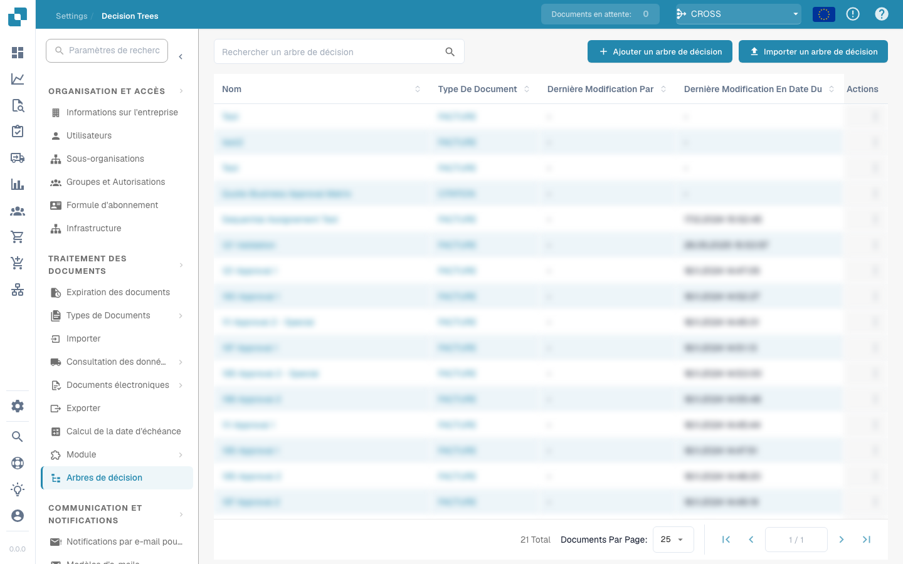

# Workflow

<figure><figcaption></figcaption></figure>

## Moteur de workflow DocBits : Simplifier l'automatisation des processus

### Introduction

### Comprendre et préparer les workflows 

Découvrez le véritable compte de test DocBits : huit exécutions dans le tableau de bord, deux workflows enregistrés avec un ordre d’exécution de 100/200 et trois scénarios de test réussis. Le tutoriel présente aussi les workflows Standard et Advanced, les licences, les modèles et le Card SDK.



[Regarder avec les sous-titres](https://docbits-videos.fra1.cdn.digitaloceanspaces.com/settings-assistant/workflow-orientation-admin/v1/fr.html) · [Ouvrir la vidéo](https://docbits-videos.fra1.cdn.digitaloceanspaces.com/settings-assistant/workflow-orientation-admin/v1/fr.mp4) · [Sous-titres (WebVTT)](https://docbits-videos.fra1.cdn.digitaloceanspaces.com/settings-assistant/workflow-orientation-admin/v1/fr.vtt) · [Transcription](https://docbits-videos.fra1.cdn.digitaloceanspaces.com/settings-assistant/workflow-orientation-admin/v1/fr.txt) · 3:19

Chapitres et transcription

| Chapitre | Début |
| --- | --- |
| Rencontrer l’administrateur | [0:00](https://docbits-videos.fra1.cdn.digitaloceanspaces.com/settings-assistant/workflow-orientation-admin/v1/fr.mp4#t=0.000) |
| Organisation et accès | [0:02](https://docbits-videos.fra1.cdn.digitaloceanspaces.com/settings-assistant/workflow-orientation-admin/v1/fr.mp4#t=2.042) |
| Tableau de bord et filtres | [0:14](https://docbits-videos.fra1.cdn.digitaloceanspaces.com/settings-assistant/workflow-orientation-admin/v1/fr.mp4#t=14.792) |
| Liste des workflows | [0:54](https://docbits-videos.fra1.cdn.digitaloceanspaces.com/settings-assistant/workflow-orientation-admin/v1/fr.mp4#t=54.375) |
| Ordre d’exécution | [1:09](https://docbits-videos.fra1.cdn.digitaloceanspaces.com/settings-assistant/workflow-orientation-admin/v1/fr.mp4#t=69.875) |
| Standard Workflow | [1:28](https://docbits-videos.fra1.cdn.digitaloceanspaces.com/settings-assistant/workflow-orientation-admin/v1/fr.mp4#t=88.000) |
| Advanced Workflow | [1:41](https://docbits-videos.fra1.cdn.digitaloceanspaces.com/settings-assistant/workflow-orientation-admin/v1/fr.mp4#t=101.333) |
| Licences | [1:59](https://docbits-videos.fra1.cdn.digitaloceanspaces.com/settings-assistant/workflow-orientation-admin/v1/fr.mp4#t=119.875) |
| Modèles | [2:18](https://docbits-videos.fra1.cdn.digitaloceanspaces.com/settings-assistant/workflow-orientation-admin/v1/fr.mp4#t=138.583) |
| Test Manager | [2:32](https://docbits-videos.fra1.cdn.digitaloceanspaces.com/settings-assistant/workflow-orientation-admin/v1/fr.mp4#t=152.625) |
| Card SDK | [2:48](https://docbits-videos.fra1.cdn.digitaloceanspaces.com/settings-assistant/workflow-orientation-admin/v1/fr.mp4#t=168.458) |
| Vérifier la préparation | [3:03](https://docbits-videos.fra1.cdn.digitaloceanspaces.com/settings-assistant/workflow-orientation-admin/v1/fr.mp4#t=183.417) |

**Rencontrer l’administrateur**

Je m’occupe de DocBits ici.

**Organisation et accès**

Bon, je vérifie d’abord l’organisation affichée en haut. Ces réglages de workflow concernent l’organisation sélectionnée. Pour cette démonstration, j’utilise notre compte de test documentaire.

**Tableau de bord et filtres**

Le tableau de bord des workflows donne une vue d’ensemble. Pour cette vue, j’ai exécuté manuellement deux workflows de formation huit fois sur une facture exemple. Je vois ici huit exécutions au total, dont six réussies. Lors de deux exécutions, la condition sur le montant n’était pas remplie. Le taux de réussite inclut aussi ces contrôles correctement terminés. Je filtre par nom de workflow et je vérifie la période. Les compteurs et le graphique suivent cette sélection. À droite, je passe des workflows enregistrés aux scénarios de test. Les exécutions du Test Manager sont comptées séparément.

**Liste des workflows**

La liste des workflows permet de gérer chaque workflow. Je vérifie le nom, le type Standard ou Advanced, l’ordre d’exécution, le déclencheur et les actions disponibles. Je recherche un workflow existant avant d’en créer un autre.

**Ordre d’exécution**

L’ordre d’exécution compte lorsque plusieurs workflows traitent le même document. Je vérifie lequel doit passer en premier et quelles données le suivant attend. Ici, le contrôle de facture a l’ordre cent et le contrôle suivant deux cents. Les valeurs les plus basses passent en premier.

**Standard Workflow**

Pour une règle linéaire, je choisis Standard Workflow. Quand définit le déclencheur, Et ajoute les conditions, puis Alors exécute les actions. La bibliothèque propose les cartes disponibles.

**Advanced Workflow**

Pour des chemins alternatifs, j’utilise Advanced Workflow. Cet aperçu du concepteur montre Start et des connexions explicites. Le succès, une condition non remplie et une erreur peuvent suivre des chemins différents. La position des cartes ne définit pas l’ordre.

**Licences**

Dans Licence, je vérifie séparément le module Workflow et Advanced Workflow. Ils sont tous deux inactifs ici. La boîte de dialogue présente les abonnements disponibles. Je ferme cet aperçu sans modification. Ouvrir le concepteur n’active pas le moteur.

**Modèles**

Les modèles permettent de réutiliser un point de départ. J’ouvre leur bibliothèque et l’option des modèles par défaut. Je vérifie toujours les champs, les destinataires et les actions pour mon propre processus.

**Test Manager**

Test Manager conserve des scénarios de test pour les workflows Standard et Advanced. Après la configuration, j’ajoute des entrées représentatives et les résultats attendus. Exécuter tous les tests permet de contrôler les modifications.

**Card SDK**

Card SDK sert aux extensions personnalisées. Les développeurs peuvent utiliser un modèle, téléverser un paquet ou importer depuis GitHub. Pour l’administration courante, je commence avec la bibliothèque de cartes existante.

**Vérifier la préparation**

Avant de construire, je confirme l’organisation, les accès, la licence nécessaire, les champs du document et le résultat attendu. Je décide si une règle linéaire suffit. La prochaine vidéo crée un Standard Workflow pas à pas.

Dans le domaine de l'automatisation des processus, le moteur de workflow DocBits se distingue par son approche simple et intuitive. Ce moteur simplifie la création et la gestion des workflows grâce à une structure basée sur des règles claires et simples. Le principe fondamental de sa conception est la règle "Quand-Et-Alors facile", qui décompose le processus d'automatisation en trois composants fondamentaux : Déclencheur, Condition et Action. Ce guide explique comment chaque composant fonctionne au sein du système et comment ils collaborent pour faciliter une automatisation fluide.

### La règle "Quand-Et-Alors facile" expliquée

Le moteur de workflow DocBits fonctionne sur un principe simple mais puissant qui rend l'automatisation des workflows accessible aux utilisateurs de tous niveaux. Ce principe est résumé dans la règle "Quand-Et-Alors facile", qui peut être décomposée comme suit :

#### [Quand](./#when-trigger) (Déclencheur)

* **Définition** : Le composant "Quand" représente le _Déclencheur_ du workflow. Il s'agit de l'événement ou de la condition qui initie l'exécution du workflow. Les déclencheurs peuvent être une variété d'occurrences telles que l'arrivée d'un nouvel e-mail, une date et une heure spécifiques, ou la création d'un nouveau document.
* **Exemple** : "Quand un nouveau formulaire client est soumis..."

#### [Et](./#and-condition) (Condition)

* **Définition** : Le composant "Et" introduit la _Condition_ qui doit être remplie pour que l'action puisse se poursuivre. Les conditions servent de filtres ou de critères qui affinent le déclencheur, garantissant que le workflow n'est exécuté que dans certaines circonstances.
* **Exemple** : "...et que le client appartient au segment 'Entreprise'..."

#### [Alors](./#then-action) (Action)

* **Définition** : Enfin, la partie "Alors" spécifie l'_Action_ à entreprendre une fois que le déclencheur se produit et que la condition est satisfaite. Les actions sont les tâches ou opérations exécutées par le workflow, telles que l'envoi d'un e-mail, la mise à jour d'une base de données ou la création d'une tâche dans un outil de gestion de projet.
* **Exemple** : "...alors attribuer le prospect à l'équipe commerciale entreprise et envoyer un e-mail de bienvenue."

### Combiner les composants pour des automatisations puissantes

En assemblant ces trois composants—Déclencheur, Condition et Action—le moteur de workflow DocBits permet aux utilisateurs de créer des workflows hautement personnalisés et efficaces. Cette approche modulaire simplifie non seulement le processus de configuration des automatisations, mais offre également la flexibilité de créer des workflows complexes capables de gérer un large éventail de tâches et de processus.

### Conclusion

La règle "Quand-Et-Alors facile" du moteur de workflow DocBits illustre l'engagement du moteur à fournir une plateforme conviviale pour l'automatisation des processus. Cette règle simple, en décomposant l'automatisation en éléments essentiels de Déclencheur, Condition et Action, facilite la conceptualisation, la création et la gestion des workflows pour les utilisateurs. Que vous soyez novice en matière d'automatisation de workflows ou un professionnel expérimenté, le moteur de workflow DocBits offre un outil efficace et accessible pour améliorer la productivité et rationaliser les opérations.
