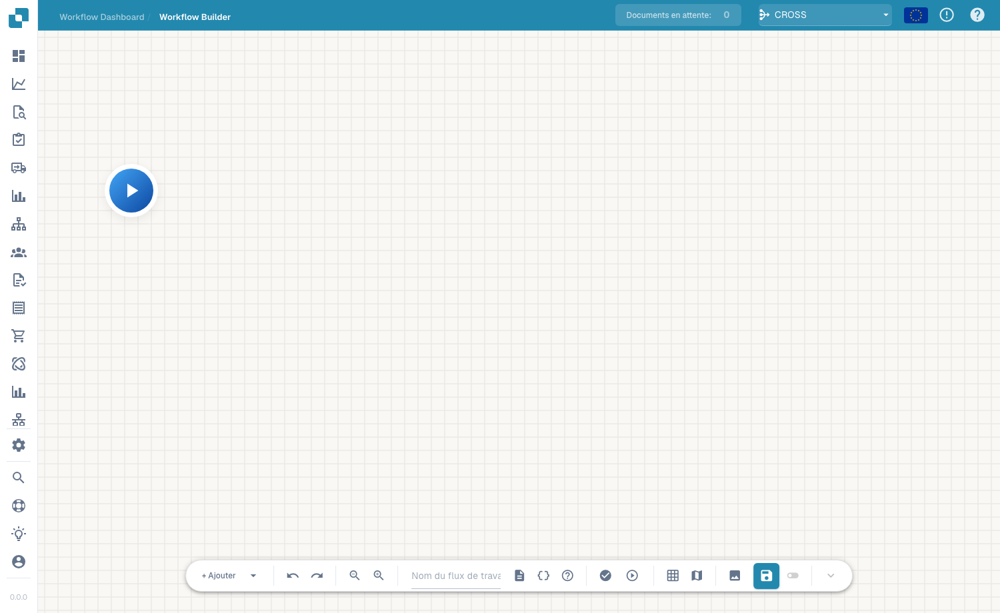
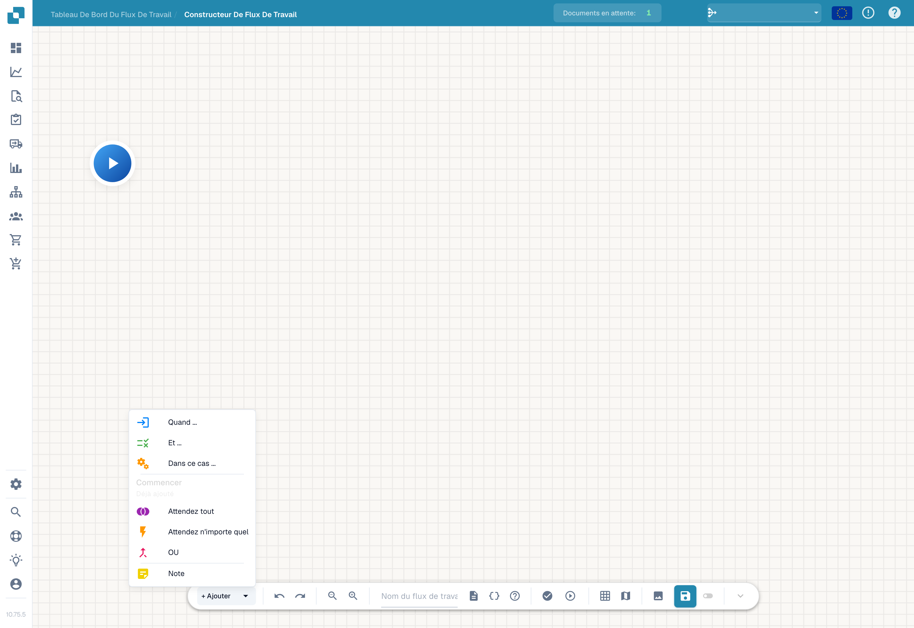

# Flux avancé

Le constructeur **Flux de travail avancé** est un éditeur de graphe de nœuds pour les workflows nécessitant des branches, des chemins parallèles et un contrôle de flux — au-delà du modèle linéaire When/And/Then du constructeur Standard. Vous disposez des nœuds sur un canevas et les reliez pour définir le flux d'exécution.

## Vidéo : routage des factures dans DocBits

Rencontrez Alain et suivez ses explications dans la véritable interface française de DocBits. Il vérifie le tableau de bord, la liste des workflows et la licence, puis ouvre un brouillon non enregistré dans le concepteur. Il nomme le workflow, configure le contrôle du montant et deux actions, dispose les cartes et relie les deux chemins, étape par étape. Il présente ensuite la préparation des tests avec un document ou des données personnalisées. Le compte de démonstration ne dispose pas d’abonnement Advanced Workflow et bloque la validation ; le brouillon reste non enregistré et inactif.



[Ouvrir la vidéo](https://docbits-videos.fra1.cdn.digitaloceanspaces.com/settings-assistant/advanced_workflows_canvas-admin/v7/fr.mp4) · [Sous-titres (WebVTT)](https://docbits-videos.fra1.cdn.digitaloceanspaces.com/settings-assistant/advanced_workflows_canvas-admin/v7/fr.vtt) · [Transcription (texte)](https://docbits-videos.fra1.cdn.digitaloceanspaces.com/settings-assistant/advanced_workflows_canvas-admin/v7/fr.txt) · 3:37

| Dans cette vidéo | Début |
| --- | --- |
| Présentation de l’administrateur | [0:00](https://docbits-videos.fra1.cdn.digitaloceanspaces.com/settings-assistant/advanced_workflows_canvas-admin/v7/fr.mp4#t=0) |
| Vérifier l’accès | [0:07](https://docbits-videos.fra1.cdn.digitaloceanspaces.com/settings-assistant/advanced_workflows_canvas-admin/v7/fr.mp4#t=7) |
| Nommer le workflow | [0:34](https://docbits-videos.fra1.cdn.digitaloceanspaces.com/settings-assistant/advanced_workflows_canvas-admin/v7/fr.mp4#t=34) |
| Configurer le contrôle du montant | [0:49](https://docbits-videos.fra1.cdn.digitaloceanspaces.com/settings-assistant/advanced_workflows_canvas-admin/v7/fr.mp4#t=49) |
| Ajouter l’action Approval | [1:14](https://docbits-videos.fra1.cdn.digitaloceanspaces.com/settings-assistant/advanced_workflows_canvas-admin/v7/fr.mp4#t=74) |
| Ajouter l’action Standard | [1:36](https://docbits-videos.fra1.cdn.digitaloceanspaces.com/settings-assistant/advanced_workflows_canvas-admin/v7/fr.mp4#t=96) |
| Organiser les cartes | [1:58](https://docbits-videos.fra1.cdn.digitaloceanspaces.com/settings-assistant/advanced_workflows_canvas-admin/v7/fr.mp4#t=118) |
| Relier les chemins | [2:13](https://docbits-videos.fra1.cdn.digitaloceanspaces.com/settings-assistant/advanced_workflows_canvas-admin/v7/fr.mp4#t=133) |
| Préparer les tests | [2:39](https://docbits-videos.fra1.cdn.digitaloceanspaces.com/settings-assistant/advanced_workflows_canvas-admin/v7/fr.mp4#t=159) |
| Valider, enregistrer et activer | [3:05](https://docbits-videos.fra1.cdn.digitaloceanspaces.com/settings-assistant/advanced_workflows_canvas-admin/v7/fr.mp4#t=185) |

Transcription

**Présentation de l’administrateur**

Je m’occupe de DocBits ici. Je vous montre comment créer un contrôle de facture avec deux chemins.

**Vérifier l’accès**

Je commence dans le tableau de bord des workflows et j’ouvre la liste. Ensuite, je vérifie la licence. Workflow et Advanced Workflow doivent tous les deux disposer d’un accès actif. Lorsque ces accès sont actifs, Nouveau workflow propose Advanced Workflow. Ce compte de documentation n’a pas de licence workflow active. Je continue donc avec un aperçu non enregistré dans le concepteur.

**Nommer le workflow**

Je travaille dans le véritable concepteur DocBits. Je donne d’abord un nom clair au brouillon. Nous vérifierons un montant de facture et utiliserons deux actions simples pour montrer les chemins possibles. Cette démonstration reste non enregistrée.

**Configurer le contrôle du montant**

J’ouvre le menu d’ajout et je choisis une carte de condition. Dans la catégorie Champ de document, je sélectionne la condition Docfield. Je renseigne le champ total_amount. Puis je choisis le comparateur supérieur à. Et je saisis mille. Utilisez votre propre identifiant de champ. Un montant égal à mille ne satisfait pas cette comparaison.

**Ajouter l’action Approval**

J’ajoute maintenant une carte d’action de la catégorie Champ de document. Cette action définit la valeur d’un champ du document. J’utilise la clé de démonstration approval_route. Et je saisis la valeur Approval. Cela identifie le chemin. Un véritable processus d’approbation nécessite ses propres actions métier.

**Ajouter l’action Standard**

J’ajoute une deuxième carte avec la même action. Cette action définit la valeur d’un champ du document. J’utilise la clé de démonstration approval_route. Cette fois, le champ de démonstration reçoit la valeur Standard. Les deux cartes sont configurées. Leurs connexions doivent encore déterminer quelle action sera exécutée.

**Organiser les cartes**

Je déplace les cartes pour obtenir une disposition lisible. Les deux actions vont à droite. La condition est au centre et Start à gauche. Déplacer une carte change sa position. Cela ne crée aucune connexion.

**Relier les chemins**

Je relie la sortie de Start à l’entrée de la condition. Le chemin de succès rejoint Approval par une connexion bleue. Le chemin orange de condition non satisfaite rejoint Standard. La sortie rouge d’erreur est distincte et traite les erreurs d’évaluation. Ici, elle reste sans connexion. Dans un workflow de production, définissez comment traiter ces erreurs.

**Préparer les tests**

Le bouton de test dans la barre d’outils ouvre la sélection d’un document de test. Je peux choisir un document de démonstration ou préparer des données personnalisées complètes. Testez des montants supérieurs, inférieurs et égaux à mille. Vérifiez aussi un montant absent. Ce compte n’a pas de licence Advanced Workflow. Je montre la préparation du test, pas un résultat exécuté.

**Valider, enregistrer et activer**

La validation vérifie les connexions et les paramètres des cartes. Ici, l’absence de licence bloque cette validation. Avec un compte autorisé, j’enregistrerais explicitement le workflow sur le serveur. Ensuite, je vérifierais séparément l’activation. L’interrupteur est désactivé avant le premier enregistrement. L’indicateur de brouillon automatique désigne une copie locale du navigateur. Il ne signifie pas que le workflow est enregistré ou activé.

## Comment y accéder

Ouvrez le concepteur Advanced Workflow depuis la zone des workflows (le canevas du constructeur avancé). Vous partez d'un nœud **Commencer** et construisez le flux en ajoutant des nœuds.

<figure><figcaption>
Le canevas de l'Advanced Workflow — un graphe de nœuds avec des commandes de zoom, d'exécution, de grille et d'enregistrement. Donnez un nom au workflow dans la barre d'outils.
</figcaption></figure>

## Ajouter des nœuds

Cliquez sur **+ Add** pour ouvrir le menu des nœuds. En plus des cartes habituelles **Quand**, **Et** et **Alors**, le constructeur avancé ajoute des nœuds de contrôle de flux :

<figure><figcaption>
Menu des nœuds du générateur de workflow avancé.
</figcaption></figure>

- **When / And / Then** — les mêmes cartes de condition et d'action que dans le constructeur Standard.
- **Attendez tout** — attend que *toutes* les branches entrantes soient terminées avant de continuer.
- **Attendez n'importe quel** — continue dès qu'une *quelconque* branche entrante est terminée.
- **OU** — fait bifurquer le flux vers des chemins alternatifs.
- **Note** — une annotation en texte libre sur le canevas (n'affecte pas l'exécution).

Exécutez le flux avec la commande de lecture, validez-le, puis enregistrez avec le bouton d'enregistrement de la barre d'outils.

## Étapes suivantes

- Découvrez ce que fait chaque carte dans la section **Cartes**.
- Pour des automatisations linéaires simples, le constructeur **Flux standard** est plus rapide à configurer.

[Voir les cinq chapitres](advanced-workflow-videos.md)
