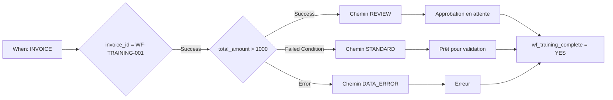

# Cas Advanced : acheminement des factures

Une facture de formation supérieure à 1000 EUR nécessite une vérification. Jusqu’à 1000 EUR inclus, elle suit le chemin standard. Un montant absent ou numériquement invalide suit la correction des données. Les trois chemins aboutissent à une action finale commune.

## Prérequis et construction

Utilisez une organisation de test avec Advanced actif et le [kit de formation](workflow-training-kit.md). Importez `advanced-workflow.json` via **Import Workflow**, laissez-le désactivé et ouvrez le graphique. When vérifie Facture ; la première carte And limite l’exercice à `invoice_id = WF-TRAINING-001`. Aucun destinataire ni export n’est configuré.

Le contrôle initial utilise `invoice_id`, `eq` et `WF-TRAINING-001` ; un autre numéro ignore toutes les actions suivantes. Le montant est contrôlé avec **Docfield is**, version 2, et `total_amount`, `gt`, `1000`. Les actions texte écrivent `wf_training_route`. Les cartes de statut utilisent la version 3 et **Trigger Workflows = false**.

**v2 :** La carte de statut du chemin choisi rejoint directement la Then commune `complete`, qui écrit `wf_training_complete = YES`. Aucun OR n’attend ici. V1 prouvait seulement le mode test : avec des prédécesseurs non atteints, l’ordonnanceur peut ignorer une jonction que le test évalue encore. Le [guide P0](masterclass/control-nodes.md) explique cette différence. Une Then commune directe ne remplace pas une barrière pour plusieurs actions obligatoires simultanées.

## Construire et vérifier

1. Validez le graphique complet.
2. Préparez les fichiers pour votre organisation selon le kit.
3. Ouvrez **Test → Custom Data** et utilisez le fichier complet de chaque cas. Un objet limité à `total_amount` ne suffit pas.
4. Exécutez depuis l’entrée complète. Contrôlez la sortie d’`amount`, le chemin atteint, le message de statut et `complete`.
5. Comparez aux attentes indépendantes. Les réponses enregistrées montrent les résultats réellement observés.

| Cas | Montant | Sortie d’amount | Chemin / statut | Résultat global |
| --- | --- | --- | --- | --- |
| above | 1785,00 | Success | REVIEW / validated_pending_approval | success |
| below | 999,00 | Failed Condition | STANDARD / ready_for_validation | success |
| boundary | 1000,00 | Failed Condition | STANDARD / ready_for_validation | success |
| just-above | 1000,01 | Success | REVIEW / validated_pending_approval | success |
| missing | absent | Error | DATA_ERROR / error | error |
| invalid-number | invalid | Error | DATA_ERROR / error | error |
| other-invoice | 1785,00 | non exécuté | autre numéro ; aucune action | failed_condition |

En cas d’erreur, `data_error` et `complete` peuvent réussir alors que le résultat global reste **error**. Le traitement de l’erreur n’efface pas l’évaluation initialement échouée.

## Étendre le processus métier

Les tests ont été effectués le 21 octobre 2026 contre le service Dev déployé DocFlow **2.10.38**. Le kit contient de vraies réponses de test ; les changements de champs et de statuts étaient simulés. Il ne contient pas de Workflow Logs documentaires persistés et ne prouve ni approbation personnelle ni réception réelle d’un export.

Remplacez les marqueurs par des affectations et actions d’approbation configurées. Reliez l’export uniquement à une condition d’approbation explicitement vérifiée. Confirmez une exécution réelle sur le document et la réception chez le destinataire, avec votre document de formation et une destination de test prévue. Consultez le [diagnostic](workflow-troubleshooting.md).

## WF-02: Exercice et recette

Exécutez les sept cas et notez sortie amount, chemin, statut, complete et résultat global. Validez séparément test et exécution réelle. Une erreur traitée ne devient pas une exécution sans erreur parce que complete réussit.

[Parcours](workflow-learning-path.md)
