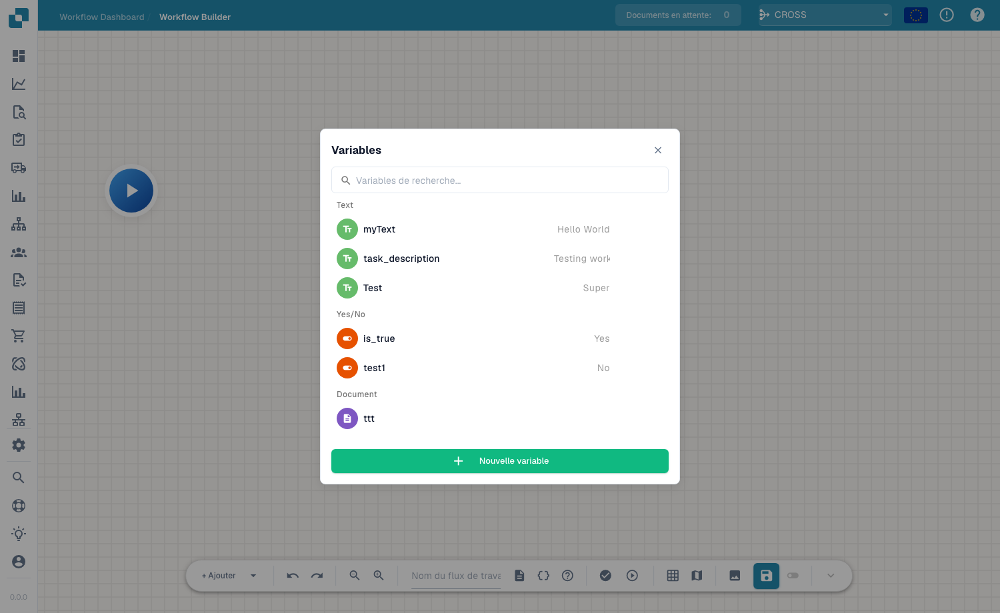

# Variables

## Vidéo: Variables, tests et activation



[Ouvrir la vidéo](https://docbits-videos.fra1.cdn.digitaloceanspaces.com/settings-assistant/advanced_workflows_testing/v3/fr.mp4) · [Sous-titres (WebVTT)](https://docbits-videos.fra1.cdn.digitaloceanspaces.com/settings-assistant/advanced_workflows_testing/v3/fr.vtt) · 1:57

Transcription

**Choisissez le type**

Ouvrez Variables avec les accolades. Choisissez texte, nombre, oui ou non, ou document. Recherchez les noms. Document contient une référence définie par une action dédiée ; ce formulaire n’accepte pas de valeur documentaire.

**Portée de l’organisation**

Choisissez un nom unique, un type et une valeur initiale. Création, modification et suppression sont enregistrées immédiatement dans l’organisation. D’autres workflows partagent ces valeurs. Enregistrer ou abandonner le canevas n’annule pas ces changements.

**Validez la structure**

Cliquez sur Valider. Examinez erreurs et avertissements au-dessus du canevas. Un message cible son nœud. Vérifiez actions, entrées, sorties, cycles et jonctions. Une structure valide ne garantit pas des données correctes.

**Choisissez le contexte**

La lecture dans la barre ouvre le choix du document. Choisissez document, données personnalisées ou test sans document pour les cartes indépendantes. Start lance directement. Les tests incluent les modifications non enregistrées et simulent les actions destructrices.

**Préparer et vérifier les scénarios de test**

Préparez des tests au-dessus, au-dessous et exactement à mille, puis sans données. Après exécution, vérifiez les messages et les durées : vert signifie réussite, orange faux, rouge erreur, gris ignoré. Retestez les corrections. Le gestionnaire de tests permet de répéter les scénarios.

**Enregistrez avant d’activer**

Le brouillon local est enregistré automatiquement environ toutes les trente secondes après modification. Enregistrez explicitement sur le serveur. Activez après le premier enregistrement. Vérifiez l’état dans la liste avant d’attendre une exécution automatique.

[Voir les cinq chapitres](../advanced-workflow-videos.md)

Les **Variables** vous permettent de stocker une valeur une seule fois et de la réutiliser dans les nœuds d'un Workflow Avancé — par exemple un seuil, un destinataire fixe ou une valeur que vous lisez dans le document et transmettez à un nœud ultérieur. Ouvrez le panneau des variables depuis le bouton **Variables** (l'icône `{ }`) dans la barre d'outils.

<figure><figcaption>
Le panneau Variables — variables regroupées par type, avec recherche et <strong>New Variable</strong>.
</figcaption></figure>

## Types de variables

Les variables sont regroupées selon leur type :

- **Text** — une valeur de chaîne de caractères (par ex. une description ou une étiquette fixe).
- **Yes/No** — un indicateur booléen (Yes / No).
- **Document** — une référence à un document ou à un champ de document.

Utilisez la zone de recherche pour trouver rapidement une variable lorsque la liste s'allonge.

## Créer une variable

Cliquez sur **New Variable**, donnez-lui un nom et un type, puis définissez sa valeur. La variable devient alors disponible pour être référencée depuis les cartes de vos nœuds, ce qui vous permet de centraliser la configuration en un seul endroit et de la modifier sans éditer chaque nœud.

## Étapes suivantes

- Découvrez comment les nœuds utilisent ces valeurs dans [Nœuds](nodes.md).
- Validez et exécutez le workflow dans [Validation & Test](validation-and-testing.md).

## Variables numériques

**Number (Nombre)** est un type de variable distinct, avec Text, Yes/No et Document. Saisissez une valeur numérique sans symbole monétaire. Les variables de l’organisation sont partagées entre les workflows ; leur création, modification ou suppression est enregistrée immédiatement, indépendamment de l’enregistrement ou de l’abandon du canevas. Avant une modification, vérifiez les workflows concernés et testez des valeurs inférieures, égales et supérieures au seuil.
