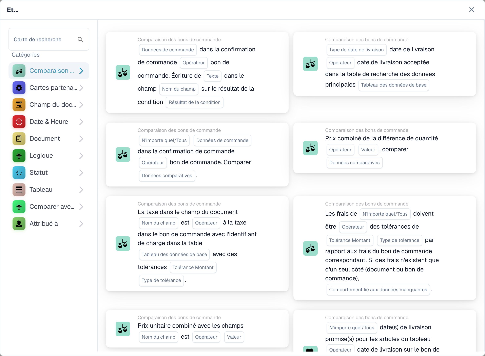
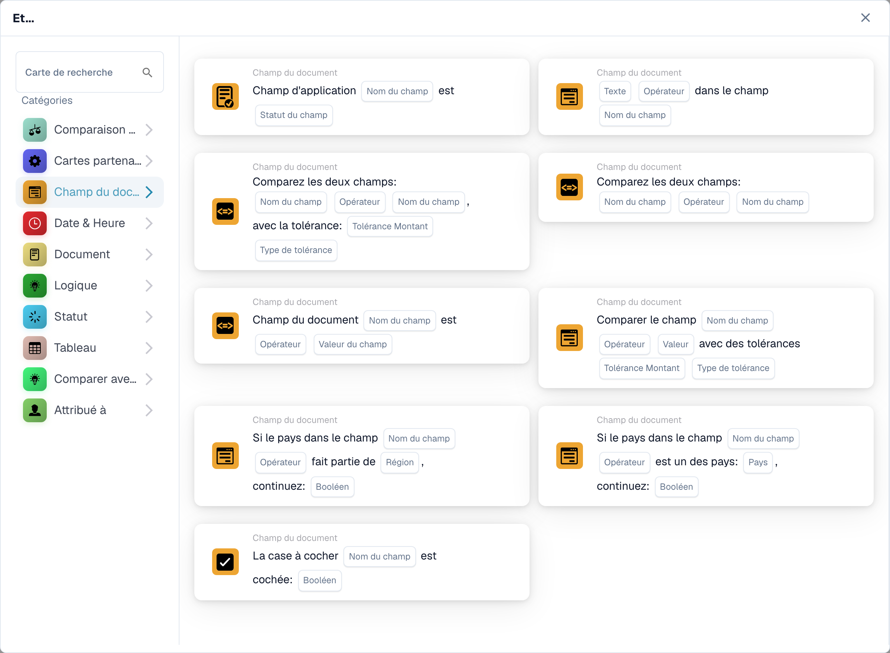
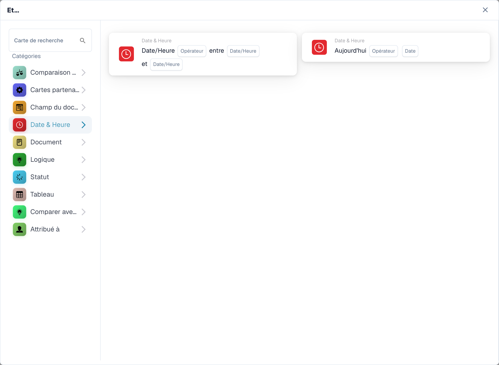
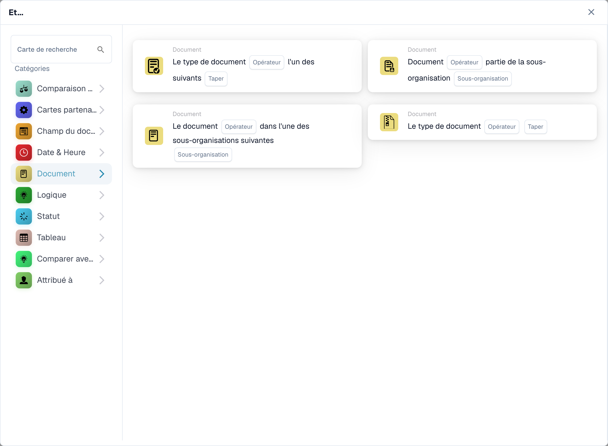
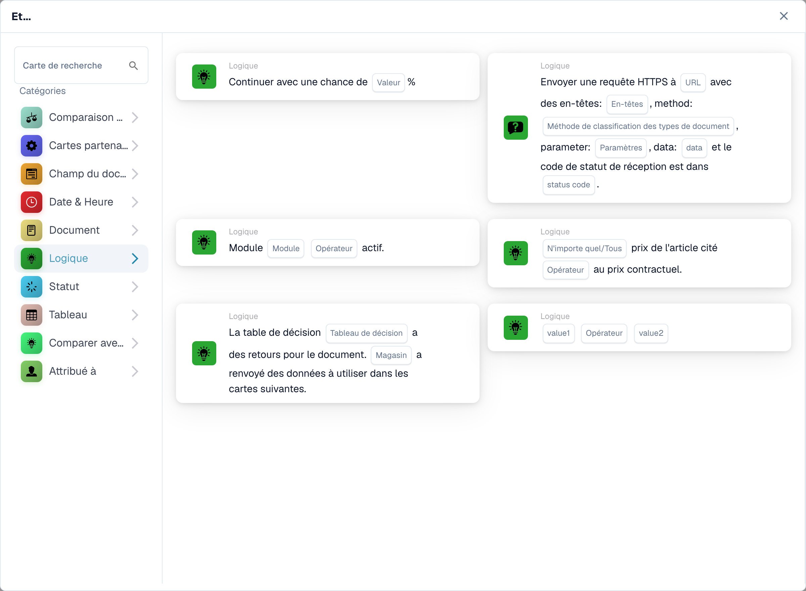
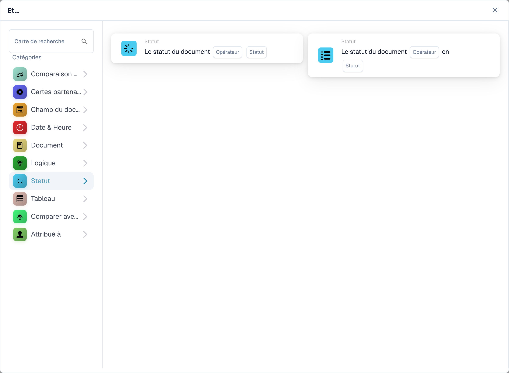
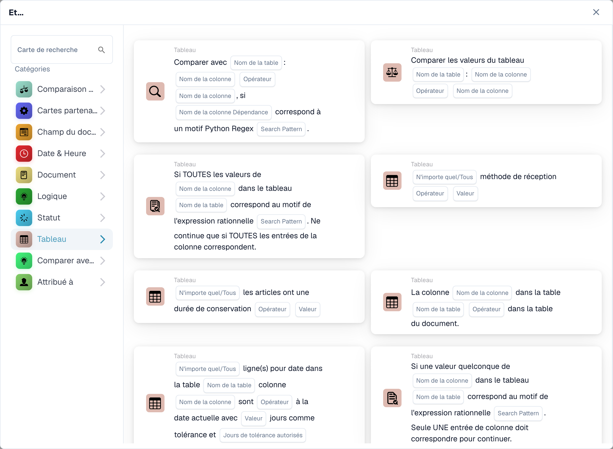
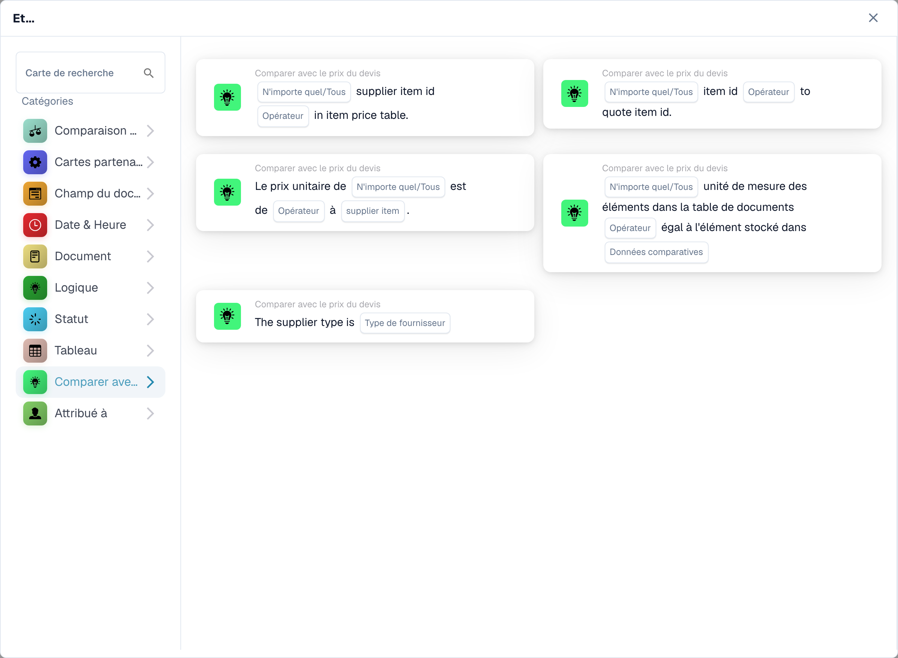
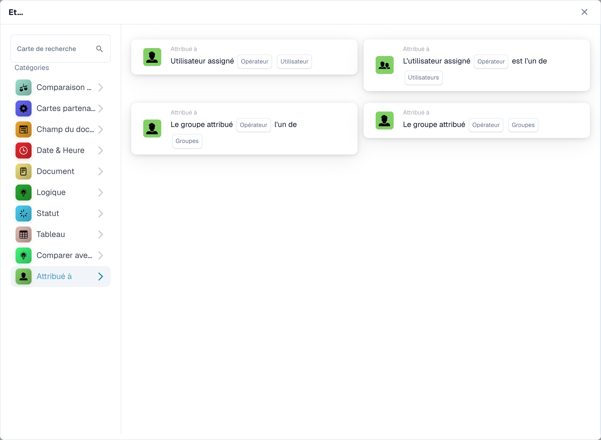

# Et

Utilisez une carte **Et** pour décider si un flux de travail doit continuer après son déclencheur **Quand**. Ajoutez les vérifications dont vous avez besoin avant l'action **Alors**. Chaque carte affiche des champs à remplir, tels que **Opérateur**, **Nom du champ** ou **Valeur** ; les captures d'écran montrent les modèles de cartes disponibles, pas les règles complétées.

Dans **Générateur de flux de travail**, sélectionnez **Ajouter une carte** sous **Et...**. Choisissez une catégorie sur la gauche ou saisissez un nom de carte dans **Rechercher une carte**. Sélectionnez un aperçu de la carte pour l'ajouter au flux de travail. Vous pouvez faire défiler la liste d'aperçu pour voir plus de cartes. Utilisez **×** pour fermer le sélecteur sans choisir une autre carte. Après avoir configuré les cartes, enregistrez le flux de travail. Voir [Workflow](..) pour les étapes environnantes **Quand**, **Et** et **Alors**.

## Comparer avec le bon de commande

Utilisez ces cartes pour comparer les données de commande ou de facture avec un bon de commande, telles que le prix unitaire, la date de livraison promise, les frais ou la quantité. Choisissez les champs, l'opérateur et toute tolérance demandée par la carte sélectionnée. Voir [Comparer avec le bon de commande](compare-with-purchase-order) pour les cartes individuelles.

<figure><figcaption>
Conditions de comparaison avec les commandes.
</figcaption></figure>

## Champ de document

Choisissez cette catégorie pour cocher une case ou l'état d'un champ, comparer un champ avec une valeur ou comparer deux champs. Remplissez les espaces réservés **Nom du champ** et **Opérateur** sur la carte choisie. Certaines comparaisons demandent également une tolérance. Voir [Champ du document](document-field).

<figure><figcaption>
Conditions sur les champs du document.
</figcaption></figure>

## Date et heure

Utilisez **Date et heure** pour comparer une date ou une heure avec une plage, ou comparez **Aujourd'hui** avec une date choisie. Sélectionnez les valeurs **Opérateur** et date dans la carte. Voir [Date et heure](date-and-time).

<figure><figcaption>
Conditions de date et d’heure.
</figcaption></figure>

## Documenter

Utilisez ces cartes lorsqu'un flux de travail doit dépendre du **type de document** ou de la **sous-organisation**. Choisissez le type ou l'organisation nommée dans la carte. Voir [Document](document).

<figure><figcaption>
Conditions sur les documents.
</figcaption></figure>

## Logique

Cette catégorie comprend les vérifications utilisant une table de décision, une réponse HTTPS, la disponibilité du module, le prix d'un article proposé, une valeur aléatoire ou deux valeurs. Ouvrez la carte spécifique et remplissez ses espaces réservés nommés ; par exemple, la carte HTTPS demande une URL, une méthode et un code de statut accepté. Voir [Logique](logic).

<figure><figcaption>
Conditions logiques.
</figcaption></figure>

## Statut

Utilisez **Statut** pour vérifier si un document a un statut choisi ou si son statut est dans un ensemble sélectionné. Choisissez le **Opérateur** et le **Statut** dans la carte. Voir [Statut](status).

<figure><figcaption>
Conditions de statut.
</figcaption></figure>

## Tableau

Ces cartes examinent les lignes du tableau des documents. Les options visibles incluent les vérifications de date, les modèles de texte, la durée de conservation et les comparaisons entre les colonnes. Sélectionnez le **Nom de la table** et le **Nom de la colonne** avant de choisir un opérateur ou un modèle. Voir [Tableau](table).

<figure><figcaption>
Conditions sur les tableaux de données.
</figcaption></figure>

## Comparer avec le prix du devis

Utilisez ces cartes pour comparer un article avec les données de prix indiquées. Les choix visibles couvrent l'ID d'article, le type de fournisseur, l'ID d'article du fournisseur, le prix unitaire et l'unité de mesure. Le **Opérateur** et les espaces réservés aux données dépendent de la carte que vous sélectionnez.

<figure><figcaption>
Conditions sur les prix des devis.
</figcaption></figure>

## Responsable

Utilisez **Responsable** lorsque la condition dépend de l'utilisateur ou du groupe affecté. Choisissez si vous souhaitez comparer avec un utilisateur ou un groupe ou avec un ensemble sélectionné. Voir [Responsable](assignee).

<figure><figcaption>
Conditions sur les affectations.
</figcaption></figure>

[Cartes de comparaison de devis détaillées et comportement Any/All](../cards-overview/quote-comparison-guide.md).

Certains libellés du produit restent en anglais ou comportent des traductions inexactes. Les tableaux désignent des tableaux de données ; les valeurs retournées ne sont pas des rendements financiers. Les identifiants techniques restent inchangés.
