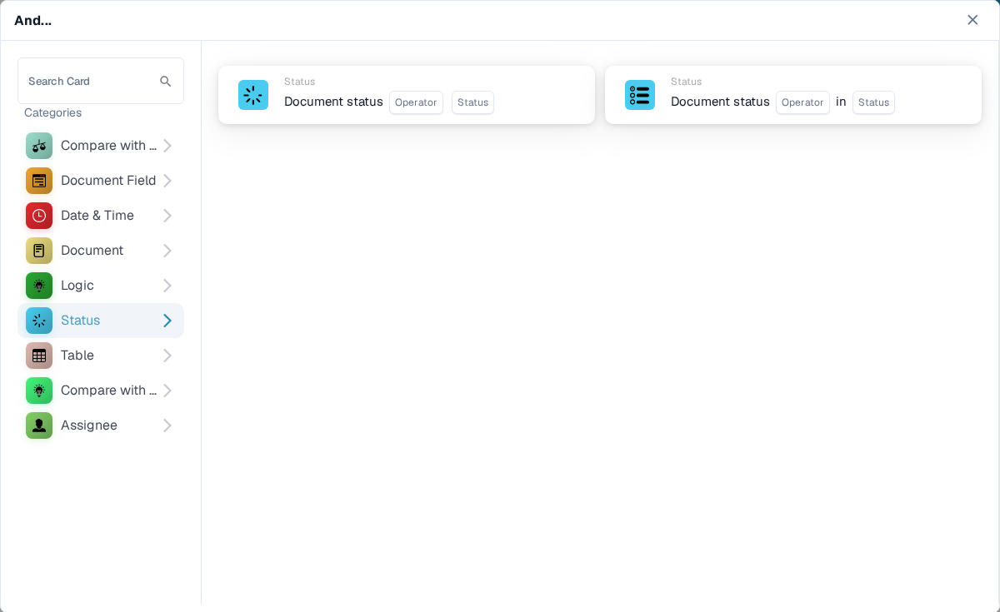

# And : choisir une carte de condition

Utilisez une carte **And** pour décider si un workflow doit se poursuivre après son déclencheur **When**. Ajoutez les contrôles dont vous avez besoin avant l'action **Then**. Chaque carte affiche des champs à renseigner, comme **Operator**, **Field Name** ou **Value** ; les captures d'écran montrent les modèles de cartes disponibles, et non des règles terminées.

Dans le **Workflow Builder**, sélectionnez **Add Card** sous **And...**. Choisissez une catégorie à gauche, ou saisissez le nom d'une carte dans **Search Card**. Sélectionnez l'aperçu d'une carte pour l'ajouter au workflow. Vous pouvez faire défiler la liste des aperçus pour voir d'autres cartes. Utilisez **×** pour fermer le sélecteur sans choisir d'autre carte. Une fois les cartes configurées, enregistrez le workflow. Consultez [Workflow](../README.md) pour les étapes **When**, **And** et **Then** dans leur ensemble.

## Compare with Purchase Order

Utilisez ces cartes pour comparer les données d'une commande ou d'une facture avec un bon de commande, par exemple le prix unitaire, la date de livraison promise, les frais ou la quantité. Choisissez les champs, l'opérateur et la tolérance éventuelle demandés par la carte sélectionnée. Consultez [Compare with Purchase Order](compare-with-purchase-order/README.md) pour le détail des cartes.

<figure><figcaption>Catégorie Compare with Purchase Order dans le Sandbox anglais.</figcaption></figure>

## Document Field

Choisissez cette catégorie pour vérifier une case à cocher ou le statut d'un champ, comparer un champ avec une valeur ou comparer deux champs. Renseignez les espaces réservés **Field Name** et **Operator** de la carte choisie. Certaines comparaisons demandent également une tolérance. Consultez [Document Field](document-field/README.md).

<figure><figcaption>Les contrôles Document Field utilisent les valeurs du document en cours.</figcaption></figure>

## Date & Time

Utilisez **Date & Time** pour comparer une date ou une heure avec une plage, ou pour comparer **Today** avec une date choisie. Sélectionnez l'**Operator** et les valeurs de date dans la carte. Consultez [Date & Time](date-and-time/README.md).

<figure><figcaption>Date & Time propose un contrôle de plage et un contrôle par rapport à la date du jour.</figcaption></figure>

## Document

Utilisez ces cartes lorsqu'un workflow doit dépendre du **type de document** ou de la **sous-organisation**. Choisissez le type ou l'organisation indiqué dans la carte. Consultez [Document](document/README.md).

<figure><figcaption>Les conditions Document vérifient le type ou la sous-organisation.</figcaption></figure>

## Logic

Cette catégorie comprend des contrôles reposant sur une table de décision, une réponse HTTPS, la disponibilité d'un module, un prix d'article proposé dans un devis, une valeur de probabilité ou deux valeurs. Ouvrez la carte concernée et renseignez ses espaces réservés nommés ; par exemple, la carte HTTPS demande une URL, une méthode et un code de statut accepté. Consultez [Logic](logic/README.md).

<figure><figcaption>Logic propose plusieurs types de conditions ; choisissez celui qui correspond à votre règle.</figcaption></figure>

## Status

Utilisez **Status** pour vérifier si un document a un statut donné ou si son statut fait partie d'un ensemble sélectionné. Choisissez l'**Operator** et le **Status** dans la carte. Consultez [Status](status/README.md).

<figure><figcaption>Les conditions Status vérifient l'état actuel du document.</figcaption></figure>

## Table

Ces cartes examinent les lignes des tableaux d'un document. Les options visibles comprennent des contrôles de dates, des motifs de texte, la durée de conservation et des comparaisons entre colonnes. Sélectionnez le **Table name** et le **Column Name** avant de choisir un opérateur ou un motif. Consultez [Table](table/README.md).

<figure><figcaption>Les conditions Table utilisent les lignes et les colonnes d'un tableau du document.</figcaption></figure>

## Compare with Quote Price

Utilisez ces cartes pour comparer un article avec les données de prix d'un devis. Les choix visibles couvrent l'ID de l'article, le type de fournisseur, l'ID d'article du fournisseur, le prix unitaire et l'unité de mesure. L'**Operator** et les espaces réservés de données dépendent de la carte que vous sélectionnez.

<figure><figcaption>Compare with Quote Price est une catégorie distincte dans le sélecteur de cartes actuel.</figcaption></figure>

## Assignee

Utilisez **Assignee** lorsque la condition dépend de l'utilisateur ou du groupe assigné. Choisissez si la comparaison porte sur un seul utilisateur ou groupe, ou sur un ensemble sélectionné. Consultez [Assignee](assignee/README.md).

<figure><figcaption>Les conditions Assignee vérifient l'utilisateur ou le groupe assigné au document.</figcaption></figure>
