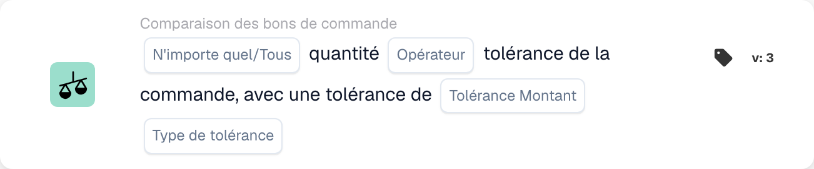
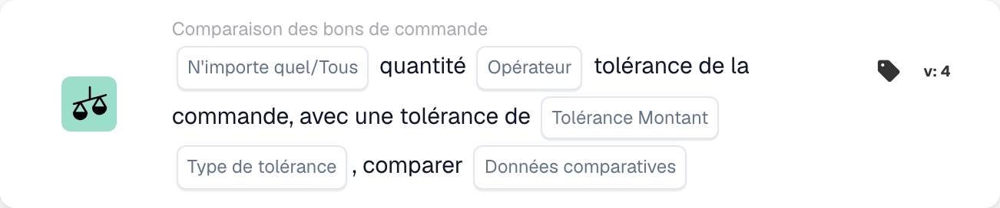

# N'importe quelle/toute quantité

<figure><figcaption>
Champs de la carte dans la version affichée. Les champs ne sont pas encore renseignés.
</figcaption></figure>

<figure><figcaption>
Champs de la carte dans la version affichée. Les champs ne sont pas encore renseignés.
</figcaption></figure>

## **Objectif :**

Cette fiche de workflow est conçue pour comparer la quantité dans un document à la tolérance définie dans le bon de commande. Il permet aux utilisateurs d'évaluer si la quantité répond à certaines conditions, telles que l'égalité ou le dépassement de la tolérance spécifiée. Dans la version 4, la carte étend les fonctionnalités en ajoutant la possibilité de comparer plusieurs entités, notamment le bon de commande, les quantités reçues et les quantités documentées, offrant ainsi une plus grande flexibilité dans la gestion de différents scénarios.

## **Composants de la carte :**

1. **Tous/Tous :**
   * **Descriptif** : Spécifie comment la comparaison doit être appliquée à plusieurs éléments ou conditions.
   * **Possibilités** :
     * **Any** : Au moins une des conditions doit être vraie pour que l'action soit déclenchée.
     * **All** : toutes les conditions doivent être vraies pour que l'action se poursuive.
2. **Opérateur :**
   * **Descriptif** : Définit la condition qui sera appliquée pour comparer la quantité de document à la tolérance spécifiée.
   * **Possibilités** :
     * **Égal à (=)** : Vérifie si la quantité correspond à la valeur de tolérance spécifiée.
     * **Pas égal à (≠)** : garantit que la quantité est différente de la valeur de tolérance spécifiée.
     * **Supérieur à (>)** : Vérifie si la quantité est supérieure à la tolérance spécifiée.
     * **Supérieur ou égal à (≥)** : Vérifie si la quantité est supérieure ou égale à la tolérance spécifiée.
     * **Inférieur à (<)** : Vérifie si la quantité est inférieure à la tolérance spécifiée.
     * **Inférieur ou égal à (≤)** : Vérifie si la quantité est inférieure ou égale à la tolérance spécifiée.
3. **Montant de tolérance :**
   * **Descriptif** : Spécifie la valeur de tolérance à laquelle la quantité de document sera comparée.
   * **Détail** : Cette valeur est numérique et représente le seuil d'écart autorisé dans la quantité
4. **Type de tolérance :**
   * **Descriptif** : Définit le type de tolérance qui sera appliqué.
   * **Possibilités** :
     * **Pourcentage** : La tolérance est calculée en pourcentage de la quantité du bon de commande.
     * **Valeur** : La tolérance est spécifiée sous la forme d'une valeur numérique fixe.

## **Composants supplémentaires dans la version 4 :**

* **Type de comparaison** : sélectionne les entités à comparer, offrant plus de flexibilité dans la façon dont les quantités sont évaluées dans la version 4.
  * **Bon de commande au document** : Compare la quantité dans le bon de commande à la quantité dans le document associé.
  * **Reçu dans le document** : Compare la quantité reçue à la quantité dans le document.
  * **Bon de commande à reçu** : Compare la quantité du bon de commande à la quantité reçue.

## **Fonctionnalité :**

* **Évaluation de la condition :** Le système compare la quantité dans le document à la tolérance dans la commande d'achat en fonction de l'opérateur sélectionné et du montant/type de tolérance. Dans la version 4, le **Type de comparaison** permet de comparer différentes quantités, telles que le bon de commande à recevoir ou le bon de commande à documenter, offrant une comparaison plus dynamique.
* **Exécution d'action :**
  * **Vrai Condition** : Si la comparaison est vraie (par exemple, la quantité de documents se situe dans la plage de tolérance acceptable), le flux de travail se poursuivra.
  * **Fausse condition** : Si la comparaison donne un résultat faux (par exemple, la quantité ne répond pas à la tolérance), le flux de travail ne se poursuivra pas.

## **Installation et configuration :**

**Version 3 :**

* Les utilisateurs configurent la carte en sélectionnant la quantité du document, en définissant le montant de la tolérance et le type de tolérance, et en choisissant l'opérateur approprié pour comparer la quantité à la tolérance. La carte évalue si la quantité se situe dans le seuil de tolérance et procède à l'action « Vrai » ou « Faux » en fonction du résultat.

**Version 4 :**

* En plus de la configuration de la version 3, les utilisateurs peuvent sélectionner le **Type de comparaison**, permettant des comparaisons entre différentes entités, telles que :
  * **Bon de commande à documenter**
  * **Reçu dans le document**
  * **Bon de commande à recevoir**

## **Exemple de scénario :**

Une facture indique que 100 unités ont été livrées, mais le bon de commande n'autorisait que 90 unités. Le montant de la tolérance est fixé à 10 unités et le type de tolérance est absolu.

* **Version 3** : La carte compare les 100 unités du document à la tolérance de 90 unités du bon de commande. Si la quantité dépasse la tolérance, la carte signale l'écart pour un examen plus approfondi.
* **Version 4** : La carte pourrait comparer la **quantité de commande** (90 unités) à la **quantité reçue** (100 unités) ou à la **quantité de document** (100 unités). En fonction du **Type de comparaison** sélectionné, il vérifie si la différence entre les deux entités dépasse la tolérance et déclenche l'action correspondante.

## **Conclusion :**

* **Version 3** : Cette carte de flux de travail compare la quantité du document avec la tolérance du bon de commande, contribuant ainsi à garantir que les écarts de quantité sont signalés et traités de manière appropriée.
* **Version 4** : étend cette fonctionnalité en permettant aux utilisateurs de comparer différentes entités, telles que le bon de commande à recevoir ou le bon de commande à documenter, offrant une plus grande flexibilité dans la gestion de scénarios plus complexes. La version 4 garantit un contrôle plus strict des flux de travail d'approvisionnement et de réception, offrant des comparaisons et des actions plus dynamiques basées sur le type de comparaison choisi.

Voir [direction de comparaison, base de tolérance et versions de carte enregistrée](../../cards-overview/po-comparison-versions-guide.md) avant de modifier les côtés de comparaison.
